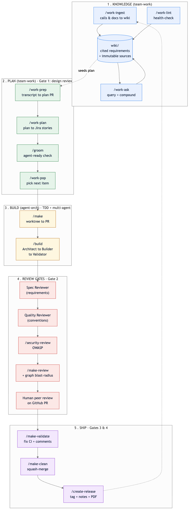
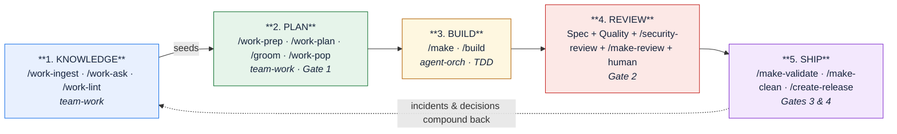
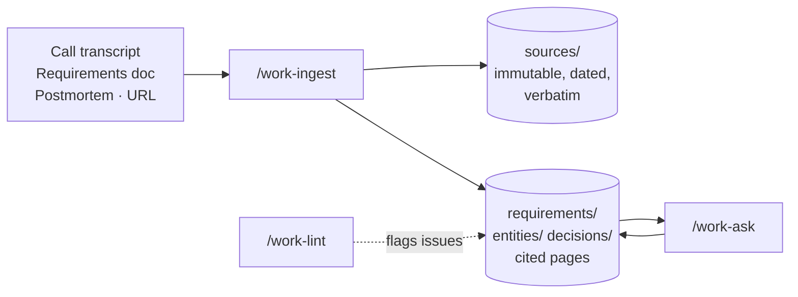
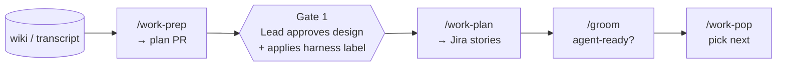
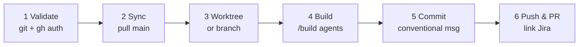
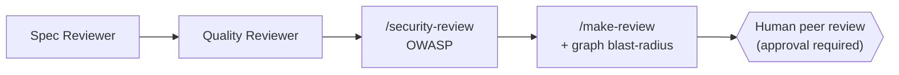
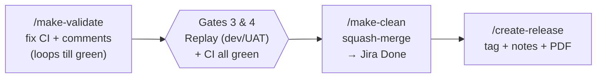
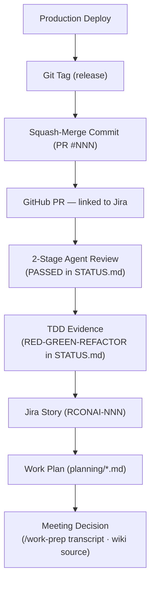

# The AI SDLC

[< Back to Documentation Index](README.md) | [< Back to README](../README.md)

---

This is the **end-to-end AI Software Development Lifecycle (SDLC)** as it works today across
the three plugins in this marketplace — `agent-orch`, `team-work`, and `codebase-graph-analyzer`.

It is written to do two jobs at once:

1. **Teach you the flow.** If you are new, read top to bottom. You will learn which slash command
   to run, in what order, and why. By the end you can take a client call and ship merged,
   reviewed code.
2. **Satisfy the auditor.** Every phase produces durable evidence. The sections on
   [Quality Gates](#quality-gates) and the [Audit Trail](#audit-trail--evidence-map) map each step
   to the control objectives an **ISO/IEC 27001** or **SOC 2** assessor will ask about — change
   management, segregation of duties, traceability, and approval gates.

> **The one-sentence version:** Humans design the harness and approve the gates; agents do the
> work inside it; and every decision, from a meeting to a production deploy, leaves an audit
> artifact behind.

---

## Table of contents

- [The mental model: vibe coding vs. agentic engineering](#the-mental-model-vibe-coding-vs-agentic-engineering)
- [The whole flow at a glance](#the-whole-flow-at-a-glance)
- [Phase 1 — Knowledge: capture requirements](#phase-1--knowledge-capture-requirements)
- [Phase 2 — Plan: turn knowledge into Jira stories](#phase-2--plan-turn-knowledge-into-jira-stories)
- [Phase 3 — Build: multi-agent implementation](#phase-3--build-multi-agent-implementation)
- [Phase 4 — Review gates](#phase-4--review-gates)
- [Phase 5 — Ship: validate, merge, release](#phase-5--ship-validate-merge-release)
- [Quality Gates](#quality-gates)
- [Definition of Done](#definition-of-done)
- [Audit Trail & Evidence Map](#audit-trail--evidence-map)
- [Compliance mapping (ISO 27001 + SOC 2)](#compliance-mapping-iso-27001--soc-2)
- [The harness: where the rules live](#the-harness-where-the-rules-live)
- [Quick start](#quick-start)
- [Command reference](#command-reference)

---

## The mental model: vibe coding vs. agentic engineering

There are two ways to use a coding agent.

| Vibe coding | Agentic engineering |
|-------------|---------------------|
| Prompt → accept → prompt → accept | Specs → plan → build → review → ship |
| No specs, no tests, no review | TDD enforced, multi-stage review |
| "Works on my machine" → ship it | CI green + human approval → merge |
| Spaghetti the LLM can't maintain | Clean code agents can extend |
| Technical debt compounds at AI speed | Quality compounds at AI speed |
| Review time > generation time | Human **on** the loop, not in or outside it |

The difference is the **harness** — the `CLAUDE.md` files, skills, agents, hooks, and rules that
constrain *how* an agent works. The guidance from the workshop: **spend 20–40% of your time on the
harness.** That investment is what turns a non-deterministic agent into a verifiable, auditable
contributor.

> An AI agent is a **non-deterministic contributor operating inside a deterministic SDLC.** The
> standard's job is not to make the agent trustworthy — it is to make its output **verifiable,
> bounded, reversible, and auditable** regardless of how much you trust it.

For the full set of first principles (and how they map to **POL-013 — Software Development
Lifecycle**), see [Agentic Engineering Principles](principles.md).

---

## The whole flow at a glance

Five phases. Each is a set of slash commands. Knowledge feeds planning; planning feeds the build;
the build passes through review gates; shipping closes the loop back to knowledge.





| Phase | Plugin | You run | Produces | Gate |
|-------|--------|---------|----------|------|
| 1. Knowledge | `team-work` | `/work-ingest`, `/work-ask`, `/work-lint` | Cited wiki of requirements + immutable sources | — |
| 2. Plan | `team-work` | `/work-prep`, `/work-plan`, `/groom`, `/work-pop` | Reviewed plan PR → Jira stories | **Gate 1** (design review) |
| 3. Build | `agent-orch` | `/make`, `/build` | Feature branch + PR, TDD evidence in `STATUS.md` | — |
| 4. Review | `agent-orch` + `graph-analyzer` | Spec/Quality agents, `/security-review`, `/make-review`, peer review | Review records, OWASP findings, blast-radius analysis | **Gate 2** (code review) |
| 5. Ship | `agent-orch` | `/make-validate`, `/make-clean`, `/create-release` | Green CI, squash-merge, tagged release | **Gates 3 & 4** (replay + CI/merge) |

---

## Phase 1 — Knowledge: capture requirements

**Plugin:** `team-work` · **Goal:** turn the stream of calls and documents into a persistent,
cited, queryable knowledge base *before* anyone writes a plan.

Most LLM+document workflows are query-time RAG: ask a question, retrieve raw chunks, synthesize on
the spot, throw it away. The **wiki** is the opposite — knowledge is compiled once, kept current,
and every claim cites the call or document it came from. That citation is the audit trail.

| Command | What it does |
|---------|--------------|
| `/work-wiki` | Initialize or repair a wiki at a path you choose. Creates the schema, `index.md` catalog, append-only `log.md`, immutable `sources/` tree, and generated page dirs. Wires [qmd](https://github.com/tobi/qmd) for hybrid search. Idempotent. |
| `/work-ingest` | **The core BA tool.** Hand it a transcript, requirements doc, postmortem, file, or URL. It classifies the source, archives the **verbatim original** under `sources/<type>/<client>/<date>` (converting PDF/xlsx/docx to markdown while keeping the binary), extracts attendees + per-claim speaker attribution, and integrates it into requirement/entity/decision pages where **every claim cites its source**. Flags contradictions instead of overwriting. |
| `/work-ask` | Ask a question. Runs qmd hybrid search (BM25 + vector + LLM re-rank), falls back to `index.md`, returns a **cited** answer, and offers to file the answer back as a new page so explorations compound. |
| `/work-lint` | Health-check the corpus: contradictions, stale claims, orphan pages, missing requirement pages, broken provenance, source gaps. Read-only by default; `--fix` applies only the safe fixes. Run it before you seed a plan. |



**Auditor's note:** the `sources/` tree is **immutable and dated** — it is the evidence that a
requirement traces back to a real conversation with named attendees and a timestamp. When someone
asks "why did we build multi-currency?", you jump to the call, not to someone's memory.

➡️ Full detail: [team-work README](../plugins/team-work/README.md) and
[blog: An LLM-Maintained Wiki for the SDLC](blog/blog-team-work-0.12.0.md).

---

## Phase 2 — Plan: turn knowledge into Jira stories

**Plugin:** `team-work` · **Goal:** convert agreed requirements into agent-ready Jira stories,
with a **human approval gate** before any work is labelled for agents.

| Command | What it does |
|---------|--------------|
| `/work-prep` | Turn a meeting transcript (or a wiki seed) into a structured work plan. **Opens a PR** so the team reviews the plan before any Jira issue is created. |
| `/work-plan` | Convert the agreed plan into Jira stories — with dependencies, labels, and assignments — linked back to the markdown plan. |
| `/groom` | Refine stories for **agent-readiness**: are the acceptance criteria testable? Is context sufficient? Are dependencies resolved? Produces a self-contained report and transitions the tracking issue. |
| `/work-pop` | Pick the next agent-ready item off the queue and hand it to the build phase. |
| `/work-report` | Generate a status report across all plans (syncs Jira status → HTML report). Shared with the team after each release. |



> **Gate 1 — Design Review (Human).** A lead engineer approves the plan PR **before** the
> `claude-code-agent-harness` label is applied. No label, no agent work. This is the first
> segregation-of-duties checkpoint: the person who *approves* the design is not the agent that
> *implements* it.

➡️ Full detail: [Jira Integration Guide](JIRA_INTEGRATION.md).

---

## Phase 3 — Build: multi-agent implementation

**Plugin:** `agent-orch` · **Goal:** implement a story with test-driven development and a team of
specialized agents, in an isolated worktree, ending in a pushed PR.

You typically run **one command**: `/make`.

| Command | What it does |
|---------|--------------|
| `/make <prompt or JIRA-ID>` | The end-to-end feature workflow. Validates git state and `gh` auth → syncs `main` → creates an isolated **worktree** (or feature branch) → runs `/build` → commits with a conventional message → pushes → opens a PR → links and transitions Jira. |
| `/build <prompt>` | The multi-agent engine `/make` calls. Gathers requirements → Architect plans and selects specialists → Builder implements with TDD (no scaffolding) → Validator writes tests and enforces ≥80% coverage → Scribe writes docs → two-stage review. Can be run directly to keep iterating on an existing branch. |

### The `/make` workflow



### Inside `/build` — the agent team

The Architect picks from **26 specialized agents**, organized in three tiers:

- **Tier 1 — Core team (every build):** Architect + Advocate (plan, select specialists),
  Builder (implements with TDD), Validator (writes tests, enforces coverage), Scribe (docs alongside code).
- **Tier 2 — Review gates (automated):** Spec Reviewer (requirements vs. actual code),
  Quality Reviewer (conventions, no TODOs, test quality).
- **Tier 3 — Specialists (on demand):** Security, Performance, Database, API, DevOps, UI/UX,
  Debugger, Migration, Telemetry, Data Engineer, ML Engineer, Incident Responder, Refactorer,
  C4 Scribe, Observability, and more.

Each agent runs in its **own isolated context window** — the only channel in is its spawn prompt,
and the only channel out is its final report. That isolation is what keeps a large build coherent.

**Evidence produced here:** `ssnc-agent-orch/.../PLAN.md` (the implementation plan) and
`STATUS.md` (TDD RED→GREEN→REFACTOR cycles, agent progress, review results).

➡️ Full detail: [Architecture](ARCHITECTURE.md) and [Agent Teams](AGENT_TEAMS.md).

---

## Phase 4 — Review gates

**Plugins:** `agent-orch` + `codebase-graph-analyzer` · **Goal:** verify the code against the
spec, the conventions, the OWASP top 10, and a human — before merge.

This is **Gate 2**, and it is layered. Agents review first; a human approves last.

| Step | Command / agent | What it checks |
|------|-----------------|----------------|
| Stage 1 | Spec Reviewer (in `/build`) | Every requirement is actually implemented — nothing more, nothing less. |
| Stage 2 | Quality Reviewer (in `/build`) | Conventions, no TODOs/scaffolding, test quality, maintainability. |
| Security | `/security-review` (built-in) | OWASP top-10 pass over the diff. |
| Consolidated | `/make-review` (agent-orch) | Runs every available review skill, aggregates into **one** consolidated review posted to the PR. |
| Structural | `/review-pr`, `/deep-review-pr`, `/review-delta` (graph-analyzer) | Blast-radius and impact analysis using the code knowledge graph. |
| Human | Peer review on GitHub | A second engineer approves the PR. |



> **Gate 2 — Code Review (AI agents, human on the loop).** Agents catch the mechanical and the
> systematic; the human owns the judgment call and the approval. The merge cannot proceed on agent
> sign-off alone.

➡️ Full detail: [codebase-graph-analyzer README](../plugins/codebase-graph-analyzer/README.md)
and [make-review skill](../plugins/agent-orch/skills/make-review/SKILL.md).

---

## Phase 5 — Ship: validate, merge, release

**Plugin:** `agent-orch` · **Goal:** get CI green, address review comments, squash-merge, and
(when cutting a release) tag with documented notes.

| Command | What it does |
|---------|--------------|
| `/make-validate` | Syncs with `main`, gathers CI failures and review comments, fixes them via `/build`, **verifies locally** (build, tests, lint) before pushing. Loops until green. |
| `/make-clean` | Verifies CI is green and the PR is approved, **squash-merges**, deletes the branch, removes the worktree, returns to `main`, and transitions Jira to Done with the PR link. |
| `/create-release` (`/release-me`) | Reads the latest tag, bumps the version, generates release notes + a PDF from commits and planning docs, commits on a `release/<tag>` branch, creates the git tag and GitHub Release. |



> **Gate 3 — Data Replay (dev + UAT).** Deterministic replay of inputs; outputs compared against
> redacted reference data. (Unchanged from the pre-AI process.)
>
> **Gate 4 — CI + Merge.** Build, lint, typecheck, tests, and coverage all green before
> `/make-clean` squash-merges. (Unchanged from the pre-AI process.)

---

## Quality Gates

Four gates stand between an idea and production. Two are unchanged from the traditional SDLC
(replay, CI) — the AI SDLC **adds** a design gate and **strengthens** the code-review gate, it
does not remove anything.

| Gate | Owner | When | Pass criteria | Evidence |
|------|-------|------|---------------|----------|
| **1 — Design Review** | Lead engineer (human) | Before `claude-code-agent-harness` label | Design approved on the plan PR | Plan PR approval + label history |
| **2 — Code Review** | Agents + human peer | After `/build`, before merge | Spec PASSED + Quality APPROVED + OWASP clean + human approval | `STATUS.md` review records, `/make-review` PR comment, GitHub approval |
| **3 — Data Replay** | QA / data (human) | Dev + UAT | Replayed outputs match redacted reference data | Replay run records |
| **4 — CI + Merge** | Automated + `/make-clean` | At merge | Build, lint, typecheck, tests, coverage ≥80% all green | CI run, squash-merge commit |

**Segregation of duties** is built in: the agent that *writes* code never *approves* its own
merge. Gate 1 is a human lead; Gate 2 ends with a human peer; Gate 4 is automated CI plus an
explicit merge command.

---

## Definition of Done

A story is **done** only when **all seven** hold. No exceptions — this is the checklist an auditor
samples against.

1. Requirements traced to the Jira story's acceptance criteria.
2. **TDD evidence** — RED → GREEN → REFACTOR cycles recorded in `STATUS.md`.
3. **2-stage agent review** — Spec Compliance PASSED **and** Code Quality APPROVED.
4. **CI green** — build, lint, typecheck, tests pass; coverage ≥ 80%.
5. **Human code review** — peer-approved PR on GitHub.
6. **PR merged via `/make-clean`** (squash merge).
7. **Jira updated to Done** with the PR link and a completion comment.

---

## Audit Trail & Evidence Map

Every layer leaves an artifact. You can start from a **production deploy** and walk all the way
back to the **meeting** where the decision was made — and vice versa. This is what makes the SDLC
**SOC 1 / SOC 2 traceable**.



| Evidence artifact | Where it lives | Produced by | Answers the auditor's question |
|-------------------|----------------|-------------|--------------------------------|
| Meeting decision / requirement | `wiki/sources/...` (immutable, dated) | `/work-ingest` | *Where did this requirement originate, and who agreed to it?* |
| Work plan | `planning/*.md` | `/work-prep` | *Was the work planned and reviewed before it started?* |
| Jira story + label history | Jira (`RCONAI-NNN`) | `/work-plan`, `/groom` | *Was the work authorized? Who approved it (Gate 1)?* |
| Implementation plan | `ssnc-agent-orch/.../PLAN.md` | `/build` Architect | *How was the change designed?* |
| TDD + review evidence | `ssnc-agent-orch/.../STATUS.md` | `/build` agents | *Were tests written first? Did review pass (Gate 2)?* |
| Consolidated review | PR comment | `/make-review`, `/security-review` | *Was it reviewed for spec, quality, and OWASP?* |
| Human approval | GitHub PR approval | Peer reviewer | *Did a second person approve (segregation of duties)?* |
| Merge commit | Squash-merge (PR #NNN) | `/make-clean` | *How did it reach `main`? Is it reversible?* |
| Release | Git tag + GitHub Release + PDF notes | `/create-release` | *What shipped, when, and with what notes?* |

---

## Compliance mapping (ISO 27001 + SOC 2)

The same evidence above maps directly onto the controls an assessor will test. This is a starting
map — pair it with your organization's control matrix and **POL-013** (see
[principles.md](principles.md)).

| Control theme | ISO/IEC 27001:2022 | SOC 2 (TSC) | How the AI SDLC satisfies it |
|---------------|--------------------|-------------|------------------------------|
| **Secure / governed change management** | A.8.32 Change management; A.8.25 Secure development lifecycle | CC8.1 Change management | `/make` → `/build` → review gates → `/make-clean`; every change is a tracked, labelled, reviewed PR. |
| **Segregation of duties** | A.5.3 | CC1.x, CC8.1 | Gate 1 (lead approves design) and Gate 2 (human peer approves PR) are separate humans from the implementing agent. |
| **Authorization of changes** | A.8.32 | CC8.1 | `claude-code-agent-harness` label applied only after Gate 1; Jira story is the authorization record. |
| **Code review** | A.8.28 Secure coding | CC8.1, CC7.1 | 2-stage agent review + `/security-review` (OWASP) + mandatory human peer approval. |
| **Testing & coverage** | A.8.29 Security testing in development | CC7.1 | TDD enforced; coverage ≥80% gate in CI; replay (Gate 3). |
| **Traceability** | A.5.28 Collection of evidence; A.8.15 Logging | CC7.2, CC3.x | Production → tag → merge → PR → review → Jira → plan → meeting (see [Audit Trail](#audit-trail--evidence-map)). |
| **Vulnerability management** | A.8.8 Technical vulnerabilities | CC7.1 | `/security-review` OWASP pass; secret-scanning PreToolUse hooks block hardcoded credentials. |
| **Documented operating procedures** | A.5.37 | CC2.x | Skills are versioned, executable procedures; this document plus the harness files are the runbook. |
| **Evidence retention** | A.5.28; A.8.15 | CC3.x | Immutable `wiki/sources/`, `STATUS.md`, PR history, and release notes are retained in git. |

> **Note:** these mappings show *how the workflow generates the evidence*. Your auditor still
> samples real artifacts (PRs, `STATUS.md` files, Jira histories) — the point of the AI SDLC is
> that those artifacts are produced **by default**, not assembled after the fact.

---

## The harness: where the rules live

Agents are governed by files in the repo. Tuning these is how you make the SDLC enforce *your*
standards. (See [CLAUDE.md](../CLAUDE.md) and [Configuration](CONFIGURATION.md).)

| File | Purpose |
|------|---------|
| `CLAUDE.md` (hierarchical) | Project standards — the agent's constitution. Global → project → subdir, additive and more-specific-wins. |
| `.claude/rules/*.md` | Path-scoped architecture, security, and testing rules. |
| `.claude/rules/jira.md` | Cached Jira project metadata (projects, issue types, transitions). |
| `.claude/rules/build-overrides.md` | Coverage targets, TDD-mode overrides. |
| `.make-config.md` | Jira integration mode (`yes` / `no` / `ask-me`). |
| `.claude/hooks/*` + `settings.json` | Lifecycle gates — e.g. a `PreToolUse` hook that blocks hardcoded secrets before any file write. |
| `planning/*.md` | Work plans (`/work-prep` output). |
| `ssnc-agent-orch/*/PLAN.md` | Per-session implementation plans. |
| `ssnc-agent-orch/*/STATUS.md` | Agent progress, TDD evidence, review results. |

**Hooks** are the difference between *asking* an agent to follow a rule and *enforcing* it — they
fire on `PreToolUse`, `PostToolUse`, `SessionStart`, etc. and can hard-block an action. That is the
control that an auditor recognizes as *preventive* rather than *detective*.

---

## Quick start

```text
# 1. Add the marketplace
/plugin marketplace add https://code.ssnc.dev/ai/claude-agent-orchestration-plugin.git

# 2. Install the plugins
/plugin install agent-orch@ssnc-agent-orch
/plugin install team-work@ssnc-agent-orch
/plugin install codebase-graph-analyzer@ssnc-agent-orch

# 3. Restart Claude Code, then set up your harness
/agent-orch:setup-claude-md          # generate a project CLAUDE.md
/agent-orch:jira                      # cache Jira metadata (optional)

# 4. Ship your first feature
/agent-orch:make "your new feature"   # worktree → build → PR
/agent-orch:make-validate             # fix CI + review comments till green
/agent-orch:make-clean                # squash-merge + clean up
```

A typical day, once you're set up:

```text
/team-work:work-ingest      # after a client call — capture into the wiki
/team-work:work-prep        # turn it into a reviewed plan PR
/team-work:work-plan        # plan → Jira stories  (Gate 1 already approved the plan)
/team-work:work-pop         # pick the next agent-ready story
/agent-orch:make RCONAI-123 # build it end-to-end
/agent-orch:make-validate   # green CI
/agent-orch:make-clean      # merge
```

You often **don't need more than the first `/make`.** Run additional `/build` passes only if you
want to keep iterating on the same PR.

---

## Command reference

### `team-work` — knowledge & planning

| Command | Phase | Purpose |
|---------|-------|---------|
| `/work-wiki` | Knowledge | Initialize/repair a configurable wiki root (qmd-wired, idempotent). |
| `/work-ingest` | Knowledge | Classify + archive a source verbatim, integrate into cited pages. |
| `/work-ask` | Knowledge | Hybrid-search the wiki, return a cited answer, file it back. |
| `/work-lint` | Knowledge | Health-check the corpus; `--fix` for safe fixes. |
| `/work-prep` | Plan | Transcript/seed → structured plan, opened as a PR. |
| `/work-plan` | Plan | Agreed plan → Jira stories with dependencies and labels. |
| `/groom` | Plan | Refine stories for agent-readiness; transition tracking issue. |
| `/work-pop` | Plan | Pick the next agent-ready item off the queue. |
| `/work-report` | Plan | Status report across plans (Jira sync → HTML). |
| `/work-recap` | Reporting | Time-windowed Markdown + PPTX recap of Jira/commits/sessions. |
| `/create-release` | Ship | Tag, release notes, PDF, GitHub release. |
| `/plugin-feedback` | Meta | Structured feedback wizard → Jira ticket. |

### `agent-orch` — build, review, ship, ops

| Command | Phase | Purpose |
|---------|-------|---------|
| `/make` | Build | End-to-end: worktree → `/build` → commit → push → PR → Jira. |
| `/build` | Build | Multi-agent TDD implementation (26 specialists, 2-stage review). |
| `/implement` | Build | Spec-kit (`.specify/`) variant of `/build`. |
| `/make-review` | Review | Run all review skills, post one consolidated PR review. |
| `/security-review`* | Review | OWASP top-10 review (built-in Claude Code command). |
| `/review`* | Review | Code review (built-in Claude Code command). |
| `/make-validate` | Ship | Fix CI failures + review comments, verify locally, loop. |
| `/make-clean` | Ship | Squash-merge, delete branch, clean worktree, Jira Done. |
| `/release-me` | Ship | Cut a release with notes + PDF + GitHub Release. |
| `/jira`, `/jira-work` | Governance | Cache Jira context; browse/triage the agent-ready queue. |
| `/analyse`, `/c4` | Architecture | Spec-kit analysis; C4 architecture docs with diagrams. |
| `/improve-codebase-architecture`, `/simplify`, `/refactor-to-bluestone` | Quality | Architecture improvement, simplification, design-system refactor. |
| `/olly` | Ops | Add OpenTelemetry observability (Collector + Prometheus/Loki/Tempo/Grafana). |
| `/private-cloud`, `/workflows-connectors-generate` | Ops | SS&C private cloud Terraform; workflow connectors. |
| `/setup-claude-md`, `/setup-constitution` | Harness | Generate the project constitution / standards. |
| `/init-plugin`, `/inherit-plugin`, `/upgrade-plugin`, `/complib-guide` | Harness | Plugin scaffolding and upgrades. |
| `/mcp-setup`, `/mcp-start`, `/mcp-stop` | Ops | Manage the MCP server (Jira, Confluence, Playwright, SonarQube, …). |
| `/create-rfo` | Incident | Postmortem → Request-for-Outage doc; `--wiki` files it into the knowledge base. |

\* `/security-review` and `/review` are **built-in Claude Code commands**, not plugin skills.

### `codebase-graph-analyzer` — structural review

| Command | Purpose |
|---------|---------|
| `/build-graph` | Build/refresh the code knowledge graph (hooks keep it current). |
| `/review-pr`, `/deep-review-pr`, `/review-delta`, `/review-changes` | Graph-powered PR review with blast-radius/impact analysis. |
| `/explore-codebase` | Navigate structure via the graph. |
| `/debug-issue` | Graph-powered systematic debugging. |
| `/refactor-safely` | Plan refactors using dependency analysis. |
| `/inject-docs` | Inject graph-derived context into docs. |

---

**Humans design the harness. Agents operate within it.**

For the principles behind every gate, see [Agentic Engineering Principles](principles.md). For the
full plugin docs, start at the [Documentation Index](README.md).
