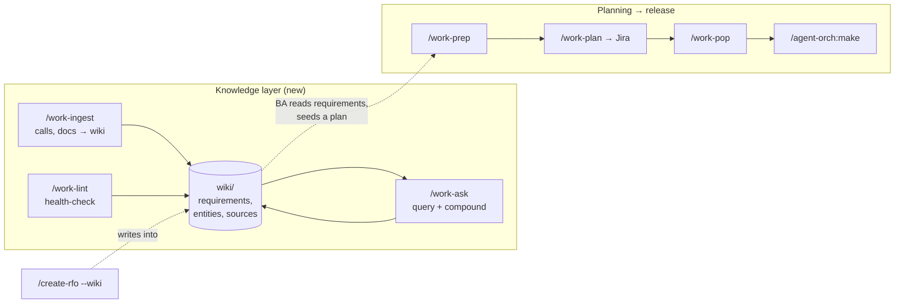

# An LLM-Maintained Wiki for the SDLC: From Client Calls to Requirements to `/make` (team-work v0.12.0)

Business analysts live in calls. Discovery sessions, requirements walkthroughs, incident postmortems, change requests, contract addenda. The knowledge that drives everything downstream — what to build and why — arrives as a stream of conversations and documents. And in most tooling, that knowledge has two failure modes.

It evaporates. The notes live in someone's head, a Slack thread, or a one-off transcript that nobody opens again. Nothing accumulates.

Or it gets flattened. A planning tool turns a single transcript into a single plan, and a second call doesn't enrich the first — it starts over. Ask a question that spans five calls and the model re-discovers the answer from scratch every time.

team-work v0.1.0 closed the gap between a planning session and a populated Jira board. v0.12.0 goes one step further upstream — to the gap *before* planning. It adds an **LLM-maintained wiki**: a persistent, compounding, cross-referenced knowledge base that turns a stream of calls and documents into living requirement pages with a full audit trail back to the call they came from.

## The RAG-vs-Wiki Gap

Most LLM+document workflows are query-time RAG. You ask a question, the system retrieves raw source chunks, and the model synthesizes an answer on the spot. Nothing is built up. The next person asks a related question and the whole derivation happens again. The sources are the only durable artifact, and they're unstructured.

A wiki is the opposite. Knowledge is *compiled once* and kept current. A new source doesn't spawn a new note — it integrates into existing pages, enriches a requirement, contradicts an old decision, supersedes a stale claim. The compiled pages are the durable artifact. Querying reads the compiled knowledge, not the raw sources.

The reason humans abandon wikis is that the bookkeeping outpaces the value. Keeping cross-references current, updating summaries when a new call changes things, noting when a fresh requirement contradicts an old one, maintaining consistency across dozens of pages — it's tedious, and it never ends. So wikis rot.

The LLM doesn't get bored, and it can touch fifteen files in a single pass. That's the whole bet of this release: **the LLM writes the wiki; the human reads it.** The BA curates sources, directs analysis, and asks good questions. The agent does everything else.

## Four Skills

The wiki is built on the three classic LLM Wiki operations — init, ingest, query, lint — exposed as four `team-work` skills.

### `/team-work:work-wiki` — Initialize

Bootstrap a wiki at a path you choose. In-repo at `./wiki/`, a sibling knowledge repo, or any directory — a BA can keep one cross-project wiki or one per engagement. The chosen path is remembered in `.team-work/wiki-config.md` so the other skills default to it.

It creates a `CLAUDE.md` "schema" (the agent's operating manual for *this* wiki), an `index.md` content catalog, an append-only `log.md`, the immutable `sources/` tree, and the generated page directories. It detects and wires [qmd](https://github.com/tobi/qmd) for on-device hybrid search, and gitignores the derived index. It's idempotent — re-run it any time to repair a missing piece or upgrade the schema. It never overwrites your content.

```
<wiki-root>/
  CLAUDE.md              # schema: conventions + workflows for the agent
  index.md               # content catalog — every page, one-line summary
  log.md                 # append-only chronological record
  .qmd/                  # qmd search index (gitignored, rebuilt on demand)
  sources/               # IMMUTABLE, categorized — the audit trail
    transcripts/acme/2026-06-04-discovery-call-acme-billing.md
    requirements-docs/acme/acme-rfp-v2.pdf      (+ .md rendering)
    incidents/2026-05-22-prod-outage-billing.md
  requirements/          # GENERATED, compounding
  entities/  concepts/  decisions/  incidents/  plans/
```

### `/team-work:work-ingest` — The Core BA Tool

This is the one a BA runs after every call. Hand it a transcript, a requirements doc, a postmortem write-up — pasted text, a file path, or a URL.

**It classifies the source** (transcript / requirements-doc / incident / email / misc), identifies the client or project, and **saves the verbatim original** into a categorized, immutable folder:

```
sources/transcripts/acme/2026-06-04-discovery-call-acme-billing.md
```

This is the audit trail. The file is never edited. If the source is a PDF, docx, or xlsx, a convert-to-markdown shim (markitdown, pandoc, or textutil) produces a readable markdown rendering for the wiki body — but the **original binary is preserved verbatim** alongside it. If no converter is installed, the binary is still archived and you get a warning instead of a silent failure.

Then it **extracts** the attendees, the speaker attribution per claim, the dates. It discusses the key takeaways with you — a wizard, not a wall of generated markdown. And it **integrates** the new knowledge into the wiki: creating or updating requirement, entity, concept, decision, and incident pages. Crucially, every claim carries a citation:

```markdown
## Invoice generation must support multi-currency

> Source: [[sources/transcripts/acme/2026-06-04-discovery-call-acme-billing]] — Maria Chen, 00:42:18
> Status: confirmed requirement

Acme requires invoices rendered in the customer's billing currency...
```

That citation is what makes the wiki trustworthy. Months later, when someone asks "why did we commit to multi-currency?", you don't re-litigate it from memory — you jump straight to the call, see who was on it, see the timestamp, and follow up.

When a new source contradicts an existing page, ingest doesn't silently overwrite. It **flags the contradiction**:

```
⚠ Possible contradiction:
  New: "multi-currency in phase 1" (Maria, 2026-06-04)
  Existing [[requirements/billing-invoice-generation]]: "currency deferred to
  phase 2" (2026-05-20 call).

How should I resolve this?
```

You decide whether the new source supersedes the old or whether both stand with a flag for the team. The wiki stays honest.

A team can choose how wiki changes land. On the first ingest, `/work-ingest` asks whether to commit **locally** (fast, for solo or trusted workflows) or via **PR** (a review gate for teams), and remembers the answer repo-wide. No re-asking.

### `/team-work:work-ask` — Query, and Compound

Ask a question. The skill runs qmd hybrid search (BM25 + vector + LLM re-rank), or falls back to the `index.md` catalog if qmd isn't installed, reads the relevant pages, follows wikilinks, and synthesizes a **cited** answer — pointing not just at a page but back through it to the originating call and speaker.

```
Multi-currency invoicing is in scope for phase 1.

- Acme requires invoices in the customer's billing currency
  ([[requirements/billing-invoice-generation]] — 2026-06-04 discovery call,
  Maria Chen 00:42:18).
- This was an explicit decision ([[decisions/billing-multicurrency-phase1]]),
  superseding an earlier 2026-05-20 note that deferred currency to phase 2.
```

And then the compounding twist: a good answer can be filed back into the wiki as a new page. The comparison you just asked for, the synthesis across five calls — save it, and the next person gets the compiled answer instead of re-deriving it. The wiki gets smarter every time you use it.

### `/team-work:work-lint` — Health-Check

Run it periodically, and especially before you seed a plan from the wiki. Lint reads the whole corpus and hands back a prioritized punch list: contradictions between pages, stale claims superseded by newer sources, orphan pages with no inbound links, requirements that are mentioned everywhere but lack their own page, missing cross-references, broken provenance (a citation pointing at a source that doesn't exist), and source gaps it can suggest filling.

It's read-only by default — it reports, you decide. Pass `--fix` and it'll apply the safe fixes (cross-references, index drift, clearly-superseded claims, stub pages for missing requirements) and leave the genuine judgment calls — resolving a real contradiction, deleting a page — to you.

## Where the Wiki Sits

The wiki doesn't replace `/work-prep`. It *front-runs* it.



A BA accumulates knowledge over many calls in the wiki. The requirement pages compound, the contradictions get resolved, the picture sharpens. When a body of work is ready, the BA seeds a `/work-prep` session from those requirement pages — and from there it's the v0.1.0 pipeline: `/work-prep` → `/work-plan` → `/work-pop` → `/agent-orch:make`. From a client call, through compiled requirements, all the way to merged code.

`/work-prep` itself is untouched. Teams that want lightweight, transcript-only planning keep using it exactly as before. The wiki is the heavier, persistent option for teams whose knowledge spans many sources over many weeks.

## `/create-rfo` Learns to Write to the Wiki

The agent-orch `/create-rfo` skill turns a postmortem transcript into a Request for Outage document. In v2.30.2 it gains an optional `--wiki <path>` flag: file the incident synthesis into the wiki's `incidents/` directory and archive the postmortem transcript under `sources/incidents/`, with citations, the same way `/work-ingest` does. Additive only — leave the flag off and `/create-rfo` behaves exactly as it always has. Turn it on and your postmortems become part of the same compounding, queryable corpus as your requirements.

## Design Decisions

**The wiki is a compounding artifact, not a query cache.** Ingest integrates; it doesn't append. This is the whole difference from RAG, and every skill is built around it.

**Sources are immutable and categorized.** The audit trail is sacred. Generated pages can be rewritten freely because the truth always traces back to a verbatim source you can re-read.

**Every claim cites its source.** Provenance is the feature. A requirement you can't trace to a call is a requirement you can't defend.

**Configurable location.** The wiki root is never hardcoded. One cross-project wiki or one per engagement — the BA decides, and `.team-work/wiki-config.md` remembers.

**Search from day one, with a fallback.** qmd gives hybrid on-device search immediately. But `index.md` is always present, so the wiki is fully functional even without qmd installed.

**Markdown all the way down.** The wiki is just a git repo of Obsidian-compatible markdown — wikilinks and frontmatter. A BA can browse and edit it in Obsidian while the agent maintains it. No database, no API, no service. `git diff` shows exactly what each ingest changed.

**Leave `/work-prep` alone.** No competing edits to a working skill. The wiki is a parallel, upstream track that *feeds* planning.

## Prerequisites

- **agent-orch plugin** for `/make` integration (2.30.2+ for `/create-rfo --wiki`).
- **qmd** (optional, recommended) — on-device hybrid search. The wiki degrades to `index.md` navigation without it. [github.com/tobi/qmd](https://github.com/tobi/qmd).
- **A markdown converter** (optional) — markitdown, pandoc, or textutil — for ingesting non-markdown sources. Without one, originals are still archived; only auto text-extraction is skipped.
- **`gh` CLI** authenticated, only if you choose PR-mode for wiki commits.

## Installation

```bash
/plugin install team-work@ssnc-agent-orch

# Then:
/team-work:work-wiki        # initialize the wiki
/team-work:work-ingest      # add your first call transcript
/team-work:work-ask         # ask it something
```

## What This Changes

Before this release, the knowledge from a client call had nowhere durable to go. It became a one-shot plan, or it evaporated. The second call didn't build on the first.

After this release, every call compounds. The wiki accumulates requirements, entities, decisions, and incidents across weeks of conversations, each claim traceable to the call it came from, contradictions surfaced instead of buried, the whole corpus searchable and queryable with citations. When it's time to build, the requirement pages seed a plan, and the plan runs all the way to merged code.

The tedious part of a knowledge base was never the thinking. It was the bookkeeping. Now the agent does the bookkeeping, and the BA gets to do the part that needed a human all along.

---

**team-work v0.12.0** — 4 new skills. `/work-wiki` initializes an LLM-maintained SDLC knowledge base. `/work-ingest` archives client calls and docs with a full audit trail and integrates them into cited, cross-referenced requirement pages. `/work-ask` answers questions with provenance and files the answer back so it compounds. `/work-lint` keeps the wiki honest. `/work-prep` is unchanged; the wiki front-runs it.

**agent-orch v2.30.2** — `/create-rfo` gains an optional `--wiki <path>` flag to file postmortem synthesis into the wiki. Additive; default behavior unchanged.
