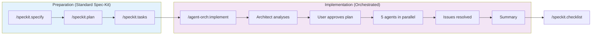

# Example Workflow: Building a REST API Feature

This example walks through using the Agent Orchestration plugin to implement a user registration API.

---

## Workflow Diagram



---

## Scenario

You need to add user registration to an existing Express.js API with:
- Email/password registration
- Email verification
- Password requirements validation
- User profile creation

**Prerequisites**: You've already run `/speckit.specify` and have a spec in `specs/user-registration/`

---

## Step 1: Start the Implementation

```bash
cd my-express-api
claude
```

```
> /agent-orch:implement
```

The command **auto-detects** the `user-registration` feature from `specs/user-registration/` since it has incomplete tasks in `tasks.md`.

---

## Step 2: Architect Analyses & Plans

The Architect agent runs first and:

1. **Reads spec-kit artifacts**:
   - `.specify/memory/constitution.md` for standards
   - `specs/user-registration/spec.md` for requirements
   - `specs/user-registration/plan.md` for approach

2. **Explores the codebase**:
   - Finds existing auth patterns in `src/auth/`
   - Identifies database models in `src/models/`
   - Notes existing validation middleware

3. **Updates `specs/user-registration/tasks.md`**:

```markdown
## Agent Assignments

### Builder
- [ ] Create registration endpoint
- [ ] Add email verification flow
- [ ] Implement password validation

### Validator
- [ ] Write registration tests
- [ ] Write verification tests

### Scribe
- [ ] Document registration API

### Specialists Recommended
- orchestrate-security (handling auth, passwords)
- orchestrate-api (new endpoint)
```

4. **Presents plan to you**:

```
I've analysed your codebase and spec. Here's the plan:

Architecture:
- Extending existing auth module (src/auth/)
- Using bcrypt for passwords (matching your pattern)
- Redis for verification tokens

Specialists recommended:
- Security Auditor (auth handling)
- API Designer (new endpoint)

Approve this plan?
```

---

## Step 3: You Approve

```
> Yes, proceed with Security and API specialists
```

---

## Step 4: Parallel Execution

Five agents launch simultaneously: Builder, Validator, Scribe + Security, API Designer

### Builder Progress
Updates `specs/user-registration/status.md`:
```markdown
## Builder Progress

### Completed
- [x] Registration endpoint: src/routes/auth.ts:45-89
- [x] Email verification: src/routes/auth.ts:91-120
- [x] Password validation middleware

### Ready for Validation
- Registration endpoint
- Email verification flow
```

### Validator Progress
Updates `specs/user-registration/status.md`:
```markdown
## Validator Results

### Test Results
- Registration: 8/8 passing ✅
- Verification: 5/5 passing ✅

### Issues Found
| Severity | Issue | File:Line | Spec Ref |
|----------|-------|-----------|----------|
| HIGH | No rate limiting | auth.ts:45 | spec.md:34 |
```

### Security Auditor Progress
Updates `specs/user-registration/status.md`:
```markdown
## Security Audit

### Findings
| Severity | Issue | OWASP | Fix |
|----------|-------|-------|-----|
| MEDIUM | Verbose error messages | A09 | Sanitize responses |

### Passed Checks
- [x] Password hashing (bcrypt, cost 12)
- [x] No SQL injection vectors
- [x] CSRF protection present
```

### API Designer Progress
Updates `specs/user-registration/status.md`:
```markdown
## API Design

### Endpoints Created
- POST /api/v1/auth/register
- GET /api/v1/auth/verify/:token

### OpenAPI Updated
- openapi/paths/auth.yaml
- openapi/schemas/User.yaml

### Consistency
- [x] Follows existing naming conventions
- [x] Uses standard error format
```

---

## Step 5: Issue Resolution

```
Issues found:
- Validator: Missing rate limiting (HIGH)
- Security: Verbose error messages (MEDIUM)

Fix these?
```

```
> Yes, fix both
```

Builder addresses the issues, Validator re-verifies.

---

## Step 6: Finalization

Final `specs/user-registration/status.md`:

```markdown
## Implementation Complete

### Summary
User registration implemented with:
- Registration endpoint with validation
- Email verification flow
- Rate limiting protection
- Security audit passed
- Full test coverage

### Files Created
- src/routes/auth.ts
- src/middleware/passwordValidation.ts
- tests/auth/registration.test.ts
- openapi/paths/auth.yaml

### All Tasks Complete
| Task | Agent | Status |
|------|-------|--------|
| Registration endpoint | Builder | ✅ |
| Email verification | Builder | ✅ |
| Password validation | Builder | ✅ |
| Registration tests | Validator | ✅ |
| Verification tests | Validator | ✅ |
| API documentation | Scribe | ✅ |
| Security review | Security | ✅ |
| OpenAPI spec | API Designer | ✅ |

### Next Steps
- [ ] Run /speckit.checklist for final validation
- [ ] Configure email service for production
```

---

## Key Difference: Native Spec-Kit Integration

Everything tracked in `.specify/`:
- **No separate MULTI_AGENT_PLAN.md** - uses spec-kit's native structure
- Tasks in `specs/[feature]/tasks.md`
- Status in `specs/[feature]/status.md`
- Specs remain the source of truth

This means your spec-kit workflow stays intact, with orchestration layered on top.
