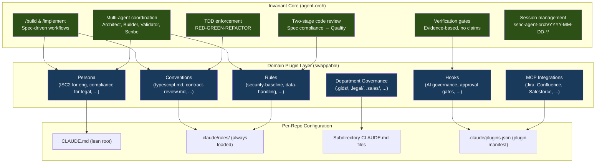
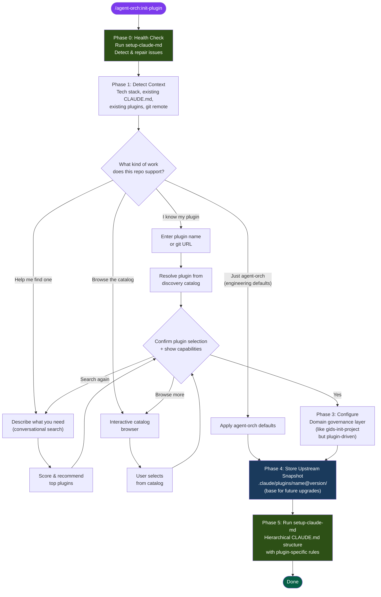
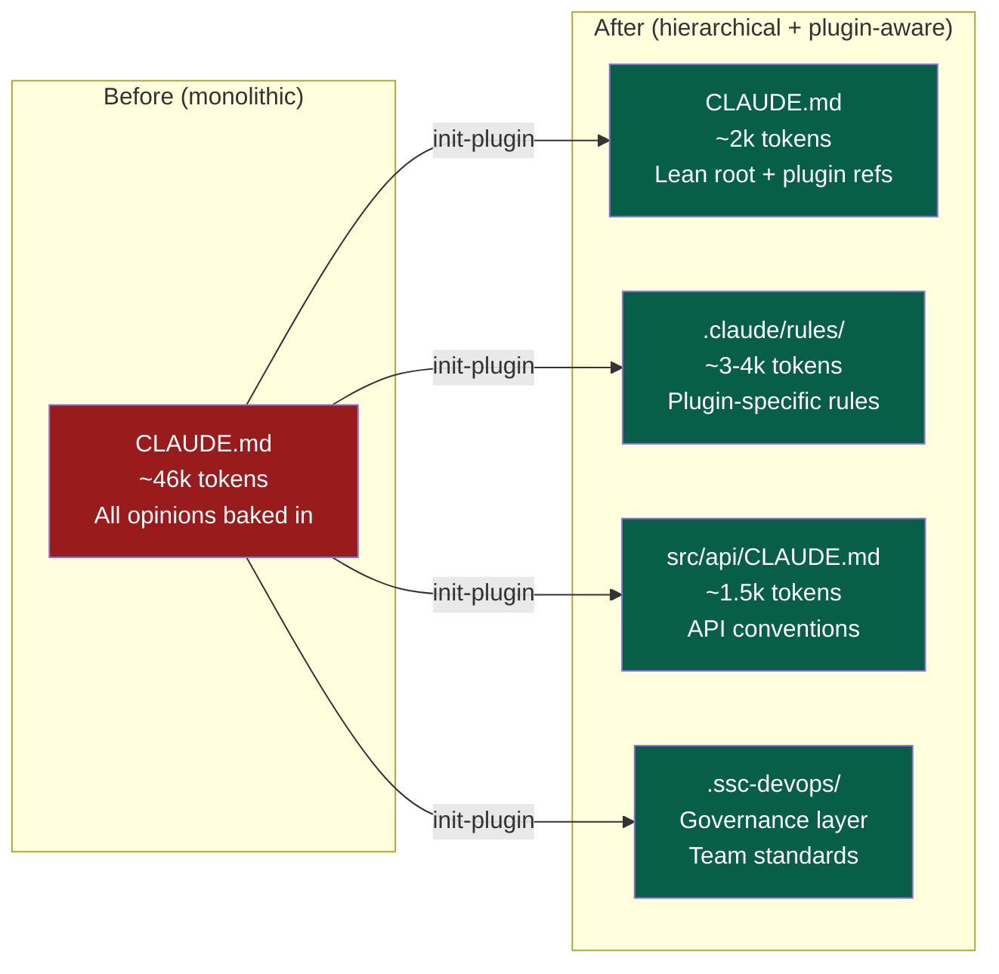

# Feature Proposal: `/agent-orch:init-plugin`

**Author:** AI Governance Team
**Date:** 2026-04-08
**Status:** Draft - Pending Human Review
**Version:** 0.1.0
**Companion:** [upgrade-plugin-proposal.md](./upgrade-plugin-proposal.md) -- seamless upgrade path for initialized repos

---

## Problem Statement

The agent orchestration plugin currently ships as a monolithic, engineering-opinionated system. Its core value -- spec-driven multi-agent coordination with verification gates, TDD enforcement, and two-stage code review -- is universally useful. But its delivery mechanism bundles that core with engineering-specific opinions (ISC2 persona, TypeScript/Python/Go conventions, OWASP rules, AI code governance hooks) that don't apply to legal, sales, compliance, or other non-engineering teams.

Today, setting up a project requires knowing which skills to run and in what order. There's no single entry point that says: "What kind of work are you doing? Let me configure the right agents, rules, and conventions for your team."

Additionally, teams working across multiple repositories need per-repo configuration. A `/build` in a React frontend repo should behave differently than `/build` in a Terraform infrastructure repo or `/build` in a legal contract review workspace.

---

## Solution: `/agent-orch:init-plugin` Wizard

A single entry-point skill that:

1. **Health-checks** the CLAUDE.md hierarchy first (run `setup-claude-md` to detect/repair issues)
2. **Discovers** what plugin(s) the user needs (via the SS&C Plugin Discovery catalog or direct selection)
3. **Configures** the orchestration layer for the user's team and domain
4. **Sets up** the CLAUDE.md hierarchy for optimal agent context loading (run `setup-claude-md` again with plugin context)

### Design Principles

- **Orchestration is the product; opinions are plugins.** The agent coordination engine (spec-driven builds, verification gates, multi-agent teams) is the invariant. Everything else is swappable.
- **Per-repo, not per-user.** Plugin configuration lives in the repository/directory so different repos get different agent behaviors.
- **Discovery-first.** Don't make users memorize plugin names. Let them describe what they need and find it.
- **Wizard, not wall-of-text.** One question at a time, with smart defaults and recommendations.
- **Healthy CLAUDE.md is a precondition.** Both `/init-plugin` and `/upgrade-plugin` run `setup-claude-md` as a health check before doing anything, and again at the end. A broken hierarchy means broken agent behavior.
- **Upgrade-aware from day one.** Every structure created by `/init-plugin` is designed so `/upgrade-plugin` can maintain it. See the [upgrade-plugin proposal](./upgrade-plugin-proposal.md).

---

## Architecture

### Layered Plugin Model



### What's Core vs. What's Pluggable

| Concern | Core (always present) | Pluggable (per-team) |
|---------|----------------------|---------------------|
| **Workflow** | /build, /implement, spec-driven | Skill customizations, domain-specific steps |
| **Agents** | Architect, Builder, Validator, Scribe, Debugger, Spec Reviewer, Quality Reviewer | Specialist agents (Security, DevOps, DB, API, UI/UX, etc.) |
| **Verification** | Evidence-based gates, no claims accepted | What constitutes "evidence" per domain |
| **Review** | Two-stage (spec compliance + quality) | Review criteria, quality standards |
| **TDD** | RED-GREEN-REFACTOR cycle | What "test" means (unit test? contract review? compliance check?) |
| **Persona** | Base professional standards | Domain expertise (ISC2, legal bar, sales methodology) |
| **Conventions** | None by default | Language/framework/domain conventions |
| **Rules** | None by default | Security, compliance, data handling, etc. |
| **Hooks** | AI code governance (Co-authored-by) | Domain-specific validation hooks |
| **MCP** | None by default | Jira, Confluence, Salesforce, TestRail, etc. |

---

## Wizard Flow



---

## Detailed Phase Design

### Phase 0: Health Check (run setup-claude-md first)

Before anything else, run `setup-claude-md` in validation mode to ensure the CLAUDE.md hierarchy is healthy:

```
Running CLAUDE.md health check...

  [ok] .claude/ directory exists
  [ok] .claude/rules/ exists (or will be created)
  [--] No CLAUDE.md found (will be created during Phase 5)
  [--] No .claude/plugins.json found (first-time init)
```

**Why this runs first:**
- A broken or missing CLAUDE.md hierarchy means agents load wrong context during `/build`
- Detects and repairs drift from manual edits before we layer plugin configuration on top
- If `CLAUDE.md` already exists but is monolithic (>100 lines), offers migration
- Establishes a clean baseline so the user knows their starting state
- Same health check runs at the start of `/upgrade-plugin` -- see [upgrade-plugin proposal](./upgrade-plugin-proposal.md)

If issues are found, ask the user before proceeding:

```
Found 2 issues:
  [!!] CLAUDE.md is monolithic (312 lines, ~24k tokens)
  [!!] No .claude/rules/ directory

Fix these before continuing? (yes / skip / details)
```

### Phase 1: Detect Context (automatic, no user interaction)

Before asking the user anything, silently gather:

1. **Tech stack detection** - scan for `pom.xml`, `package.json`, `requirements.txt`, `go.mod`, `*.tf`, `Cargo.toml`, `*.sln`
2. **Existing configuration** - check for `CLAUDE.md`, `.claude/rules/`, `.claude/plugins.json`, `.gids/`, other governance dirs
3. **Git remote** - detect org/team from remote URL for catalog filtering
4. **Installed plugins** - read `.claude-plugin/marketplace.json` if it exists

Present a one-line summary:

```
Detected: TypeScript/React project, no existing CLAUDE.md, git remote: code.ssnc.dev/globeop/portfolio-ui
```

### Phase 2: Plugin Selection (interactive wizard)

**Question 1: What kind of work?**

```
What kind of work does this repository support?

(a) Software engineering (code, APIs, infrastructure) -- use agent-orch defaults
(b) I know the plugin I want -- enter name or URL
(c) Help me find the right plugin -- describe what you need
(d) Browse the plugin catalog
```

#### Path (a): Agent-orch defaults

Skip plugin discovery entirely. Apply the current agent-orch opinions (ISC2 persona, engineering conventions, security rules) as-is. Jump to Phase 4 (setup-claude-md).

This is the fast path for engineering teams that just want multi-agent orchestration with sensible defaults.

#### Path (b): Direct plugin entry

```
Enter the plugin name or git URL:
>
```

- If it looks like a git URL: clone and validate it has `.claude-plugin/` structure
- If it's a name: search the discovery catalog at `git@code.ssnc.dev:ai/code-plugin-discovery.git`

The catalog is searched by matching against `plugin.md` manifests in the `catalog/` directory tree. Each manifest has YAML frontmatter with `name`, `display_name`, `description`, `tags`, `stack`, and `capabilities`.

If multiple matches, present them:

```
Found 3 plugins matching "devops":

1. ssc-devops (GlobeOp/Infrastructure)
   Deploy, monitor, and secure SS&C Cloud workloads
   Stack: Python, Ansible, Terraform | 5 skills, 0 agents

2. platform-devops (Technology/Platform)
   Kubernetes and Helm deployment orchestration
   Stack: Go, Terraform, Helm | 3 skills, 2 agents

3. agent-orch (Technology/AI Governance)
   Multi-agent orchestration with 24 specialist agents
   Stack: All languages | 16 skills, 24 agents

Select a plugin (1-3), or (s) search again:
```

#### Path (c): Conversational search

```
Describe what your team does and what you need help with:
>
```

Use the discovery catalog's weighted scoring algorithm:
- Tag match = 3 points
- Capability name match = 3 points
- Description match = 2 points
- Capability type match = 2 points
- Tech stack match = 1 point
- Body content match = 1 point

Augment with the detected tech stack from Phase 1 for implicit stack matching.

Present top 5 results conversationally with recommendations:

```
Based on what you described, I'd recommend:

1. **ssc-devops** (best match - 12 points)
   Built for infrastructure teams managing SS&C Cloud deployments.
   Has skills for deploy, monitor, security scanning, and CI/CD.
   Your Terraform files align with its stack.

2. **agent-orch** (good match - 8 points)
   General-purpose multi-agent orchestration.
   Has 24 specialist agents including DevOps, Security, and Database.
   More agents but less infrastructure-specific.

Would you like to:
(a) Select one of these (enter number)
(b) See more details about a specific plugin
(c) Search with different terms
(d) Browse the full catalog instead
```

#### Path (d): Browse catalog

Hierarchical drill-down through the discovery catalog's directory structure:

```
catalog/
├── technology/
│   ├── ai-governance/ (2 plugins)
│   ├── platform/ (3 plugins)
│   └── data-engineering/ (1 plugin)
├── operations/
│   ├── globeop/ (4 plugins)
│   └── fund-admin/ (2 plugins)
├── legal/
│   └── compliance/ (1 plugin)
└── sales/
    └── client-onboarding/ (1 plugin)

Enter a division to browse, or (a) show all plugins:
```

### Phase 3: Plugin Configuration (interactive, plugin-driven)

Once a plugin is selected, this phase adapts based on what the plugin provides. This is the decoupled equivalent of what `gids-init-project` does for GIDS specifically.

**Step 1: Show what the plugin will set up**

```
Plugin: ssc-devops v0.1.0
By: GlobeOp Infrastructure Team

This plugin will configure:
  [x] 5 skills (deploy, monitor, security, cicd, troubleshoot)
  [x] 3 rules (infra-standards, naming-conventions, cost-tagging)
  [x] 2 hooks (terraform-plan-gate, secret-detection)
  [x] 1 MCP integration (Confluence for architecture docs)
  [x] 2 conventions (python, terraform)
  [ ] 0 agents (uses agent-orch core agents)

It will also create:
  .ssc-devops/              -- department governance files
  .claude/rules/            -- always-loaded standards
  CLAUDE.md                 -- project constitution

Proceed? (yes / customize / details / cancel)
```

**Step 2: If the plugin has a governance layer (like `.gids/`)**

For plugins that include department-specific instruction files (like `gids-init-project` creates), configure them:

```
This plugin includes department governance files.
These tell agents when and how to follow your team's standards.

Configuring governance for: .ssc-devops/

  [x] coding-standards.md -- language-aware coding conventions
  [x] infra-standards.md -- infrastructure provisioning rules
  [x] compliance-check.md -- validates against team policies
  [ ] confluence-pages.md -- Confluence page registry (requires MCP auth)

Keep all, or customize? (keep / customize)
```

**Step 3: If the plugin has MCP integrations**

```
This plugin uses Confluence for architecture documentation.

Configure MCP now?
(a) Yes -- set up .mcp.json (you'll need to authenticate after)
(b) Skip -- I'll configure MCP later
(c) I already have MCP configured
```

If (a), create/merge `.mcp.json` with the plugin's MCP config. Provide authentication instructions at the end.

**Step 4: Plugin-specific questions**

Some plugins may need additional context. The plugin's `SKILL.md` or `settings.json` can define required environment variables or configuration:

```
The ssc-devops plugin needs some configuration:

What SS&C Cloud environment do you deploy to? (dev/staging/prod):
>

What's your team's Confluence space key? (e.g., INFRA):
>
```

Store answers in `.claude-plugin/settings.json` for the project.

### Phase 4: Store Upstream Snapshot (for future upgrades)

Before applying the plugin configuration, store a pristine copy of the upstream plugin files. This snapshot becomes the **base** for three-way merges during `/upgrade-plugin`. See the [upgrade-plugin proposal](./upgrade-plugin-proposal.md) for how this is used.

```
Storing upstream snapshot for future upgrades...

  .claude/plugins/agent-orch@2.14.0/
  ├── agents/core/           (7 files)
  ├── agents/specialists/    (17 files)
  ├── rules/core/            (1 file)
  └── conventions/           (0 files -- populated by domain plugin)

  .claude/plugins/ssc-devops@0.2.0/
  ├── rules/                 (3 files)
  ├── conventions/           (2 files)
  └── hooks/                 (2 files)

  .claude/plugins.json updated with installed versions.
```

The `.claude/plugins.json` manifest records what was installed and when:

```json
{
  "plugins": [
    {
      "name": "agent-orch",
      "source": "git@code.ssnc.dev:ai/claude-agent-orchestration-plugin.git",
      "version": "2.14.0",
      "role": "orchestrator",
      "installedAt": "2026-04-08T10:00:00Z"
    },
    {
      "name": "ssc-devops",
      "source": "git@code.ssnc.dev:GlobeOp/devops-claude-plugin.git",
      "version": "0.2.0",
      "role": "overlay",
      "installedAt": "2026-04-08T10:00:00Z"
    }
  ]
}
```

This metadata is what `/upgrade-plugin` reads to know what's installed and where to fetch updates from.

### Phase 5: Run `setup-claude-md` (apply plugin context)

The final phase runs `setup-claude-md` again, this time informed by the plugin selection:

- **Root CLAUDE.md** includes references to the plugin's governance directory (`.gids/`, `.ssc-devops/`, etc.)
- **`.claude/rules/`** includes the plugin's rules files, not just engineering defaults
- **Subdirectory CLAUDE.md files** are generated based on detected project structure AND the plugin's conventions
- **Persona** is set from the plugin, not hardcoded to ISC2



---

## Per-Repo vs Per-User Configuration

```mermaid
graph TB
    subgraph "User Level (~/.claude/)"
        U1["CLAUDE.md -- personal prefs"]
        U2["settings.json -- CLI config"]
        U3["memory/ -- conversation memory"]
    end

    subgraph "Repo: React Frontend"
        R1["CLAUDE.md -- lean root"]
        R2[".claude/rules/ -- frontend rules"]
        R3[".claude/plugins.json -- agent-orch + ui-ux plugin"]
        R4["src/components/CLAUDE.md -- React conventions"]
    end

    subgraph "Repo: Terraform Infra"
        T1["CLAUDE.md -- lean root"]
        T2[".claude/rules/ -- infra rules"]
        T3[".claude/plugins.json -- agent-orch + ssc-devops plugin"]
        T4[".ssc-devops/ -- governance layer"]
    end

    subgraph "Repo: Legal Contracts"
        L1["CLAUDE.md -- lean root"]
        L2[".claude/rules/ -- compliance rules"]
        L3[".claude/plugins.json -- agent-orch + legal plugin"]
        L4[".legal/ -- contract templates + review gates"]
    end

    U1 -.->|"inherited by all"| R1
    U1 -.->|"inherited by all"| T1
    U1 -.->|"inherited by all"| L1

    style U1 fill:#4a5568,color:#fff
    style U2 fill:#4a5568,color:#fff
    style U3 fill:#4a5568,color:#fff
```



**Key insight:** `/build` in the React repo loads React conventions and UI/UX agent opinions. `/build` in the Terraform repo loads infrastructure rules and DevOps agent opinions. `/build` in the Legal repo loads contract review gates and compliance standards. Same command, different behavior, driven entirely by what's in the repo.

---

## Plugin Discovery Integration

The wizard uses the SS&C Plugin Discovery service at `git@code.ssnc.dev:ai/code-plugin-discovery.git` as its catalog backend.

### Catalog Structure

```
code-plugin-discovery/
└── catalog/
    └── [division]/
        └── [business-unit]/
            └── [team]/
                └── [plugin-name]/
                    └── plugin.md    # YAML frontmatter + markdown body
```

### Plugin Manifest Schema (plugin.md)

Each plugin in the catalog exposes this metadata:

```yaml
name: plugin-name
display_name: "Human Readable Name"
description: "What it does"
repo: git@code.ssnc.dev:group/repo.git
version: "1.2.3"
owner: "Team <email>"
tags: [orchestration, security, aws]
stack:
  languages: [typescript, python]
  frameworks: [react, fastapi]
  cloud: [aws]
  infrastructure: [terraform, kubernetes]
capabilities:
  agents:
    - name: security-auditor
      description: Reviews for OWASP vulnerabilities
  skills:
    - name: deploy
      description: Deploy to staging or production
  rules:
    - name: no-secrets.md
      description: Prevents hardcoded secrets
  hooks:
    - event: PreToolUse
      description: Validates terraform commands
  mcp:
    - name: jira-server
      description: Jira integration
```

### Search Algorithm

Weighted signal matching (not full-text search):

| Signal | Weight | Example |
|--------|--------|---------|
| Tag match | 3 | User searches "security", plugin tagged "security" |
| Capability name match | 3 | User searches "deploy", plugin has skill named "deploy" |
| Description match | 2 | User searches "terraform", description mentions "Terraform" |
| Capability type match | 2 | User wants "agents", plugin has agents |
| Tech stack match | 1 | User's repo has `package.json`, plugin supports TypeScript |
| Body content match | 1 | Keyword found in markdown body |

### Integration Approach

The wizard shallow-clones the catalog (`git clone --depth 1`) to a temp directory, indexes all `plugin.md` files, scores them, and cleans up. No persistent catalog cache -- always fresh from Git.

```bash
TIMESTAMP=$(date +%s)
CATALOG_DIR="/tmp/init-plugin-catalog-${TIMESTAMP}"
git clone --depth 1 git@code.ssnc.dev:ai/code-plugin-discovery.git ${CATALOG_DIR}
# ... index and search ...
rm -rf ${CATALOG_DIR}
```

---

## Decoupling Strategy: What Changes in agent-orch

### Current State (coupled)

```
plugins/agent-orch/
├── agents/           # 24 agents, all engineering-flavored
├── skills/           # 16 skills, engineering workflows
├── rules/            # ISC2 persona, security-baseline
├── conventions/      # typescript, python, go, java, etc.
├── hooks/            # AI code governance
└── mcp/              # Jira, Confluence
```

### Target State (decoupled)

```
plugins/agent-orch/
├── agents/
│   ├── core/                    # Always present: architect, builder, validator, scribe,
│   │   │                        # debugger, spec-reviewer, quality-reviewer
│   │   ├── orchestrate-architect.md
│   │   ├── orchestrate-builder.md
│   │   ├── orchestrate-validator.md
│   │   ├── orchestrate-scribe.md
│   │   ├── orchestrate-debugger.md
│   │   ├── orchestrate-spec-reviewer.md
│   │   └── orchestrate-quality-reviewer.md
│   └── specialists/             # Activated by domain plugins
│       ├── orchestrate-security.md
│       ├── orchestrate-devops.md
│       ├── orchestrate-database.md
│       └── ... (17 more)
├── skills/
│   ├── core/                    # Always present
│   │   ├── build/SKILL.md
│   │   ├── implement/SKILL.md
│   │   ├── init-plugin/SKILL.md  # <-- THIS FEATURE
│   │   └── setup-claude-md/SKILL.md
│   └── support/                 # Available but not mandatory
│       ├── jira/SKILL.md
│       ├── olly/SKILL.md
│       └── ...
├── rules/
│   └── core/                    # Minimal: AI governance only
│       └── ai-code-governance.md
├── conventions/                 # EMPTY by default -- populated by domain plugins
├── hooks/
│   └── core/                    # AI commit trailer only
│       └── hooks.json
└── mcp/                         # EMPTY by default -- populated by domain plugins
```

### What Stays in agent-orch (Invariant)

1. **Core agents** (7): Architect, Builder, Validator, Scribe, Debugger, Spec Reviewer, Quality Reviewer
2. **Core skills**: /build, /implement, /init-plugin, /setup-claude-md, /analyse
3. **Verification gates**: Evidence-based, no-claims policy
4. **Two-stage review**: Spec compliance then quality (the pattern, not the criteria)
5. **TDD enforcement**: RED-GREEN-REFACTOR (the cycle, not what "test" means)
6. **Session management**: `ssnc-agent-orch/YYYY-MM-DD-*/`
7. **AI code governance**: `Co-authored-by: Claude Code` trailer

### What Moves to Domain Plugins

1. **Persona** (ISC2 -> per-plugin): Engineering plugin keeps ISC2. Legal plugin gets compliance expertise. Sales plugin gets methodology expertise.
2. **Conventions** (language-specific -> per-plugin): Engineering plugin provides typescript/python/go. Infrastructure plugin provides terraform/ansible. Legal plugin provides contract-review conventions.
3. **Rules** (security-baseline -> per-plugin): Engineering plugin provides OWASP/security. Legal plugin provides data-handling/PII. Sales plugin provides CRM-hygiene.
4. **Specialist agents** (17 specialists -> activated by plugin): A plugin's `capabilities.agents` declares which specialists it needs. The orchestrator only activates those.
5. **MCP integrations** (Jira/Confluence -> per-plugin): Engineering plugin bundles Jira+Confluence. Sales plugin might bundle Salesforce. Legal plugin might bundle DocuSign.

---

## Examples: Same Orchestrator, Different Domains

### Engineering Team (current default)

```
/agent-orch:init-plugin
> (a) Software engineering

Result:
  CLAUDE.md         -- references .claude/rules/ with ISC2 persona
  .claude/rules/    -- security-baseline, code-standards, testing-standards
  conventions/      -- typescript.md, python.md (detected from project)
  24 agents active  -- all specialists available
```

### Legal Team

```
/agent-orch:init-plugin
> (c) Help me find one
> "contract review and compliance checking for legal documents"

Result:
  CLAUDE.md         -- references .legal/ governance layer
  .claude/rules/    -- data-handling, PII-protection, retention-policy
  .legal/           -- contract-templates, review-gates, compliance-check
  conventions/      -- contract-review.md, regulatory-citation.md
  9 agents active   -- core 7 + content-specialist + quality-reviewer
  MCP: DocuSign     -- contract signing integration
```

### Sales Team

```
/agent-orch:init-plugin
> (b) I know my plugin
> "sales-enablement"

Result:
  CLAUDE.md         -- references .sales/ governance layer
  .claude/rules/    -- crm-hygiene, data-quality, approval-workflows
  .sales/           -- pitch-templates, objection-handling, roi-calculator
  conventions/      -- proposal-writing.md, pricing-rules.md
  8 agents active   -- core 7 + content-specialist
  MCP: Salesforce   -- CRM integration
```

### Infrastructure Team

```
/agent-orch:init-plugin
> (d) Browse catalog
> operations > globeop > infrastructure > ssc-devops

Result:
  CLAUDE.md         -- references .ssc-devops/ governance layer
  .claude/rules/    -- infra-standards, cost-tagging, naming-conventions
  .ssc-devops/      -- deploy-gates, monitoring-standards, runbook-templates
  conventions/      -- terraform.md, ansible.md, python.md
  12 agents active  -- core 7 + devops + security + database + observability + telemetry
  MCP: Confluence   -- architecture docs
```

---

## Handling Multiple Plugins Per Repo

A repo can compose multiple plugins. For example, an engineering team that also needs legal compliance:

```json
// .claude/plugins.json
{
  "plugins": [
    {
      "name": "agent-orch",
      "source": "git@code.ssnc.dev:ai/claude-agent-orchestration-plugin.git",
      "version": "2.12.0",
      "role": "orchestrator"
    },
    {
      "name": "legal-compliance",
      "source": "git@code.ssnc.dev:legal/compliance-plugin.git",
      "version": "1.0.0",
      "role": "overlay"
    }
  ],
  "mergeStrategy": "overlay"
}
```

Rules from both plugins load into `.claude/rules/`. Conventions merge. Agents accumulate. Conflicts are resolved by the `mergeStrategy` (overlay = last wins, strict = error on conflict).

---

## Implementation Plan

### Files to Create

| File | Purpose |
|------|---------|
| `plugins/agent-orch/skills/init-plugin/SKILL.md` | The wizard skill definition |

### Files to Modify

| File | Change |
|------|--------|
| `plugins/agent-orch/skills/setup-claude-md/SKILL.md` | Accept plugin context as input (persona, rules, conventions to use) |
| `README.md` | Add /init-plugin documentation |
| `CHEAT-SHEET.md` | Add /init-plugin quick reference |

### Files to Restructure (future phase)

| Current | Target | Notes |
|---------|--------|-------|
| `plugins/agent-orch/agents/*.md` | `plugins/agent-orch/agents/core/` + `specialists/` | Separate core from specialist agents |
| `plugins/agent-orch/rules/persona.md` | Move to engineering-defaults plugin | ISC2 persona becomes opt-in |
| `plugins/agent-orch/conventions/*.md` | Move to engineering-defaults plugin | Language conventions become opt-in |

### Skill Implementation Path

The SKILL.md at `plugins/agent-orch/skills/init-plugin/SKILL.md` should implement:

1. **Phase 0** - Run `setup-claude-md` health check (detect/repair CLAUDE.md hierarchy)
2. **Phase 1** - Context detection (auto, silent)
3. **Phase 2** - Plugin selection wizard (interactive, one question at a time)
4. **Phase 3** - Plugin configuration (interactive, plugin-driven)
5. **Phase 4** - Store upstream snapshot (`.claude/plugins/[name]@[version]/` for upgrade base)
6. **Phase 5** - Run `setup-claude-md` with plugin context (apply final hierarchy)

### Dependencies

- **Plugin Discovery catalog** at `git@code.ssnc.dev:ai/code-plugin-discovery.git` -- must be accessible via SSH for search/browse
- **setup-claude-md skill** at `plugins/agent-orch/skills/setup-claude-md/SKILL.md` -- must accept plugin context parameters
- **gids-init-project** at `/Users/jstein/dev/ssnc/gps/ai-skills/gids-init-project` -- reference implementation for governance layer setup; patterns from this will be generalized into the plugin configuration phase

### External References

| Resource | Location | Purpose |
|----------|----------|---------|
| Plugin Discovery Service | `git@code.ssnc.dev:ai/code-plugin-discovery.git` | Catalog of all SS&C Claude Code plugins |
| GIDS Init Project (reference) | `/Users/jstein/dev/ssnc/gps/ai-skills/gids-init-project` | Pattern for department governance layer setup |
| Agent Orch Plugin | `/Users/jstein/dev/ssnc/ai/claude-agent-orchestration-plugin` | This repository -- where init-plugin will be implemented |
| Setup Claude MD Skill | `plugins/agent-orch/skills/setup-claude-md/SKILL.md` | Final phase of the wizard |
| Inherit Plugin Skill | `plugins/agent-orch/skills/inherit-plugin/SKILL.md` | Referenced when user wants to fork/transform a discovered plugin |

---

## Migration Path

### Phase 1: `/init-plugin` wizard (this proposal)

- Create the skill with all four phases
- Plugin discovery integration with catalog
- Governance layer setup (generalized from gids-init-project)
- Ends with setup-claude-md

### Phase 2: Agent-orch decoupling

- Restructure agents into `core/` and `specialists/`
- Move ISC2 persona to engineering-defaults overlay
- Move conventions to engineering-defaults overlay
- Keep AI code governance in core

### Phase 3: Engineering-defaults plugin

- Extract current engineering opinions into `git@code.ssnc.dev:ai/engineering-defaults-plugin.git`
- Register in discovery catalog
- `/init-plugin` path (a) "Software engineering" installs this automatically

### Phase 4: Team-specific plugins

- Legal, Sales, Infrastructure teams create their own plugins
- Register in discovery catalog
- `/init-plugin` finds and configures them

---

## Open Questions for Review

1. **Should `/init-plugin` live in agent-orch or in the discovery plugin?** It needs both the orchestration context AND catalog access. Current proposal: lives in agent-orch, consumes discovery catalog.

2. **Plugin updates are handled by `/upgrade-plugin`.** See the [upgrade-plugin proposal](./upgrade-plugin-proposal.md) for the full design: three-way merge with user walkthrough, upstream snapshots as merge base, `setup-claude-md` health check before and after.

3. **Should specialist agents be lazy-loaded?** Today all 24 agents are available. Should the orchestrator only load agents declared in the active plugin's capabilities?

4. **What's the minimum viable "legal plugin" or "sales plugin"?** We need at least one non-engineering plugin to validate the decoupling works.

5. **How does this interact with `/jira-work`?** Jira integration is currently baked into agent-orch. If a legal team uses Jira differently, do they get a different Jira skill configuration?

---

## Success Criteria

- A user can run `/agent-orch:init-plugin` in any repo and get a working multi-agent setup in under 5 minutes
- The wizard recommends appropriate plugins based on natural language description
- `/build` behaves differently in repos configured with different plugins
- Non-engineering teams can use the orchestrator without seeing engineering-specific opinions
- `setup-claude-md` runs both at start (health check) and end (apply plugin context)
- Upstream snapshots are stored in `.claude/plugins/[name]@[version]/` for `/upgrade-plugin` three-way merge
- `.claude/plugins.json` is created with installed plugin metadata for upgrade tracking
- Existing engineering teams see no regression -- path (a) gives them exactly what they have today
- See [upgrade-plugin proposal](./upgrade-plugin-proposal.md) for the seamless upgrade path that builds on these structures
