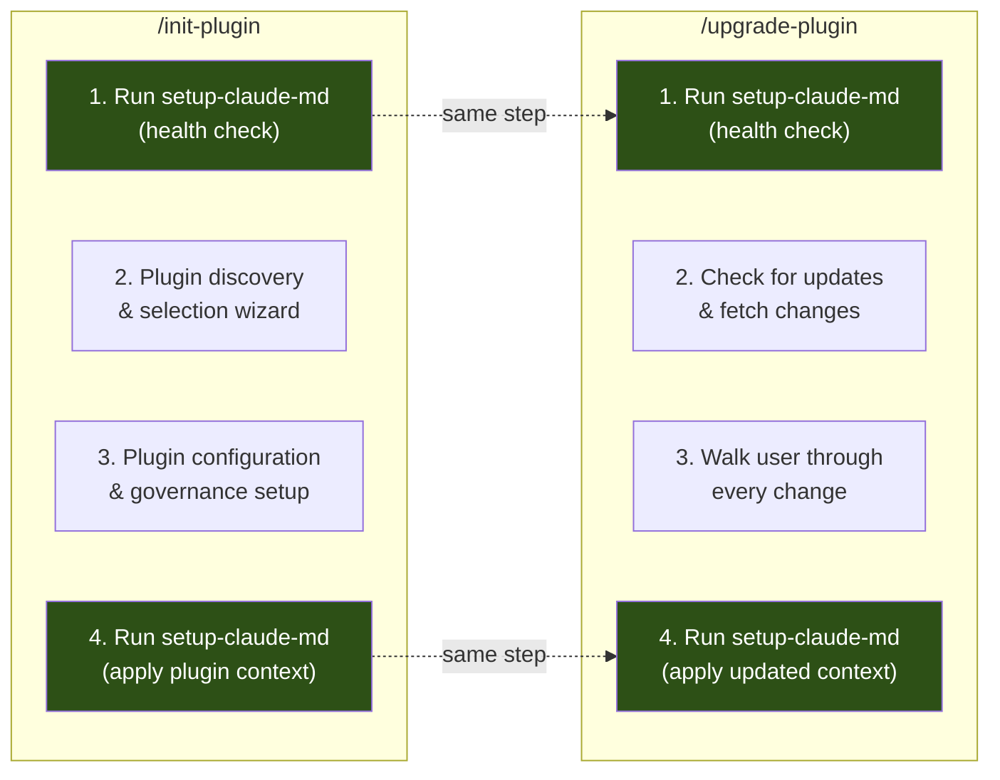
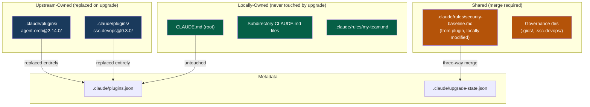
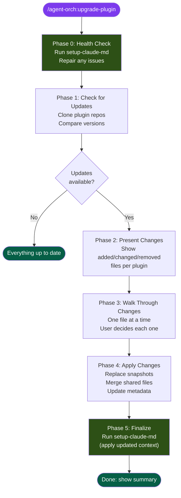

# Feature Proposal: `/agent-orch:upgrade-plugin`

**Author:** AI Governance Team
**Date:** 2026-04-08
**Status:** Draft - Pending Human Review
**Version:** 0.1.0
**Companion to:** [init-plugin-proposal.md](./init-plugin-proposal.md)

---

## Problem Statement

`/init-plugin` gets a repo configured once. But plugins evolve -- agent-orch ships new core agents, domain plugins add rules, conventions get updated for new framework versions. Today there is no way to pull upstream improvements into a repo that's already been initialized without manually diffing files or re-running `/init-plugin` from scratch and losing local customizations.

This is the "create-react-app eject" problem: once you've customized, you're on your own. We need an upgrade path that respects local changes while surfacing upstream improvements -- and always leaves the CLAUDE.md hierarchy healthy.

---

## Relationship to `/init-plugin`

These two skills share a contract. `/init-plugin` creates; `/upgrade-plugin` maintains. Both follow the same fundamental principles from the [init-plugin proposal](./init-plugin-proposal.md):

- **Orchestration is the product; opinions are plugins.** Upgrade handles core and domain plugin layers independently.
- **Per-repo, not per-user.** Upgrade reads from and writes to repo-level configuration.
- **Wizard, not wall-of-text.** Walk the user through every change, one at a time.
- **Healthy CLAUDE.md is a precondition.** Both skills run `setup-claude-md` as a health check before doing anything else, and again at the end to ensure the hierarchy reflects the final state.

### Shared `setup-claude-md` Contract



**Why setup-claude-md runs first (health check):**
- Detects and repairs broken CLAUDE.md hierarchy before upgrade begins
- Ensures `.claude/rules/` exists and is structurally sound
- Catches drift from manual edits (missing files, orphaned references)
- Establishes a clean baseline so upgrade diffs are accurate
- If health check finds issues, ask the user to fix before proceeding

**Why setup-claude-md runs last (apply):**
- New rules, conventions, or persona from the upgrade need to be wired into the CLAUDE.md hierarchy
- Subdirectory CLAUDE.md files may need regeneration if conventions changed
- Root CLAUDE.md may need new governance directory references
- Ensures everything is consistent before the user's next `/build`

---

## Architecture: Layered File Model

Upgrade relies on a clear ownership model for every file in the repo. This is established by `/init-plugin` and maintained by `/upgrade-plugin`.



### File Ownership Rules

| Ownership | Examples | On Upgrade |
|-----------|----------|-----------|
| **Upstream-owned** | Plugin snapshots in `.claude/plugins/[name]@[version]/` | Replaced entirely with new version |
| **Locally-owned** | Root `CLAUDE.md`, subdirectory `CLAUDE.md` files, custom rules | Never touched -- user's territory |
| **Shared** | Rules/conventions originally from a plugin but locally modified | Three-way merge with user walkthrough |
| **Metadata** | `.claude/plugins.json`, `.claude/upgrade-state.json` | Updated by the upgrade process |

---

## Wizard Flow



---

## Detailed Phase Design

### Phase 0: Health Check (automatic)

Run `setup-claude-md` in validation mode before anything else:

```
Running CLAUDE.md health check...

  [ok] CLAUDE.md exists (lean root, 47 lines)
  [ok] .claude/rules/ exists (3 files)
  [ok] .claude/plugins.json exists (2 plugins registered)
  [!!] src/api/CLAUDE.md is missing (expected from last init)
  [ok] .ssc-devops/ governance directory intact (6 files)

1 issue found. Fix before upgrading? (yes / skip / details)
```

If the user says "yes", `setup-claude-md` regenerates the missing file. If "skip", proceed with a warning. If "details", show what's expected vs what's present.

**If no `.claude/plugins.json` exists:**

```
This repo hasn't been initialized with /init-plugin yet.
No plugin configuration found at .claude/plugins.json.

Would you like to run /init-plugin first? (yes / no)
```

If yes, hand off to `/init-plugin`. If no, exit.

### Phase 1: Check for Updates

Read `.claude/plugins.json` to get the list of installed plugins and their pinned versions:

```json
{
  "plugins": [
    {
      "name": "agent-orch",
      "source": "git@code.ssnc.dev:ai/claude-agent-orchestration-plugin.git",
      "version": "2.12.0",
      "installedAt": "2026-03-15T10:00:00Z"
    },
    {
      "name": "ssc-devops",
      "source": "git@code.ssnc.dev:GlobeOp/devops-claude-plugin.git",
      "version": "0.2.0",
      "installedAt": "2026-03-20T14:00:00Z"
    }
  ]
}
```

For each plugin, clone the source repo and compare:

```bash
TIMESTAMP=$(date +%s)
UPSTREAM_DIR="/tmp/upgrade-plugin-${TIMESTAMP}"
git clone --depth 1 <source-url> ${UPSTREAM_DIR}
```

Read the upstream version from `.claude-plugin/marketplace.json` or `plugin.json`. Compare against installed version.

Present results:

```
Checking for updates...

  agent-orch:
    Installed: 2.12.0 (2026-03-15)
    Available: 2.14.0
    Changes:   2 added, 3 changed, 1 removed

  ssc-devops:
    Installed: 0.2.0 (2026-03-20)
    Available: 0.2.0
    Status:    Up to date

Upgrade agent-orch 2.12.0 -> 2.14.0?
(a) Yes -- walk me through the changes
(b) Show changelog first
(c) Skip this plugin
(d) Upgrade all plugins at once (still walks through changes)
```

### Phase 2: Present Changes

For each plugin being upgraded, diff the installed snapshot against the upstream version. Categorize every file:

```
agent-orch 2.12.0 -> 2.14.0:

  ADDED (2 files):
    + agents/core/orchestrate-incident-responder.md
      New core agent for production incident triage and emergency fixes.

    + rules/core/supply-chain-security.md
      Validates dependency sources and lockfile integrity.

  CHANGED (3 files):
    ~ agents/core/orchestrate-builder.md
      TDD gate now supports property-based testing alongside unit tests.
      Lines changed: +18, -3

    ~ conventions/typescript.md
      Added Bun runtime support, updated import conventions for Node 22.
      Lines changed: +45, -12

    ~ hooks/core/hooks.json
      Added supply-chain-security hook to PreToolUse events.
      Lines changed: +8, -0

  REMOVED (1 file):
    - conventions/coffeescript.md
      Deprecated -- CoffeeScript no longer supported.

  YOUR LOCAL OVERRIDES THAT MAY BE AFFECTED:
    ! .claude/rules/security-baseline.md
      You modified this file (last changed 2026-03-22).
      The upstream version added supply-chain checks (+12 lines, additive only).

Ready to walk through each change? (yes / skip all / accept all)
```

**"Accept all"** applies everything without individual review -- for users who trust the upstream and haven't customized much. **"Skip all"** aborts the upgrade for this plugin.

### Phase 3: Walk Through Changes (the wizard)

**CRITICAL**: One file at a time. Always ask the user. Never silently apply.

#### For ADDED files:

```
[1/6] NEW: agents/core/orchestrate-incident-responder.md

  What it does:
    Production incident response agent. Handles triage, debugging live
    systems, emergency fixes, and post-incident analysis. Joins the
    core agent team (always available, not specialist-gated).

  Why it was added:
    Core team gap -- incidents previously required manual debugging
    or repurposing the Debugger agent outside its design scope.

  Impact on your setup:
    Will be available in all /build and /implement sessions.
    No conflicts with existing configuration.

Accept this addition?
(a) Yes -- add to my setup
(b) No -- skip this file
(c) Show full file content
```

#### For CHANGED files (upstream-owned, no local modifications):

```
[2/6] CHANGED: agents/core/orchestrate-builder.md

  What changed:
    TDD gate now supports property-based testing alongside unit tests.
    The builder can now accept property-based test evidence (e.g., from
    fast-check, hypothesis, QuickCheck) as valid TDD proof.

  Lines: +18, -3 (net addition)

  Your status: No local modifications -- safe to update.

Accept this update?
(a) Yes -- update to new version
(b) No -- keep current version
(c) Show diff
```

#### For CHANGED files (shared -- local modifications exist):

This is the critical path. The user has customized a file that the upstream also changed.

```
[5/6] CHANGED: .claude/rules/security-baseline.md

  YOUR VERSION differs from upstream.

  Upstream change:
    Added supply-chain security checks: lockfile integrity validation,
    dependency source verification, SBOM generation requirements.
    Change type: ADDITIVE (new content only, nothing removed or rewritten)

  Your local changes (since init):
    You relaxed the "no eval()" rule for the test/ directory and added
    a custom rule about internal certificate pinning.

  Conflict risk: LOW (upstream additions don't overlap with your changes)

How would you like to handle this?
(a) Merge -- add upstream additions to my version (recommended for additive changes)
(b) Keep mine -- ignore upstream additions
(c) Accept upstream -- replace my version (lose my customizations)
(d) Show three-way diff (base / upstream / mine)
(e) Create both -- keep mine, save upstream as security-baseline.upstream.md for reference
```

**Three-way diff** (option d) shows:

```
=== BASE (what was installed at init, 2.12.0) ===
[original file content]

=== UPSTREAM (new version, 2.14.0) ===
[new upstream content, with additions highlighted]

=== YOURS (current local version) ===
[your modified content, with changes highlighted]

=== MERGE PREVIEW ===
[predicted merge result -- your changes + upstream additions]

Accept the merge preview?
(a) Yes -- apply this merge
(b) No -- let me choose a different option
```

#### For REMOVED files:

```
[6/6] REMOVED: conventions/coffeescript.md

  Why it was removed:
    CoffeeScript support deprecated upstream. No longer maintained.

  Your status: File exists in .claude/plugins/agent-orch@2.12.0/conventions/
  Local references: None found (no files reference coffeescript.md)

Remove this file?
(a) Yes -- remove from my setup
(b) No -- keep it (will be marked as locally-maintained)
```

#### Batch escape hatch

After walking through 3 files in a plugin that has many changes:

```
You've reviewed 3 of 12 changes. Would you like to:
(a) Continue one-by-one for the remaining 9
(b) Accept all remaining changes
(c) Skip all remaining changes
(d) Accept additions, walk through modifications only
```

### Phase 4: Apply Changes

Execute all decisions:

1. **Replace upstream snapshots**: Delete `.claude/plugins/[name]@[old]/`, create `.claude/plugins/[name]@[new]/`
2. **Copy new files**: Add accepted additions to appropriate locations
3. **Apply merges**: Write merged content for shared files
4. **Remove deleted files**: Remove accepted removals
5. **Update metadata**: Write new version to `.claude/plugins.json`
6. **Record state**: Write all decisions to `.claude/upgrade-state.json`

```
Applying upgrade...

  [1/6] Added agents/core/orchestrate-incident-responder.md
  [2/6] Updated agents/core/orchestrate-builder.md
  [3/6] Updated conventions/typescript.md
  [4/6] Updated hooks/core/hooks.json
  [5/6] Merged .claude/rules/security-baseline.md (your changes + upstream additions)
  [6/6] Removed conventions/coffeescript.md

  Updated .claude/plugins.json (agent-orch: 2.12.0 -> 2.14.0)
  Saved decisions to .claude/upgrade-state.json
```

### Phase 5: Finalize (setup-claude-md)

Run `setup-claude-md` with the updated plugin context:

```
Refreshing CLAUDE.md hierarchy with updated plugin configuration...

  [ok] Root CLAUDE.md -- updated agent reference (added incident-responder)
  [ok] .claude/rules/ -- 4 files (security-baseline merged successfully)
  [ok] src/api/CLAUDE.md -- regenerated (typescript conventions updated)
  [ok] src/components/CLAUDE.md -- no changes needed
  [new] .claude/rules/supply-chain-security.md -- wired into hierarchy

CLAUDE.md hierarchy is healthy and reflects agent-orch 2.14.0.
```

Present final summary:

```
=== UPGRADE COMPLETE ===

  agent-orch: 2.12.0 -> 2.14.0

  Applied: 5 changes
    + 1 new agent (incident-responder)
    + 1 new rule (supply-chain-security)
    ~ 2 updated files (builder agent, typescript conventions)
    - 1 removed file (coffeescript conventions)

  Merged: 1 file
    ~ .claude/rules/security-baseline.md (your changes preserved + upstream additions)

  Skipped: 0 changes

  CLAUDE.md hierarchy: Healthy (refreshed by setup-claude-md)

  Next: Your next /build or /implement session will use the updated agents and rules.
```

---

## The `upgrade-state.json` File

Records every upgrade decision for auditability and replay:

```json
{
  "schemaVersion": "1.0",
  "upgrades": [
    {
      "plugin": "agent-orch",
      "fromVersion": "2.12.0",
      "toVersion": "2.14.0",
      "performedAt": "2026-04-08T14:30:00Z",
      "healthCheckPassed": true,
      "decisions": [
        {
          "file": "agents/core/orchestrate-incident-responder.md",
          "type": "added",
          "action": "accept"
        },
        {
          "file": "agents/core/orchestrate-builder.md",
          "type": "changed",
          "action": "accept",
          "hadLocalModifications": false
        },
        {
          "file": ".claude/rules/security-baseline.md",
          "type": "changed",
          "action": "merge",
          "hadLocalModifications": true,
          "mergeStrategy": "additive",
          "conflictRisk": "low"
        },
        {
          "file": "conventions/coffeescript.md",
          "type": "removed",
          "action": "accept"
        }
      ],
      "setupClaudeMdRan": true
    }
  ]
}
```

This enables:
- **Audit trail**: What was accepted, merged, or skipped in each upgrade
- **Replay**: If something goes wrong, review exactly what changed
- **Smart defaults**: Next upgrade can pre-fill decisions based on patterns (e.g., "user always accepts additions, always merges shared files")

---

## Handling the Three-Way Merge

The merge algorithm needs a **base** to work correctly. The base is the upstream version that was installed during `/init-plugin` or the last `/upgrade-plugin`.

### Where the Base Comes From

When `/init-plugin` installs a plugin, it stores the upstream snapshot:

```
.claude/plugins/agent-orch@2.12.0/
├── agents/
│   └── core/
│       └── orchestrate-builder.md     # base version
├── rules/
│   └── core/
│       └── security-baseline.md       # base version
└── conventions/
    └── typescript.md                  # base version
```

When the user modifies `.claude/rules/security-baseline.md`, the base remains in the snapshot. On upgrade:

```
Base:     .claude/plugins/agent-orch@2.12.0/rules/core/security-baseline.md
Upstream: (cloned from git, new version)
Local:    .claude/rules/security-baseline.md (user's working copy)
```

Three-way diff produces a merge. If the merge has conflicts (overlapping changes), present them to the user as in Phase 3.

### Merge Strategies

| Change Type | Strategy | User Prompt |
|-------------|----------|-------------|
| **Additive** (upstream only adds, user's changes untouched) | Auto-merge recommended | "Merge (recommended)" |
| **Non-overlapping** (both changed, different sections) | Auto-merge possible | "Show merge preview" |
| **Overlapping** (both changed same lines) | Manual resolution required | "Show three-way diff, choose per conflict" |
| **Rewrite** (upstream rewrote the file) | Cannot auto-merge | "Keep yours / Accept upstream / Side-by-side" |

---

## Edge Cases

### User skips an upgrade, then upgrades two versions later

```
agent-orch: 2.12.0 -> 2.16.0 (skipping 2.14.0)

Note: You're skipping 2 minor versions. Changes from 2.13.0 and 2.14.0
are included in this upgrade.

Showing cumulative changes (not incremental):
  + 3 files added across 2.13.0-2.16.0
  ~ 5 files changed
  - 1 file removed
```

The three-way merge still works because the base is 2.12.0 (what's installed) and the target is 2.16.0 (what's upstream). Intermediate versions don't matter.

### User runs `/upgrade-plugin` with uncommitted changes

```
Warning: You have uncommitted changes in your working tree.

It's recommended to commit or stash changes before upgrading so you can
easily review upgrade changes with `git diff`.

(a) Continue anyway
(b) Abort -- I'll commit first
```

### Plugin removed from catalog or source repo gone

```
Warning: Cannot reach source for ssc-devops at
git@code.ssnc.dev:GlobeOp/devops-claude-plugin.git

The repository may have moved or been archived.

(a) Skip this plugin
(b) Enter a new source URL
(c) Remove this plugin from my configuration
```

### Multiple plugins with conflicting changes

If two plugins both modify the same file (e.g., both add rules with the same name):

```
Conflict: Both agent-orch and ssc-devops provide a rule named
"naming-conventions.md" in the new version.

Current merge strategy: overlay (last plugin wins)

(a) Keep agent-orch's version
(b) Keep ssc-devops's version
(c) Keep both (rename one: naming-conventions-devops.md)
(d) Show both and let me merge manually
```

### First run after `/init-plugin` (no previous upgrade state)

```
This is the first upgrade check since /init-plugin was run.
Establishing baseline from installed versions in .claude/plugins.json.
```

Create initial `upgrade-state.json` with install records, then proceed normally.

### User wants to downgrade

```
agent-orch: 2.14.0 -> 2.12.0 (DOWNGRADE)

Warning: Downgrading may remove features your setup depends on.
Files that were added in 2.13.0-2.14.0 will be flagged for removal.

Are you sure you want to downgrade? (yes / no)
```

If yes, walk through the same wizard but in reverse -- removals become additions, additions become removals.

---

## Cross-Reference: How `/init-plugin` Enables `/upgrade-plugin`

The init-plugin proposal at [init-plugin-proposal.md](./init-plugin-proposal.md) establishes the structures that upgrade depends on:

| Structure | Created by `/init-plugin` | Used by `/upgrade-plugin` |
|-----------|--------------------------|--------------------------|
| `.claude/plugins.json` | Records installed plugins + versions | Reads to determine what needs upgrading |
| `.claude/plugins/[name]@[version]/` | Stores upstream snapshots as base | Compares base vs upstream for three-way merge |
| `.claude/rules/` | Populates with plugin rules | Detects local modifications for merge decisions |
| `.claude/upgrade-state.json` | Created on first upgrade | Records all upgrade decisions for audit/replay |
| `CLAUDE.md` hierarchy | Created by setup-claude-md | Refreshed by setup-claude-md after upgrade |
| Governance dirs (`.gids/`, etc.) | Created during plugin config phase | Checked for local modifications during upgrade |

**Implementation ordering**: `/init-plugin` MUST be implemented first. `/upgrade-plugin` depends on the file structures and metadata that `/init-plugin` creates. Both proposals should be `/build`-ed together so the implementations are aware of each other's contracts.

---

## Implementation Plan

### Files to Create

| File | Purpose |
|------|---------|
| `plugins/agent-orch/skills/upgrade-plugin/SKILL.md` | The upgrade wizard skill definition |

### Files to Modify

| File | Change |
|------|--------|
| `plugins/agent-orch/skills/init-plugin/SKILL.md` | Ensure it creates `.claude/plugins/[name]@[version]/` snapshots for three-way merge base |
| `plugins/agent-orch/skills/setup-claude-md/SKILL.md` | Add health-check/validation mode (detect and report issues without full regeneration) |
| `README.md` | Add /upgrade-plugin documentation, update /init-plugin docs to mention upgrade path |
| `CHEAT-SHEET.md` | Add /upgrade-plugin quick reference |

### Dependencies

| Dependency | Why |
|-----------|-----|
| `/init-plugin` (companion proposal) | Creates the file structures and metadata that `/upgrade-plugin` reads and maintains |
| `setup-claude-md` | Called at start (health check) and end (apply) of both init and upgrade |
| Plugin Discovery catalog | Used to fetch upstream versions for comparison |
| `.claude/plugins.json` | Source of truth for installed plugins and versions |

### External References

| Resource | Location | Purpose |
|----------|----------|---------|
| Init Plugin Proposal | `new-features/init-plugin-proposal.md` | Companion proposal -- defines structures upgrade depends on |
| Plugin Discovery Service | `git@code.ssnc.dev:ai/code-plugin-discovery.git` | Catalog for fetching upstream plugin versions |
| Agent Orch Plugin | `/Users/jstein/dev/ssnc/ai/claude-agent-orchestration-plugin` | This repository |
| Setup Claude MD Skill | `plugins/agent-orch/skills/setup-claude-md/SKILL.md` | Health check and finalization |
| Inherit Plugin Skill | `plugins/agent-orch/skills/inherit-plugin/SKILL.md` | Reference for state file pattern (`.inherit-plugin-state.json`) |

### Build Order

When `/build`-ing these proposals, both documents should be provided as context:

```
/agent-orch:build "Implement init-plugin and upgrade-plugin from proposals in new-features/"
```

The builder should read both proposals and implement them together so:
1. `/init-plugin` creates the snapshot structures that `/upgrade-plugin` expects
2. `/upgrade-plugin` reads the metadata that `/init-plugin` writes
3. Both call `setup-claude-md` at start and end with the same contract
4. `.claude/plugins.json` schema is consistent across both skills
5. Error handling cross-references correctly (e.g., "run /init-plugin first")

---

## Success Criteria

- User can run `/upgrade-plugin` in any repo that was initialized with `/init-plugin` and see available updates
- Every change is presented individually -- nothing is silently applied
- Local customizations to shared files (rules, conventions) are preserved through three-way merge
- The CLAUDE.md hierarchy is healthy before and after upgrade (setup-claude-md runs both times)
- Upgrade decisions are recorded in `upgrade-state.json` for audit
- Users who accepted all defaults in `/init-plugin` can accept all defaults in `/upgrade-plugin` with a fast path
- Skipping versions works correctly (cumulative diff, not incremental)
- The next `/build` or `/implement` session uses the updated agents, rules, and conventions
