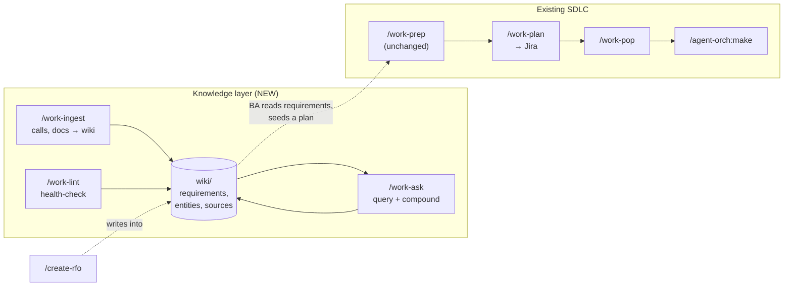

# Feature Proposal: Team-Work Wiki (LLM-maintained SDLC Knowledge Base)

**Author:** AI Governance Team
**Date:** 2026-06-04
**Status:** Draft - Pending Human Review
**Target plugin:** `team-work`
**Companion skills (existing):** `/work-prep`, `/work-plan`, `/work-pop`, `/groom`, `/create-rfo` (agent-orch)

---

## Problem Statement

Business analysts, project leads, and delivery teams spend their day in calls and receiving documents from clients: requirement walkthroughs, discovery calls, incident postmortems, change requests, contract addenda. Today that knowledge has two failure modes in our tooling:

1. **It evaporates.** Notes live in someone's head, a Slack thread, or a one-off transcript. Nothing accumulates.
2. **It gets flattened.** `/work-prep` is excellent at turning a *single* transcript into a *single* `planning/<slug>.md` plan and a review PR. But it is **planning-centric and one-shot**. It does not maintain *requirements* as living documents, it does not track *entities* (clients, systems, people), it does not accumulate *decisions* or *incidents* into a compounding, cross-referenced corpus. A second `/work-prep` run does not enrich the first — it starts a new plan.

This is the classic RAG-vs-wiki gap described in the "LLM Wiki" pattern: most LLM+document workflows re-derive knowledge from raw sources on every query. Nothing is built up. Ask a question that spans five calls and the model re-discovers the answer from scratch every time.

What a BA actually needs is a **persistent, compounding knowledge repository** that sits between raw sources (calls, docs) and the downstream SDLC (`/work-prep` → `/work-plan` → `/work-pop` → `/make`). The repository should be the *source of truth for what needs to be built and why*, with a full audit trail back to the originating call or document — so when a question arises you can trace a requirement back to "who was on that call, what did they say, when."

---

## Solution: A `wiki/` layer + four new `team-work` skills

Adopt the LLM Wiki pattern as a first-class SDLC layer in the `team-work` plugin. The LLM does all the bookkeeping (summarizing, cross-referencing, filing, lint); the human curates sources, directs analysis, and asks questions.

### Design Principles

- **The wiki is a compounding artifact, not a query cache.** Ingest *integrates* new sources into existing pages (requirements, entities, concepts), flags contradictions, and revises synthesis. Knowledge is compiled once and kept current.
- **Sources are immutable and categorized with a full audit trail.** Every ingested source is saved verbatim into a categorized `sources/` tree (by type → sub-type → date). Generated wiki pages **cite the source file**, so any claim traces back to the originating call/document — including attendees, date, and speaker attribution — enabling follow-up.
- **Leave `/work-prep` untouched.** The wiki is a parallel, upstream track. `/work-prep` continues to work transcript-only for teams that want lightweight planning. The wiki is the heavier, persistent option that *feeds* planning. (No competing edits to an existing, working skill.)
- **Configurable location per-invocation.** The wiki root is not hardcoded. Each skill accepts/asks for a path (in-repo `wiki/`, a sibling knowledge repo, or any directory), so a BA can keep one cross-project wiki or one per engagement.
- **Search from day one (qmd).** Wire [`qmd`](https://github.com/tobi/qmd) (on-device hybrid BM25/vector + LLM re-rank, CLI + MCP) into query/lint from the start, with `index.md` as the always-present fallback.
- **The LLM writes the wiki; the human reads it.** Skills are wizards, not wall-of-text dumps. Obsidian-compatible markdown (wikilinks, frontmatter) so the human can browse in Obsidian while the agent edits.

### The three LLM Wiki operations, as skills

| New skill | LLM Wiki op | What it does |
|---|---|---|
| `/team-work:work-wiki` | (init) | Bootstrap a wiki at a chosen path: `CLAUDE.md` schema, `index.md`, `log.md`, `sources/` + page directories, optional qmd index. Idempotent — re-run to repair/upgrade. |
| `/team-work:work-ingest` | **Ingest** | The BA's primary tool. Take a transcript/doc → save it categorized into `sources/` (audit trail) → extract & integrate into requirement/entity/concept/decision/incident pages → update `index.md` + `log.md` → re-index qmd. |
| `/team-work:work-ask` | **Query** | Ask a question against the wiki (qmd search → read pages → synthesize cited answer). Offer to file good answers back as new wiki pages so explorations compound. |
| `/team-work:work-lint` | **Lint** | Health-check: contradictions, stale claims, orphan pages, requirements lacking their own page, missing cross-refs, source gaps. Suggests next questions/sources. |

---

## Architecture

### Wiki directory layout

The wiki root is configurable; this is the canonical structure created inside it:

```
<wiki-root>/
  CLAUDE.md              # "schema": conventions + ingest/query/lint workflows for the agent
  index.md               # content catalog — every page, one-line summary, by category
  log.md                 # append-only chronological record (## [YYYY-MM-DD] ingest|query|lint | title)
  .qmd/                  # qmd search index (gitignored or committed, configurable)

  sources/               # IMMUTABLE, categorized — the audit trail
    transcripts/
      <client-or-project>/
        2026-06-04-discovery-call-acme-billing.md   # verbatim transcript
        2026-06-11-requirements-walkthrough-acme.md
    requirements-docs/
      <client-or-project>/
        acme-rfp-v2.pdf
        acme-data-dictionary.xlsx.md
    incidents/
      2026-05-22-prod-outage-billing.md             # postmortem transcript
    emails/
    misc/
    assets/                                          # downloaded images (Obsidian-style)

  requirements/          # GENERATED, compounding — functional + NFR pages
    billing-invoice-generation.md
    sso-authentication.md
  entities/              # clients, systems, people, products
    acme-corp.md
    billing-service.md
  concepts/              # domain glossary
  decisions/             # ADR-style decision pages
  incidents/             # generated postmortem/RFO synthesis (feeds /create-rfo)
  plans/                 # thin pages linking a planning/<slug>.md back to its requirements
```

### Source categorization & audit trail (per user requirement)

On ingest, the agent first **classifies the source type** (transcript / requirements-doc / incident / email / misc) and files the verbatim original under the matching `sources/<type>/<client-or-project>/<YYYY-MM-DD>-<slug>.<ext>`. It then extracts:

- **Attendees / participants** (for calls) and **speaker attribution** per claim
- **Date** and source provenance

Every generated page records, per claim, a citation block linking back to the source file and the speaker/date, e.g.:

```markdown
## Invoice generation must support multi-currency

> Source: [[sources/transcripts/acme/2026-06-04-discovery-call-acme-billing]] — Maria Chen, 00:42:18
> Status: confirmed requirement

Acme requires invoices rendered in the customer's billing currency...
```

This is what lets a BA, months later, ask "why did we commit to multi-currency?" and jump straight to the call, the attendee list, and the timestamp to follow up.

### Where the wiki sits in the SDLC (before `/make`)



The wiki does not *replace* `/work-prep`; it *front-runs* it. A BA accumulates knowledge over many calls in the wiki, then when a body of work is ready, uses the requirement pages to seed a `/work-prep` planning session. `/create-rfo` (already producing `incidents/request-for-outages/rfo-NNN.md`) gains an optional flag to also file its synthesis into `wiki/incidents/`.

---

## Skill specifications

### `/team-work:work-wiki` (init / repair)

- **Args:** optional `[path]`. If omitted, ask: in-repo `wiki/`, a sibling repo, or a custom path. Persist the chosen path to `.team-work/wiki-config.md` so other skills default to it.
- **Behavior:** create the directory structure + a `CLAUDE.md` schema (the agent's operating manual for this wiki), `index.md`, `log.md`. Detect & install/justify qmd (offer CLI install instructions; degrade gracefully to index-only if absent). Idempotent: re-running repairs missing pieces and upgrades the schema.
- **Output:** a ready wiki + a short "how to use" summary pointing at `/work-ingest`.

### `/team-work:work-ingest` (the core BA tool)

1. Resolve wiki root (config → arg → ask).
2. Accept a source: pasted transcript, a file path, or a URL/doc. **Classify** its type.
3. **Save verbatim** into `sources/<type>/<client>/<date>-<slug>` (audit trail). Extract attendees, date, speaker attribution.
4. Discuss key takeaways with the user (wizard, not a dump).
5. **Integrate**: create/update requirement, entity, concept, decision, incident pages — each new claim carries a source citation. Flag contradictions with existing pages.
6. Update `index.md` and append to `log.md`. Re-index qmd.
7. Summarize: "Touched N pages, M new, K contradictions flagged. Source archived at `sources/...`."

### `/team-work:work-ask` (query + compound)

1. Resolve wiki root.
2. qmd hybrid search (fallback: read `index.md`, drill into pages).
3. Synthesize a **cited** answer (page + source provenance).
4. Offer to file the answer back as a new wiki page (comparison, analysis, synthesis) so explorations compound. Output forms: markdown page, comparison table, optionally a deck/chart on request.

### `/team-work:work-lint` (health-check)

Scan for: contradictions between pages, stale claims superseded by newer sources, orphan pages (no inbound links), requirements mentioned but lacking a page, missing cross-references, source gaps fillable by web search. Produce a prioritized punch list and suggested next questions/sources. Read-only by default; offer to apply fixes.

### Touches to existing skills (additive only)

- **`/create-rfo`** (agent-orch): optional `--wiki <path>` to also write synthesis into `wiki/incidents/` and cite the postmortem transcript saved under `sources/incidents/`. No change to default behavior.
- **`/work-prep`**: *unchanged* per decision. (A future, separate proposal could let `/work-prep` optionally seed from `wiki/requirements/`, but that is out of scope here.)

---

## Dependencies

- **qmd** — on-device markdown search (BM25/vector hybrid + LLM re-rank). CLI for shell-out, MCP server for native tool use. Document install in README + a prerequisites note; skills degrade to `index.md`-only if qmd is missing.
- **gh CLI** — only if a skill opens a PR for wiki changes (optional; wiki edits can be local).
- No new runtime services. The wiki is just a git repo of markdown.

---

## Documentation & release work (in scope for the build)

- **README.md** (team-work): add the four skills, the wiki layer, the SDLC diagram, qmd prerequisite.
- **plugin.json** (team-work): bump version, update description with the new skills.
- **.claude-plugin/marketplace.json** (root): bump team-work entry version + description; bump marketplace `version`.
- **CHEAT-SHEET.md / docs**: per CLAUDE.md sync rules, reflect new skills.
- **Blog post** in `docs/blog/`: `blog-team-work-<new-version>.md` — "An LLM-maintained wiki for the SDLC: from client calls to requirements to `/make`", following the style of existing `blog-team-work-0.1.0.md`.
- **CHANGELOG.md**: entry for the new version.

---

## Resolved Decisions

- [x] **Version target:** minor bump `0.11.0 → 0.12.0` for team-work, given four new skills.
- [x] **`.qmd/` index:** **gitignored** — it is derived from the markdown and rebuilt on demand.
- [x] **Wiki-config storage:** **repo-level** `.team-work/wiki-config.md` in the working repo (not user-level). This file records the chosen wiki root path AND the ingest commit preference (below).
- [x] **`/work-ingest` PR vs. local:** **ask the user the first time and store the answer for the whole repo** in `.team-work/wiki-config.md` (e.g., `ingest_mode: pr` or `ingest_mode: local`). On subsequent runs, honor the stored preference without re-asking. Teams that want a review gate pick `pr`; solo/fast workflows pick `local`.
- [x] **PDF/image handling:** **convert-to-markdown shim now** (not deferred). On ingest of a non-markdown source (PDF, xlsx, docx), convert to markdown for the wiki body while preserving the original binary verbatim under `sources/`. Use available tooling (pandoc/textutil/markitdown-style shim) with a graceful fallback + warning if no converter is present.

---

## Why this works

The tedious part of a knowledge base is not the reading or thinking — it's the bookkeeping: updating cross-references, keeping summaries current, noting when a new call contradicts an old requirement, maintaining consistency across dozens of pages. Humans abandon wikis because maintenance outpaces value. The LLM doesn't get bored and can touch 15 files in one pass. The BA curates sources, directs analysis, and asks good questions; the agent does everything else — and every requirement keeps a thread back to the call it came from.
