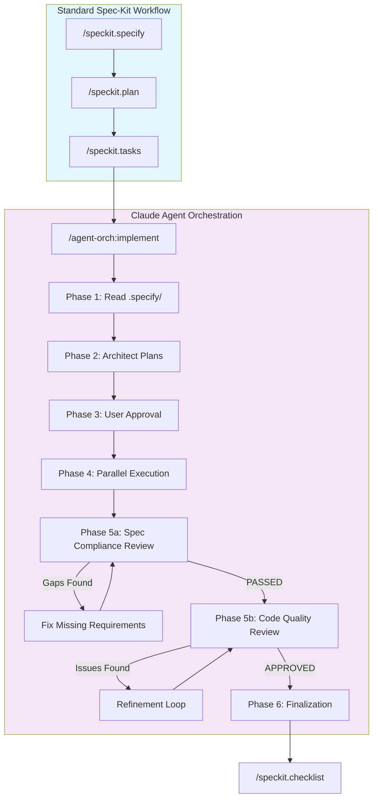
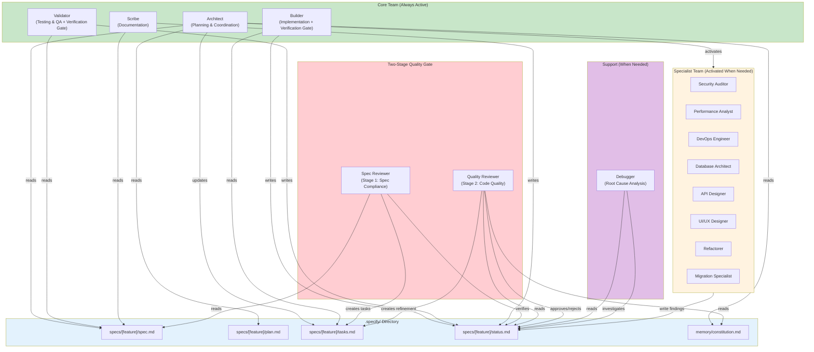

# Claude Agent Orchestration

Multi-agent orchestration plugin for Claude Code. Works **with or without** [GitHub spec-kit](https://github.com/github/spec-kit). Provides 25 specialized agents that work in parallel with Jira-driven work queues, [human-on-the-loop](https://martinfowler.com/articles/exploring-gen-ai/humans-and-agents.html) governance, two-stage code review, verification gates, and systematic debugging.

## What This Does

This plugin provides **25 specialized agents** that can work in parallel on implementation tasks:

- **4 Core Agents** - Architect, Builder (with verification gate), Validator (with verification gate), Scribe
- **2 Review Agents** - Two-stage quality gate (Spec Compliance → Code Quality)
- **1 Support Agent** - Systematic Debugger (root cause analysis)
- **18 Specialist Agents** - Security, Performance, DevOps, Telemetry, Database, API, UI/UX, Refactorer, Migration, C4 Scribe, Data Engineer, ML Engineer, Observability, Incident Responder, Legacy Modernizer, Content Specialist, Advocate, Jira Triage

### Two Modes of Operation

| Mode | Skill | Requirements |
|------|-------|--------------|
| **Spec-Kit Mode** | `/agent-orch:implement` | Requires `.specify/` directory |
| **Standalone Mode** | `/agent-orch:build` | No spec-kit needed - conversation-based |

---

## Workflow Overview



---

## Agent Architecture



---

## The 25 Agents

### Core Team (Always Active)

| Agent | Role | What It Does |
|-------|------|--------------|
| **Architect** | Planning & Coordination | Reads `specs/` and `.specify/memory/`, analyses codebase patterns, assigns tasks to other agents, selects which specialists to activate, resolves design conflicts, acts as decision-maker |
| **Builder** | Implementation | Implements features according to the specification, follows codebase patterns, updates progress in `tasks.md` and `status.md`. **Includes verification gate** - must provide evidence before marking tasks complete |
| **Validator** | Testing & QA | Writes tests based on spec requirements, validates implementation against `specs/`, reports spec compliance issues, ensures edge cases are covered. **Includes verification gate** - must show actual test output |
| **Scribe** | Documentation | Documents completed features, creates usage examples, updates `.specify/` when implementation deviates (with Architect approval), maintains API documentation |

### Review Team (Two-Stage Quality Gate)

| Agent | Role | What It Does |
|-------|------|--------------|
| **Spec Reviewer** | Stage 1: Spec Compliance | Verifies implementation matches spec **exactly** - nothing more, nothing less. Distrusts implementer claims, requires independent code verification. Must PASS before Stage 2 can begin |
| **Quality Reviewer** | Stage 2: Code Quality | Reviews code against constitution for patterns, consistency, test coverage, documentation. Only runs after Stage 1 passes. Has authority to request refinements |

### Support Team (When Needed)

| Agent | Role | What It Does |
|-------|------|--------------|
| **Debugger** | Systematic Problem Solving | Launched when tests fail or issues persist. Uses 4-phase methodology: Root Cause Investigation → Pattern Analysis → Hypothesis Testing → Implementation. **NO FIXES WITHOUT ROOT CAUSE**. Stops after 3 failed attempts for architectural review |

### Specialist Agents (Activated When Relevant)

| Agent | Role | What It Does | Activated When |
|-------|------|--------------|----------------|
| **Security Auditor** | Vulnerability Review | Reviews code for OWASP Top 10 vulnerabilities, checks authentication/authorization, validates input handling, identifies injection risks, verifies secure session management | Auth code, user input, API endpoints, sensitive data handling |
| **Performance Analyst** | Optimization | Identifies N+1 queries, detects bottlenecks, finds memory leaks, recommends caching strategies, analyses loop efficiency, checks for blocking operations | Database queries, loops/iterations, caching opportunities, real-time features |
| **DevOps Engineer** | Infrastructure | Creates/updates CI/CD pipelines, manages Docker configurations, handles Kubernetes manifests, documents environment variables, ensures deployment readiness | New services, env var changes, Docker/K8s updates, CI/CD modifications |
| **Database Architect** | Data Layer | Designs database schemas, creates migration scripts, optimizes queries, recommends indexes, plans data backfill strategies, ensures rollback safety | Schema changes, new tables/columns, migrations, query optimization |
| **API Designer** | Contract Design | Designs RESTful endpoints, creates OpenAPI/Swagger specs, ensures API consistency, defines request/response schemas, documents error codes | New API endpoints, API modifications, contract changes |
| **UI/UX Designer** | Frontend & Design System | Ensures design system component usage, validates accessibility (WCAG 2.1 AA), checks design token compliance, reviews component library usage, verifies layout patterns (Stack, Cluster), validates no hardcoded styles | React/frontend components, UI implementation, design system usage, accessibility requirements |
| **Refactorer** | Code Quality | Identifies code smells, flags technical debt, suggests extraction opportunities, recommends pattern improvements, assesses safe refactoring scope | Modifying existing/legacy code, complex functions, code duplication |
| **Migration Specialist** | Upgrades & Compatibility | Plans migration paths, ensures backward compatibility, designs deprecation strategies, creates upgrade guides, defines rollback procedures | Framework upgrades, breaking changes, major version bumps, data format changes |
| **Telemetry Engineer** | Observability | Sets up OTel Collector, Docker Compose observability stack (Prometheus, Loki, Tempo, Grafana), Grafana dashboards, application instrumentation, env-var-based config for local/cloud portability | Observability, monitoring, tracing, metrics, logging, dashboards |
| **C4 Scribe** | Architecture Docs | Creates and maintains C4 model documentation (System Context, Container, Component diagrams) using Mermaid in `docs/c4/` with navigation | Architecture changes, new services, system boundary changes |

---

## Installation

```bash
git clone https://github.com/YOUR_USERNAME/claude-agent-orchestration-plugin.git
cd claude-agent-orchestration-plugin
./install.sh
```

## Usage

```bash
# Use with your existing spec-kit project
cd your-project          # Has .specify/ directory

# Standard spec-kit workflow (unchanged)
claude
> /speckit.specify       # Write specification
> /speckit.plan          # Create plan
> /speckit.tasks         # Generate tasks

# Enhanced implementation with multi-agent orchestration
> /agent-orch:implement
```

## Uninstallation

```bash
cd claude-agent-orchestration-plugin
./uninstall.sh
```

Or manually: `rm -rf ~/.claude/plugins/local/orchestrate`

---

## Skills

### Implementation Skills

| Skill | Description |
|-------|-------------|
| `/agent-orch:implement [feat\|JIRA-ID]` | Multi-agent implementation (auto-detects `.specify/` or pulls from Jira) |
| `/agent-orch:build [desc\|JIRA-ID]` | **Standalone mode** - Gathers requirements through conversation or pulls from Jira |
| `/agent-orch:analyse` | Multi-agent codebase analysis |
| `/agent-orch:olly` | Add OpenTelemetry observability (greenfield or migrate from vendor SDKs) |
| `/agent-orch:c4` | Generate [C4 model](https://c4model.com/) architecture documentation (`docs/c4/`) for entire codebase |

### Jira Skills

| Skill | Description |
|-------|-------------|
| `/agent-orch:jira-work` | Jira-driven work queue: browse agent-ready issues, triage backlogs, pick up work |
| `/agent-orch:jira` | Discover and cache Jira project metadata for fast MCP calls |

### Setup Skills

| Skill | Description |
|-------|-------------|
| `/agent-orch:setup-claude-md` | Review and configure `CLAUDE.md` for standalone mode |
| `/agent-orch:setup-constitution` | Review and configure `.specify/memory/constitution.md` for spec-kit mode |

---

## Getting Started

### Before Using Agent Orchestration

The agents need configuration files to understand your project standards:

| Mode | Configuration File | Setup Skill |
|------|-------------------|-------------|
| **Standalone** (`/agent-orch:build`) | `CLAUDE.md` in project root | `/agent-orch:setup-claude-md` |
| **Spec-kit** (`/agent-orch:implement`) | `.specify/memory/constitution.md` | `/agent-orch:setup-constitution` |

**Quick Start:**

```bash
# For standalone mode (no spec-kit)
claude
> /agent-orch:setup-claude-md    # Configure CLAUDE.md
> /agent-orch:build              # Start implementation

# For spec-kit mode
claude
> /agent-orch:setup-constitution # Configure constitution.md
> /agent-orch:implement          # Start implementation
```

### Template Files

Example templates are provided in `examples/`:

| File | Description |
|------|-------------|
| `CLAUDE.md.template` | Complete template for standalone mode |
| `constitution.md.template` | Complete template for spec-kit mode |
| `EXAMPLE_WORKFLOW.md` | Step-by-step usage example |

Copy these to your project and customize for your tech stack.

---

## How It Works

1. You run `/agent-orch:implement` (auto-detects feature from `specs/`)
2. **Architect** reads `specs/` and analyses the task
3. **Architect** updates `tasks.md` with agent assignments
4. **Architect** recommends which specialists to activate based on the task
5. You review and approve the plan + specialist selection
6. **All approved agents launch in parallel** (core team + selected specialists)
7. Agents read from and write to `.specify/` (native spec-kit structure)
8. Progress tracked in `specs/[feature]/status.md`
9. **Two-stage code review**: Spec Compliance (Stage 1) → Code Quality (Stage 2)
10. Final summary with all changes made

---

## Spec-Kit Native Integration

```
.specify/
├── memory/
│   └── constitution.md    # Agents read: project standards
├── specs/[feature]/
│   ├── spec.md            # Agents read: requirements (from /speckit.specify)
│   ├── plan.md            # Agents read: approach (from /speckit.plan)
│   ├── tasks.md           # Agents update: assignments & checkboxes
│   └── status.md          # Agents update: progress, findings, issues
└── orchestration/
    └── [feature]/
        └── agents.md      # Created if needed: specialist coordination
```

**No separate tracking files** - everything stays in spec-kit's native structure.

---

## UI/UX Designer: Component Library Configuration

The UI/UX Designer agent requires configuration to work with your design system. Add the following to your `.specify/memory/constitution.md`:

### Required Configuration

```markdown
## Component Library

### Paths (Required)
COMPONENT_LIBRARY_ROOT: /path/to/your/Component-Library
DOCS_ROOT: ${COMPONENT_LIBRARY_ROOT}/packages/ui-docs/src

### Optional Paths
PACKAGE_DOCS: ${DOCS_ROOT}/<package-name>
COMPONENT_DOCS: ${DOCS_ROOT}/<package-name>/<ComponentName>/<ComponentName>.mdx
COMPONENT_STORIES: ${DOCS_ROOT}/<package-name>/<ComponentName>/<ComponentName>.stories.tsx
MATERIALS: ${DOCS_ROOT}/materials
```

### Package Structure

```markdown
### Core Packages
| Package | Purpose |
|---------|---------|
| @org/bsds-core | Button, Spinner, Layout, Stack, Cluster |
| @org/bsds-forms | Form controls and validation |
| @org/bsds-icons | Icon system |

### UI Pattern Packages
| Package | Purpose |
|---------|---------|
| @org/ui-modal | Modal dialogs |
| @org/ui-toast | Toast notifications |
| @org/ui-drawer | Slide-out panels |
```

---

## Agent Summary

| # | Agent | Type | Focus |
|---|-------|------|-------|
| 1 | Architect | Core | Planning, coordination, decisions |
| 2 | Builder | Core | Implementation (with verification gate) |
| 3 | Validator | Core | Testing, QA (with verification gate) |
| 4 | Scribe | Core | Documentation |
| 5 | Spec Reviewer | Review | Stage 1: Spec compliance verification |
| 6 | Quality Reviewer | Review | Stage 2: Code quality, constitution compliance |
| 7 | Debugger | Support | Systematic root cause analysis |
| 8 | Security Auditor | Specialist | OWASP, vulnerabilities, auth |
| 9 | Performance Analyst | Specialist | N+1 queries, bottlenecks, optimization |
| 10 | DevOps Engineer | Specialist | CI/CD, Docker, K8s, deployment |
| 11 | Database Architect | Specialist | Schema, migrations, queries |
| 12 | API Designer | Specialist | REST/GraphQL design, OpenAPI |
| 13 | UI/UX Designer | Specialist | Design system, accessibility, component library |
| 14 | Refactorer | Specialist | Code smells, technical debt |
| 15 | Migration Specialist | Specialist | Upgrades, breaking changes, compatibility |
| 16 | Telemetry Engineer | Specialist | Observability, OTel, Docker Compose stack, Grafana dashboards |
| 17 | C4 Scribe | Specialist | C4 model architecture documentation, Mermaid diagrams |

---

## License

MIT
