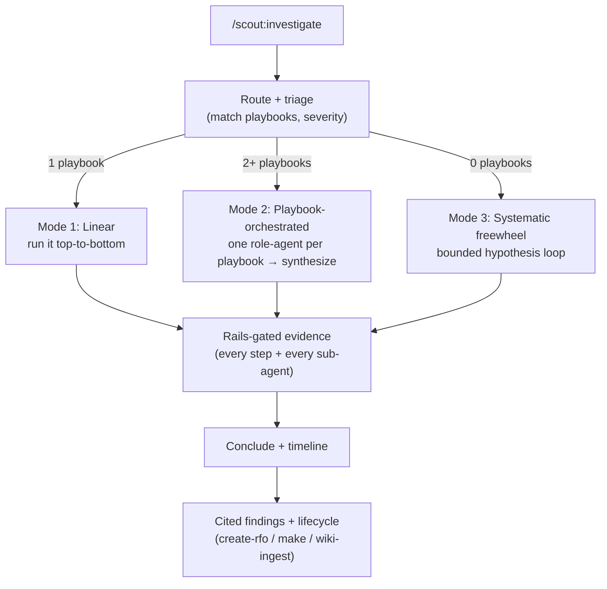

# Scout Architecture

How Scout is put together, and how to extend it. This is an evergreen reference for
contributors and playbook authors — not a build plan.

> **Looking for the detailed, leveled docs?** This file is the concise single-page overview. The
> [`architecture/`](./architecture/README.md) directory expands it into a C4-inspired set with rich
> mermaid diagrams: [system context](./architecture/01-system-context.md),
> [components](./architecture/02-components.md), the [playbook model](./architecture/03-playbook-model.md),
> [investigation flow](./architecture/04-investigation-flow.md),
> [security and rails](./architecture/05-security-and-rails.md),
> [integrations](./architecture/06-integrations.md),
> [lifecycle and the flywheel](./architecture/07-lifecycle-and-flywheel.md), and
> [design decisions](./architecture/08-design-decisions.md).

## The one idea

Scout separates **who authors** from **who consumes**, and **knowledge** from **delivery**. A
developer captures a support investigation once, as a declarative **playbook** (in the repo,
no code), and the framework *projects* it onto whichever delivery surface a repository
supports. The same playbook then serves any audience: a developer in Claude Code with full
evidence, or a business user — who has no repo access — running a scoped, redacted version
from the app's own AI chat. You never write an investigation twice for different surfaces.

```
             author / harvest                    project
  knowledge ─────────────────▶  playbook  ──────────────────▶  Claude Code skill
  (a person, or existing docs)  (one YAML)  (per repo caps)      MCP tool
                                                                 existing AI chat
                                                                 guided-human runbook
```

## Components

| Component | Location | Responsibility |
|-----------|----------|----------------|
| **Playbook schema** | `schema/playbook.schema.md` (spec), `schema/playbook.schema.json` (validation) | The declarative contract every playbook conforms to. The stable core everything else depends on. |
| **Playbook store** | a repo's `.claude/scout/playbooks/` | Where authored/harvested playbooks live in a target repo. |
| **Capability Manifest** | a repo's `.claude/scout/capability-manifest.md` | Binds abstract capability names used by playbooks to the repo's real endpoints/queries/commands + auth env vars, and maps audience tiers onto the repo's roles. Written by `/scout:setup`. |
| **Playbook INDEX** | a repo's `.claude/scout/playbooks/INDEX.md` (schema: `schema/index.schema.md`) | The per-repo routing backbone — a minimal list mapping natural-language triggers to a playbook id + `kind` + path. `/scout:author` + `/scout:harvest` append an entry on every write; `/scout:investigate` and `/scout:runbook` read it FIRST to route (filtered by `kind`); `/scout:lint` reconciles it against the store. |
| **Rails engine** | `rails/RAILS.md` (spec), `rails/check.py` (reference checker) | The enforced decision + redaction engine every executable step passes through. Consumed by `/scout:investigate` and `/scout:runbook`, never bypassed. |
| **Skills** | `skills/*/SKILL.md` | The seven verbs: `setup`, `author`, `harvest`, `investigate`, `runbook` (natural-language runner for `kind: procedure` playbooks), `explain` (read-only how-does-X-work, wiki-delegating), `lint` (read-only playbook health check). |
| **Findings / run artifact** | a repo's `.claude/scout/findings/` (investigate) and `.claude/scout/runs/` (runbook) | The cited, redacted markdown doc every `/scout:investigate` (findings) or `/scout:runbook` (run) emits — attachable to a ticket; ingestible into a team-work wiki. |

## Who authors vs. who consumes

Two different populations, kept deliberately distinct:

- **Authoring + setup happen in the repo, so authors have repo access** — developers, or
  support engineers embedded with the team. `/scout:setup`, `/scout:author`, and
  `/scout:harvest` are developer-facing. Authoring is declarative (no code), but it is *not*
  a business-user activity.
- **Consuming an investigation is open to any audience** — a developer in Claude Code, a
  support engineer, or a business user in the app's AI chat who has no repo access at all. The
  playbook's `audience` tiers plus the Capability Manifest's role map decide what each caller
  may run and see; business-tier output is scoped and redacted.

## Delivery surfaces

One playbook projects to whatever the repo supports (discovered by `/scout:setup`):

| Surface | Who reaches it | Notes |
|---------|----------------|-------|
| Claude Code skill | developers/support | guide-a-human, or call-API-with-the-operator's-own-env-creds |
| App MCP server | the app's agents/tools | Scout registers scoped read tools alongside the repo's existing MCP |
| App AI chat | business users | scouting runs inside the app's own chat so it enriches the chat's decisions, not just Claude Code |
| Guided-human runbook | anyone | universal fallback when no programmatic surface exists |

Wiring into the app's existing chat/MCP is what lets Scout *drive scouting from inside the
application* — the chat gains investigation ability without the team rebuilding it.

## Complement, never replace

Scout wraps what a team already has rather than supplanting it:

- **Existing skills** — a `skill-call` step invokes a team's current investigators
  (`investigate-sentry`, custom or tool-specific skills) and folds their output in as
  evidence. `/scout:setup` records which skills a repo has; a call to a missing skill is inert.
- **Existing runbooks/docs** — `/scout:harvest` drafts playbooks from them.
- **Fix on the spot** — when `/scout:investigate` surfaces a bug, hand off to `/agent-orch:make`
  to branch, fix, and open a PR without leaving the flow.
- **Existing knowledge wiki** — see the wiki section below.

## Why capability indirection matters

A playbook step never names a concrete endpoint. It names a **capability** (e.g.
`run-status`, `fetch-inventory`). The Capability Manifest — produced per repo by
`/scout:setup` — maps that name to the repo's actual API/query/command and the env var that
authenticates it. Consequences:

- **Portability:** the same playbook runs against any repo that provides the named
  capability; a repo that doesn't provide it renders the playbook *inert*, not broken.
- **Secret safety:** the manifest references an env var name; the value is used to connect but
  is never read into the model or echoed into output.
- **Governance inheritance:** the manifest maps Scout's tiers (developer/support/business/
  admin) onto the repo's own roles, so Scout enforces the repo's existing access model rather
  than inventing one.

## The investigation toolbox (v0.4) — ambient shared capabilities

Every investigation needs the same base toolset — application logs, a read-only database query,
traces, an investigation MCP. Rather than re-declaring each capability in every playbook, a repo
declares them once in the manifest's **optional `investigation_toolbox[]`** section (canonical
tools: `app-logs`, `db-read`, `traces`, `mcp`, `other`). These tools are **ambient** — implicitly
available to every investigation and every step/agent **without re-declaration** (`ambient: true`)
— yet still explicitly nameable. The rails resolve a `request.capability` against
`capabilities[] ∪ investigation_toolbox[]` (capabilities-first, so a declared name wins on
collision), and **every ambient use still passes the identical gates and emits a DecisionRecord**
(`resolved_from` distinguishes it) — ambient changes *discovery, never authority*. `db-read` is a
**named allowlisted proc** (never free-form SQL), closing the "root-cause needed a DB read the
playbook never declared" gap. The section is optional and additive: a repo without it behaves
exactly as v0.3, and the playbook `apiVersion` stays `scout/v0.3`. See
[architecture/02](./architecture/02-components.md) and [05](./architecture/05-security-and-rails.md).

## Playbook classes, one routing backbone

A playbook declares `metadata.kind`: **`investigation`** (the default — diagnose a symptom to a
confidence-gated verdict, run by `/scout:investigate`), **`procedure`** (an ordered operational
runbook — promote a build, sync secrets, refresh a cache, run terraform — run by `/scout:runbook`),
or **`toolbox`** (v0.4 — how to USE/interpret a specific tool; lives in the store's `toolbox/`
subdir and is **composed as a sub-procedure**, never symptom-routed). All share the SAME document
shape, the SAME rails, and the SAME redaction; the kind only changes which runner routes to a
playbook and how its steps are gated (a procedure's mutating steps are `needs-approval` minimum with
preview + confirm; see RAILS.md §10).

Both runners route by **natural language** through the per-repo **INDEX** (`.claude/scout/playbooks/
INDEX.md`, [`schema/index.schema.md`](./schema/index.schema.md)): a minimal list mapping trigger
keywords/`when_to_use` to a playbook id + `kind` + path. A runner reads the INDEX FIRST, filters to
its own `kind` (`investigate` → `investigation`, `runbook` → `procedure`), matches, then opens only
the matched playbook(s) — so routing stays cheap at scale and users never memorize ids. `/scout:author`
and `/scout:harvest` append an INDEX entry on every write; `/scout:lint` reconciles it against the
store; absent an INDEX, a runner falls back to scanning the store. Route, don't duplicate — the
INDEX carries no executable or safety-relevant detail; on any conflict the playbook file wins.

## The safety model (enforced, not advisory)

- Every executable step carries `safety: read-only | needs-approval | forbidden`. The schema
  *requires* it (an executable step without it fails validation).
- `query` and `diagnostic-query` steps may only reference an allowlisted parameterized query /
  stored proc. Free-form queries against a production store are `forbidden` by definition. Under
  the v0.3 gate reordering (**G9**), capability resolution runs *before* the free-form check, so
  an **unmapped** query degrades gracefully to `inert` while only a **mapped-but-free-form**
  binding is `reject`ed.
- `redaction` is mandatory and defaults to `safe` (redact anything not explicitly allowed for
  the caller's tier). No output reaches any surface un-redacted. In v0.3 (**G10**) matching is
  normalized/token-boundary aware and a set of **built-in credential patterns** (`redaction.builtins`,
  default on) blocks credential-shaped fields regardless of author wording — closing the
  plural/singular leak class.
- Conclusions carry a `confidence` (`confirmed | likely | unknown`); a lower-privilege surface
  may never present a conclusion at higher confidence than authored. In v0.3 (**G2**) the rails
  record each step's **`resolved_env`** on its DecisionRecord, and a **data-gap verdict cannot be
  presented at `confirmed` unless the load-bearing capability resolved to the environment that owns
  the data** (else it downgrades to `likely — verify`) — you cannot confirm "no data exists" from a
  non-owning env. In v0.4 (**RAILS.md §6.2**) a **liveness guardrail** extends this: a conclusion
  resting on a load-bearing step whose output came back **empty/no-op** is likewise capped at
  `likely — verify` — you cannot "confirm" from a source that returned nothing (recommend a trace
  tool whose spans no-op, or declare "no data" when a query silently hit an empty source). It is
  downgrade-only. A **guardrail preflight** catches these cheaply *before* live data — three static
  checks (would-run-inert / would-reject-free-form / confirmed-can't-reach-owning-env) at
  author-time (`/scout:author`), in `/scout:lint`, and in `/scout:investigate --dry-run` — with the
  §6.2 liveness rule as the fourth, runtime-only layer.

## How to add a playbook

1. Read `schema/playbook.schema.md` (the normative spec).
2. Write a YAML file that validates against `schema/playbook.schema.json`. Start from
   `playbooks/examples/file-fetch-miss.playbook.yaml`.
3. Give it specific `metadata.triggers` (keywords/signals) so the router selects it without
   colliding with other playbooks, and set `metadata.kind` (`investigation` — the default —
   `procedure`, or `toolbox`). `/scout:author` and `/scout:harvest` append the matching INDEX entry
   for you.
4. Classify every executable step's `safety`, declare `redaction`, and tag each conclusion's
   `confidence`.
5. Reference **capability names** for anything that reads data — do not hardcode endpoints.
   `/scout:setup` maps those names to the target repo.

You do not need to touch plugin code to add a playbook. Authoring is data, not code — that is
the point.

## Investigation flow

`/scout:investigate <ticket|run-id|free-text>` composes the whole thing into one loop. Effort
scales with the incident — the number of matching playbooks (and severity) picks the mode:



1. **Route + triage** — read the **INDEX first** (filtered to `kind: investigation`), match the
   intake against entries' keywords/`when_to_use`, then open the matched playbook(s) to confirm
   against `metadata.triggers` (signals > specific keywords > tag/title); rank, **count the
   materially-matching set, and triage severity** (impact × urgency × scope; use
   `metadata.triggers.severity_hint` when a playbook matches). A best match that is `kind: procedure`
   is redirected to `/scout:runbook`, not run here.
2. **Tier decision — pick one of three modes** (effort scales with the incident; all three share
   the SAME rails, tiers, and findings):
   - **Mode 1 — Linear** (exactly 1 playbook): run it top-to-bottom in the main thread. Unchanged.
   - **Mode 2 — Playbook-orchestrated** (2+ playbooks): a lead assigns each matching playbook to a
     **role-agent** (role from `metadata.roles`, resolved to a real agent via the manifest
     `investigators:` map), runs them in parallel (up to lead + ~5, HARD cap) writing evidence to a
     single-sink session `STATUS.md`, then synthesizes one correlated root cause + timeline.
   - **Mode 3 — Systematic freewheel** (0 playbooks): a **bounded hypothesis loop** mirroring
     `/agent-orch:bugfix` (characterize → hypothesize → gather+test via role-agents → refine/
     conclude), with six explicit stop conditions; a resolution offers to become a new playbook
     via `/scout:author` (the flywheel).
3. **Rails-gated evidence (all modes, every sub-agent)** — every executable step first goes through
   the rails decision (`allow | needs-approval | reject | inert`) and each result through the
   redaction pass. **Agents are added UNDERNEATH the rails, never around them:** every sub-agent
   tool call passes `decide()`, sub-agents are read-only by default, the tier is resolved once and
   passed down immutably (no sub-agent may upshift or collectively exceed the caller's tier), and a
   sub-agent finding is untrusted input that can never induce an ungated action. A role with no
   agent is inert. `${env.*}` values are used to connect, never surfaced. **Before any executable
   step runs, a preview shows exactly what it would do** (resolved target, params, the rails
   decision, the redaction that would apply — reflecting `decide()`, never re-deciding); it is on
   by default for business/chat and always required for `needs-approval`. A **`--dry-run`** mode
   plans the whole run and executes nothing, emitting a shareable preview/plan artifact.
4. **Conclude** — evaluate `conclusions[]` (using the optional `from_steps` evidence linkage to
   locate the load-bearing steps; Mode 2 synthesizes across legs; Mode 3 from the confirmed
   hypothesis) and present the verdict at its authored `confidence` (business tier may never
   upgrade). A **data-gap verdict is refused `confirmed` unless the load-bearing step's
   `resolved_env` is the owning environment** (G2), else it downgrades to `likely — verify`. When a
   matched playbook sets `incident.timeline: true`, maintain an append-only, redacted timeline in
   the session `STATUS.md`. `/scout:investigate` also consumes the v0.3 step primitives: step
   `emits`/`binds` data flow (read the provenance row, replay it), the blessed read-only
   `diagnostic-query` kind, a one-axis `sweep` matrix, `required_params` vs `widenable_params`
   widening, per-input-tuple fan-out, and a compare-two-capabilities delta — all as first-class
   evidence.
5. **Findings + lifecycle** — emit a cited, redacted findings artifact (per step: what ran + rails
   decision; the verdict + confidence; provenance by capability NAME; Mode 2/3 add which agents ran
   + per-agent evidence + the synthesized root cause + the timeline). Then offer next steps: a
   postmortem via `/agent-orch:create-rfo` when `incident.postmortem: create-rfo`, a
   `/agent-orch:make` handoff to fix a discovered bug, and — when a team-work wiki exists — optional
   ingest via `/team-work:work-ingest` (type: incident).

The routing + rails are **delivery-surface-agnostic**: the same logic applies whether Claude
Code (default tier `developer`), a chat, or an MCP surface calls in (RAILS.md §0).

## Knowledge-wiki integration (complementary, optional)

Scout complements the `team-work` LLM knowledge wiki when one is present, and works fully
without it (repo-agnostic).

- **Detection:** presence of `.team-work/wiki-config.md` at the repo root; read `wiki_root:`
  (and `qmd:`). Absent → Scout runs standalone.
- **Findings → wiki:** `/scout:investigate` writes a cited findings document. When a wiki
  exists, it is ingested via `/team-work:work-ingest` (as an `incident` source) so
  investigations compound into searchable institutional knowledge.
- **Explain via the wiki:** `/scout:explain` delegates retrieval to `/team-work:work-ask` when
  a wiki exists (it does not reimplement search); otherwise it falls back to reading the
  repo's `docs/`, `README`, and runbooks.
- **Harvest ↔ wiki:** `/scout:harvest` reads the same class of source docs the wiki ingests;
  when a wiki exists it can ingest those sources alongside drafting playbooks from them.

**The wiki loop (the flywheel).** Investigations compound into searchable knowledge:
`/scout:investigate` emits a cited findings doc → (when a wiki exists) it is ingested as an
`incident` via `/team-work:work-ingest` → `/scout:explain` then answers future "how does X work /
why does X break?" questions from that compounded knowledge (delegating to `/team-work:work-ask`).
Without a wiki the same loop degrades gracefully: findings stay as cited docs and `/scout:explain`
reads them + the repo's docs + the playbook store directly. `/scout:lint` keeps the *playbook*
side of that knowledge fresh — flagging stale/drifted/never-promoted playbooks before they mislead
an investigation (the playbook analogue of `/team-work:work-lint`).

Cross-plugin calls use the Skill tool, e.g. `skill: "team-work:work-ask"`,
`args: "<question> --wiki <wiki_root>"`. All such integration is guarded by detection and
degrades gracefully.

## Invariants (contributors uphold all of these)

| ID | Invariant |
|----|-----------|
| INV-1 | Repo-agnostic core. No application-specific logic in `plugins/scout/`. App specifics live in a repo's `.claude/scout/`. |
| INV-2 | Knowledge separate from delivery. One playbook → many surfaces; never author per-surface. |
| INV-3 | Authorable by non-developers. Authoring produces declarative data, not code. |
| INV-4 | Complementary, not a replacement. Wrap existing runbooks/chat/MCP/scripts/wiki. |
| INV-5 | Secrets never seen, only used. Env vars connect; never read/echoed. |
| INV-6 | No sensitive data through audited/logged channels. Redact before any surface returns output. |
| INV-7 | Safe-command contract. Every executable step is classified; free-form prod queries forbidden. |
| INV-8 | Inherit governance, don't invent it. Map tiers onto the repo's roles. |

> Building Scout itself is tracked separately in the repo's `planning/` directory. This file
> documents the product; the build plan is not part of the product.
