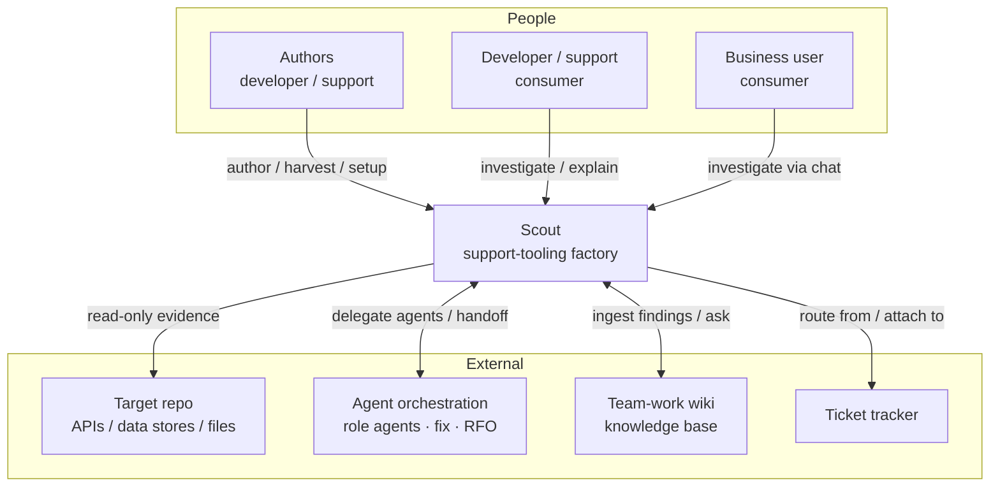

# 01 — System Context (Level 1)

Who interacts with Scout, and what external systems it touches. This is the C4 System Context
level: Scout as one box, its people, and its neighbours.

[← Index](./README.md) · [Components →](./02-components.md)

## Context diagram

## Actors — authors vs. consumers

Scout deliberately keeps two populations distinct.

- **Authors (in the repo, with repo access).** Developers, or support engineers embedded with a
  team, run `/scout:setup`, `/scout:author`, and `/scout:harvest`. Authoring is **declarative —
  no code** — but it is *not* a business-user activity; it happens where the repo lives and
  requires access to it.
- **Consumers (any audience).** Once a playbook exists, running an investigation is open to any
  audience: a developer in Claude Code with full evidence, a support engineer, or a business user
  in the app's AI chat who has no repo access at all. The playbook's `audience` tiers plus the
  manifest's role map decide what each caller may run and see; business-tier output is scoped and
  redacted.

The four canonical tiers — `developer`, `support`, `business`, `admin` — are a fixed vocabulary
that each repo maps onto its *own* roles during setup (governance is inherited, not invented).

## External systems Scout touches

| Neighbour | Relationship | Notes |
|-----------|--------------|-------|
| **Target repo** | reads its APIs, data stores, files | Only through named capabilities, read-only, with the operator's own env. Scout adds no app logic to the repo. |
| **Agent orchestration** | reuses role agents; hands off fixes and postmortems | Optional. Orchestrated investigation spawns role agents; a discovered bug hands off to a fix workflow; an incident can hand off to an RFO/postmortem workflow. |
| **Team-work wiki** | ingests findings; delegates "how does X work?" | Optional. When present, findings compound into searchable knowledge and `/scout:explain` delegates retrieval to it. |
| **Ticket tracker** | routes from a ticket; attaches findings back | Optional. A ticket id/URL can be the investigation intake; the findings doc is attachable. |

Every external relationship is **optional and degrades gracefully**. Scout's baseline surface —
the Claude Code skill — is always available, so Scout works even on a plain repo with only a
README and a couple of scripts (see [Setup in the components doc](./02-components.md)).

## Delivery surfaces

One playbook projects to whatever the repo supports (discovered during setup):

- **Claude Code skill** — developers/support; guide-a-human, or call an API with the operator's
  own env creds.
- **App MCP server** — the app's agents/tools; Scout registers scoped read tools.
- **App AI chat** — business users; scouting runs inside the app's own chat.
- **Guided-human runbook** — anyone; the universal fallback when no programmatic surface exists.

The routing and rails logic is **delivery-surface-agnostic**: the same decision is produced no
matter which surface calls in (see [05 — Security and rails](./05-security-and-rails.md)).
