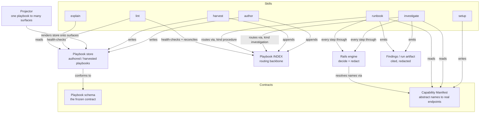
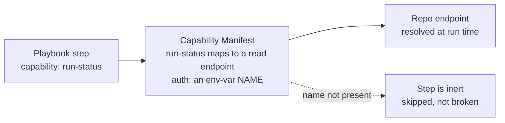

# 02 — Components (Level 2)

The internal pieces of Scout and how they relate. This is the C4 Container/Component level.

[← System context](./01-system-context.md) · [Playbook model →](./03-playbook-model.md)

## Component diagram

## Components table

| Component | Location | Responsibility |
|-----------|----------|----------------|
| **Playbook schema** | [`schema/playbook.schema.md`](../schema/playbook.schema.md) (spec), `schema/playbook.schema.json` (validation) | The declarative contract every playbook conforms to. The stable core everything else depends on. |
| **Playbook store** | a repo's `.claude/scout/playbooks/` (incl. a v0.4 `toolbox/` subdir) | Where authored/harvested playbooks live in a target repo. The `toolbox/` subdir holds `kind: toolbox` how-to-use-a-tool playbooks (see [03](./03-playbook-model.md)). |
| **Capability Manifest** | a repo's `.claude/scout/capability-manifest.md` (schema: [`capability-manifest.schema.json`](../schema/capability-manifest.schema.json)) | Binds abstract capability names to the repo's real endpoints/queries/commands + auth env-var NAMES, maps audience tiers onto the repo's roles, and lists existing skills + investigator agents. Written by setup. Also holds the optional **investigation toolbox** (below). |
| **Investigation toolbox** (v0.4) | the manifest's optional `investigation_toolbox[]` section | The **ambient shared capability layer**: a small set of common tools — canonically `app-logs`, `db-read` (a **named allowlisted proc**, the read-only DB capability that was the #1 dogfood gap), `traces`, `mcp`, and `other` — available to EVERY investigation and every step/agent WITHOUT re-declaration in a playbook (`ambient: true`). Same item shape as `capabilities[]` (one shared `$defs`); still rails-gated per use. Optional and additive: an absent section = identical v0.3 behavior. |
| **Playbook INDEX** | a repo's `.claude/scout/playbooks/INDEX.md` (schema: [`index.schema.md`](../schema/index.schema.md)) | The per-repo routing backbone: a minimal list mapping natural-language triggers → a playbook id + `kind` + path. Runners read it FIRST (filtered by `kind`); author/harvest append to it; lint reconciles it. Route, don't duplicate. |
| **Rails engine** | [`rails/RAILS.md`](../rails/RAILS.md) (spec), `rails/check.py` (reference checker) | The enforced decision + redaction engine every executable step passes through. Consumed by investigate and runbook, never bypassed. |
| **Skills** | `skills/*/SKILL.md` | The seven verbs: `setup`, `author`, `harvest`, `investigate`, `runbook`, `explain`, `lint`. |
| **Projector** | conceptual (framework behavior) | Compiles one playbook into whichever delivery surface a repo supports. Authors never write per-surface. |
| **Findings / run artifact** | a repo's `.claude/scout/findings/` (investigate) · `.claude/scout/runs/` (runbook) | The cited, redacted markdown doc every investigate (findings) or runbook (run) emits — attachable to a ticket; ingestible into a wiki. |
| **Preview / plan artifact** | a repo's `.claude/scout/previews/` | The dry-run "here is the plan, nothing executed" doc (investigate plan / runbook mutation-plan). Reflects the rails decision; contains no secret or masked value. |

## The seven skills at a glance

| Skill | Role | Reads | Writes |
|-------|------|-------|--------|
| `setup` | Probe a repo; emit the manifest; scaffold the store. Read-only probe. | repo surfaces/roles/docs | the manifest; an empty store |
| `author` | Guided wizard producing one schema-valid playbook. No code. | schema, manifest | one playbook; an INDEX entry |
| `harvest` | Auto-draft playbooks from existing runbooks/docs/targets. | source docs, schema, manifest | draft playbooks; INDEX entries |
| `investigate` | Route intake (via INDEX, `kind: investigation`) to a playbook, gather railed evidence, conclude, emit findings. | INDEX, store, manifest, rails | findings / preview |
| `runbook` | Route a natural-language operation (via INDEX, `kind: procedure`) to a procedure playbook, execute its steps in order through the rails (mutating → needs-approval + preview + confirm), verify + rollback. | INDEX, store, manifest, rails | run doc / mutation-plan preview |
| `explain` | Answer "how does X work here?" read-only; delegates to a wiki when present. | wiki / docs / store | nothing (read-only) |
| `lint` | Health-check the store + reconcile the INDEX: stale / draft / drifted / broken / INDEX drift. Read-only. | INDEX, store, manifest | nothing (read-only) |

## Capability indirection — abstract names to real endpoints

A playbook step never names a concrete endpoint. It names a **capability** (e.g. `run-status`,
`fetch-inventory`). The Capability Manifest — produced per repo by setup — maps that name to the
repo's actual API/query/command and the env-var NAME that authenticates it.

Consequences of this indirection:

- **Portability** — the same playbook runs against any repo that provides the named capability; a
  repo that doesn't provide it renders the step *inert*, not broken.
- **Secret safety** — the manifest references an env-var **NAME**; the value is used to connect
  but is never read into the model or echoed into output.
- **Governance inheritance** — the manifest maps Scout's tiers onto the repo's own roles, so
  Scout enforces the repo's existing access model rather than inventing one.

The manifest also records `production` per capability (a non-allowlisted production query is
`forbidden` by the rails), an `approval_tiers` list (who may confirm a `needs-approval` step —
never business), a `skills` list (existing investigators a `skill-call` step can reuse), and an
`investigators` role→agent map (used by orchestrated/freewheel investigation).

### The investigation toolbox — ambient shared capabilities (v0.4)

The optional `investigation_toolbox[]` section is a second source of capabilities alongside
`capabilities[]`. Its tools are **ambient**: a step or a sub-agent may USE one WITHOUT the
playbook enumerating it, so a fresh playbook reads logs / a read-only DB proc / traces without
naming those capabilities every time. Ambient changes *discovery, never authority* — the rails
resolve a `request.capability` against `capabilities[] ∪ investigation_toolbox[]`
(capabilities-first, so a declared name wins on collision), and every ambient use passes the
identical gates and emits a DecisionRecord (with `resolved_from` recording which section it came
from). `db-read` ships as the canonical toolbox tool — a **named allowlisted proc**, never
free-form SQL — closing the "root-cause needed a DB read the playbook never declared" gap. See
[05](./05-security-and-rails.md) §4.1 for resolution and gating.
