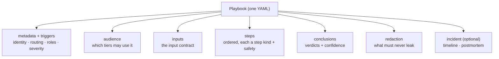
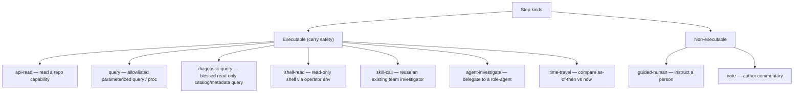

# 03 — The Playbook Model

The declarative playbook is the single artifact at the heart of Scout — one YAML file that
captures one support **investigation** OR one operational **procedure** (`metadata.kind`,
v0.3). The full normative spec is [`schema/playbook.schema.md`](../schema/playbook.schema.md)
(v0.3); this doc summarizes its anatomy for architecture readers.

[← Components](./02-components.md) · [Investigation flow →](./04-investigation-flow.md)

## Anatomy



| Section | Required | Purpose |
|---------|----------|---------|
| `metadata` + `triggers` | yes | Identity (id/title/summary/owner), routing keywords/signals, and optional `kind` (`investigation` default / `procedure` / `toolbox`, v0.4), `roles`, `severity_hint`, `source`, `status`. |
| `audience` | yes | The tiers permitted to invoke the playbook at all. Steps and conclusions may narrow, never widen. |
| `inputs` | yes | The structured, typed facts the playbook needs before it runs (the input contract). |
| `steps` | yes | Ordered investigation actions, each a step kind carrying a `safety` classification. |
| `conclusions` | yes | Possible verdicts, each with a `when` guard and a `confidence` level. |
| `redaction` | yes | What must be scrubbed before any surface returns output; defaults to `safe`. |
| `incident` | optional | Incident-class behavior: a running timeline and/or a postmortem handoff. |
| `surfaces` | optional | Per-surface presentation hints only — never per-surface logic. |

The design principles the schema enforces: knowledge separate from delivery, declarative (not
code), safe by construction, redaction mandatory, and audience-scoped.

## Playbook classes — `metadata.kind`

Every playbook is one of three classes; all share the SAME document shape, rails, and redaction —
`kind` only changes which runner routes to it and how it is used.

| `kind` | Purpose | Runner / use |
|--------|---------|--------------|
| `investigation` (default) | Diagnose a symptom to a confidence-gated verdict. | `/scout:investigate` |
| `procedure` | An ordered operational runbook (promote a build, sync secrets, refresh a cache). | `/scout:runbook` (mutating steps `needs-approval` + preview + confirm; see [05](./05-security-and-rails.md) §10) |
| `toolbox` (v0.4) | How to **USE / interpret** a specific tool (e.g. how to read a per-run vs windowed query, how to interpret a service's logs). | **Never symptom-routed** — only **composed as a sub-procedure** by an investigation/procedure playbook (or a freewheel agent) that uses the underlying tool. |

`kind: toolbox` playbooks live in the store's **`toolbox/` subdir** and are indexed with
`kind: toolbox` so `/scout:investigate` and `/scout:runbook` never route an incoming symptom TO
one — they pull it in only as a reusable sub-procedure. This turns tribal "how to use this tool
correctly" know-how into a first-class, composable asset rather than a repeated correction.

## Step-kind taxonomy

Each step is one of a small fixed set of kinds. Executable kinds carry a `safety` classification;
non-executable kinds are commentary or human instructions.



| Kind | Executable | Required body | Purpose |
|------|-----------|---------------|---------|
| `api-read` | yes | `request.capability` | Call a repo capability that reads data (never mutates). |
| `query` | yes | `request.capability` | Run an allowlisted parameterized query / stored proc (never free-form). |
| `diagnostic-query` | yes | `request.capability` | (v0.3) A blessed **read-only** catalog/metadata query — confirm a column/table exists before filtering. Same safety as `query`: allowlisted proc only, never free-form. |
| `shell-read` | yes | `request.capability` | Run a read-only shell command via the operator's own env. |
| `skill-call` | yes | `request.skill` | Invoke an existing team investigator; fold its output in as evidence. |
| `agent-investigate` | yes | `request.role` + `objective` | Delegate a bounded sub-investigation to a role-agent (orchestrated/freewheel). |
| `time-travel` | yes | `request.capability` | Compare state as-of run-time vs now; wraps an `api-read`/`query`. |
| `guided-human` | no | `instructions` | Instruct a person to do what Scout can't/shouldn't automate. |
| `note` | no | — | Author commentary shown during the investigation. |

`api-read`/`query`/`diagnostic-query`/`shell-read`/`time-travel` reference an **abstract capability
name**, never an endpoint. `skill-call` references an existing skill. `agent-investigate` references
a role resolved to a real agent via the manifest. A reference the repo lacks renders the step
*inert*, not broken.

### v0.3 step-level fields (all optional, consumed by the runners)

- **`emits` / `binds` + `${steps.<id>.<name>}`** — step→step data flow: a step publishes named
  outputs; a later step references them in its params (the "read the provenance row, then replay
  it" backbone). Emitted values pass through redaction like any output — a redacted value cannot be
  un-redacted by flowing into a later param.
- **`sweep`** — a one-axis parameter matrix on a `query`/`diagnostic-query` step; runs once per
  combination and reports per-variant results as first-class evidence rows (a matrix, not prose).
- **`required_params` / `widenable_params`** — which request params must stay bound vs may be
  relaxed to widen a search that returned nothing; a runner may widen only along blessed axes and
  must say it did.
- **`conclusions[].from_steps`** — step ids whose evidence supports a verdict, making the
  step→conclusion linkage explicit and machine-checkable (and load-bearing for the G2 owning-env
  rule — see [05](./05-security-and-rails.md)).

## Safety and confidence vocabularies

- **`safety`** on every executable step: `read-only` (allowed, still redacted) · `needs-approval`
  (blocked until an authorized tier confirms) · `forbidden` (hard-rejected; a free-form
  production query is `forbidden` by definition).
- **`confidence`** on every conclusion: `confirmed` (state as fact) · `likely` (must be phrased
  "likely — verify") · `unknown` (must escalate). A business-tier answer may never upgrade a
  conclusion's confidence — the framework enforces it.

## Annotated example (generic)

A generic file-fetch investigation: a run reports missing input data, and the playbook decides
whether the data is genuinely absent, present-but-mismatched, or a fetcher/mount fault.

```yaml
apiVersion: scout/v0.3
kind: Playbook
metadata:
  id: file-fetch-miss
  title: "File-fetch step reports no data for a run"
  summary: "Diagnoses a run whose file-fetch step reports missing input data."
  owner: "team-or-person"
  kind: investigation                                        # v0.3: investigation (default) | procedure
  triggers:
    keywords: ["no files", "missing data", "fetch failed"]  # how the router selects this
    severity_hint: sev2                                      # default severity when matched
audience: [developer, support, business]                     # who may use it at all
inputs:
  - name: run_id                                             # the input contract
    type: string
    required: true
steps:
  - id: fetch-run-status
    kind: api-read
    title: "Fetch the run's status and stage breakdown"
    audience: [developer, support, business]
    safety: read-only                                        # required on executable steps
    request:
      capability: run-status                                 # abstract name, not an endpoint
      params: { run_id: "${inputs.run_id}" }
    expect:
      description: "A run object with a per-stage list."     # optional golden baseline to diff against
conclusions:
  - id: genuinely-missing
    when: "no files on disk for the requested segment"       # the guard the evidence must satisfy
    verdict: "Data has not landed yet for this segment."
    confidence: confirmed
    audience: [developer, support, business]
redaction:
  never_return: ["connection strings", "credentials / tokens"]
  default: safe                                              # redact anything not explicitly allowed
  builtins: on                                               # v0.3: also block credential-shaped fields
```

The same one artifact projects onto every surface the repo supports; a developer sees full
evidence, a business user sees a scoped, redacted, confidence-gated version — see
[04 — Investigation flow](./04-investigation-flow.md) and
[05 — Security and rails](./05-security-and-rails.md).
