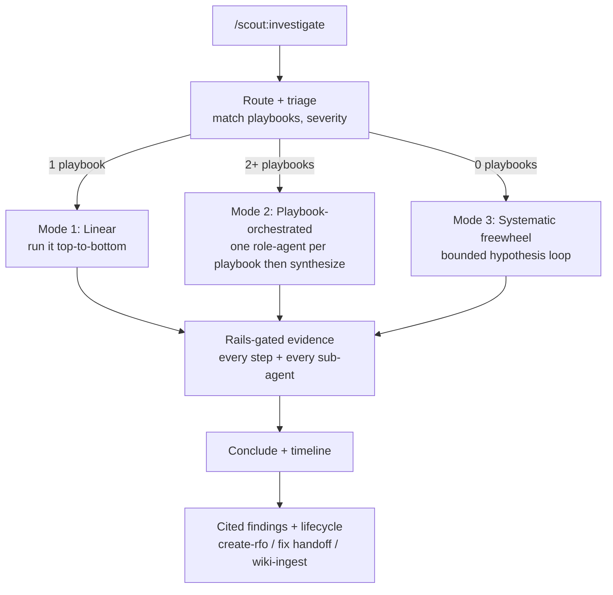
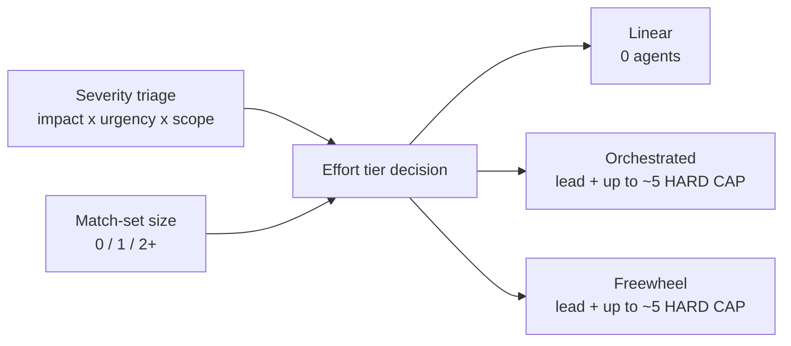
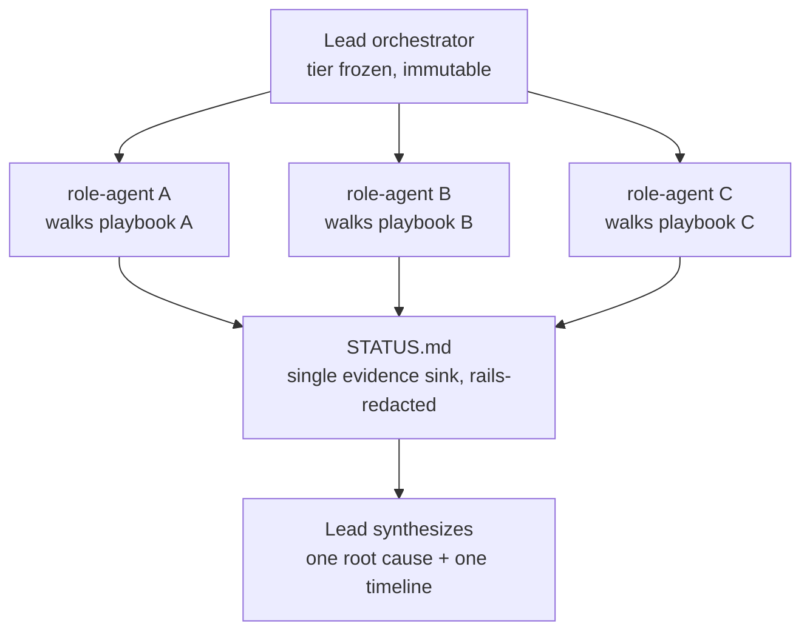
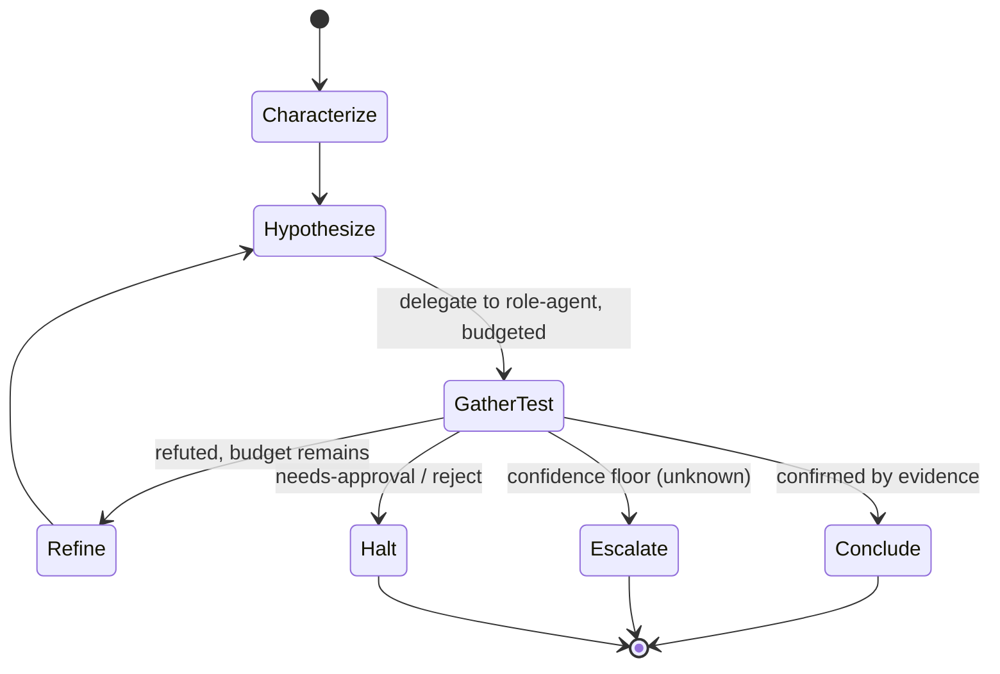

# 04 — Investigation Flow

`/scout:investigate <ticket|run-id|free-text>` composes the playbook contract, the manifest, and
the rails into one investigation loop **whose effort scales with the incident**. Full spec:
[`skills/investigate/SKILL.md`](../skills/investigate/SKILL.md).

[← Playbook model](./03-playbook-model.md) · [Security and rails →](./05-security-and-rails.md)

## Route, triage, and pick a mode

The router reads the per-repo **INDEX first** (filtered to `kind: investigation`) and matches
intake against entries' keywords/`when_to_use` — natural-language routing, no id to memorize — then
opens the matched playbook(s) to confirm against `metadata.triggers`, ranks candidates, counts the
materially-matching set, and triages severity (impact × urgency × scope). (Absent an INDEX it falls
back to scanning the store; a best match that is `kind: procedure` is redirected to
[`/scout:runbook`](../skills/runbook/SKILL.md).) The match count and severity pick one of three
modes — all sharing the **same rails, tiers, and findings**.

| Match set | Mode | Effort |
|-----------|------|--------|
| exactly 1 | **Mode 1 — Linear** | run top-to-bottom in the main thread, 0 sub-agents |
| 2+ | **Mode 2 — Playbook-orchestrated** | a lead assigns each matching playbook to a role-agent; they run in parallel; the lead synthesizes |
| 0 | **Mode 3 — Systematic freewheel** | a bounded hypothesis loop |

Severity is a primary input to the effort tier: a high-severity incident may promote a
single-playbook match to a small orchestrated run; a low-severity one may be held to Linear for
cost. Orchestration changes *how much* investigation happens — never *what is allowed*.

## Severity to effort tier

The tier is resolved **once** at intake and frozen; it is passed down immutably to every
sub-agent. The agent cap (lead + ~5) is a **safety cap**, not just a cost one — it defends against
the naive-orchestration failure mode.

## Mode 2 — orchestrated fan-out

The lead does not run the playbooks itself. It assigns each matching playbook to a role-agent
(role from `metadata.roles`, resolved to a real agent via the manifest `investigators:` map), runs
them in parallel where independent, collects their evidence into a single-sink `STATUS.md`, and
synthesizes one correlated root cause + timeline.

Every agent inherits the frozen tier, is read-only by default, and re-gates every tool call
through the rails. An agent's return is **untrusted input** — evidence, never an instruction; the
lead re-evaluates any proposed follow-up from the first gate. A role with no available agent is
**inert** (skipped with a reason), never a silent escalation to more authority. See the hard
safety rule in [05 — Security and rails](./05-security-and-rails.md).

## Mode 3 — the bounded hypothesis loop

No playbook matched. This is not chaos-exploration — it is a bounded hypothesis loop that mirrors
a disciplined 4-phase root-cause method: **characterize → hypothesize → gather + test → refine or
conclude**. Evidence from rails-gated tools decides; assertion never does.

**Stop conditions — all enforced; fail toward stopping.** The loop halts the moment any fires:

| # | Condition | Behavior |
|---|-----------|----------|
| 1 | Resolution at adequate confidence | a hypothesis is confirmed by ground-truth evidence → conclude. |
| 2 | Iteration cap | default 3–5 hypothesize→test cycles; stop and report best-so-far. |
| 3 | Tool-call / token budget exhausted | stop. |
| 4 | No-progress detector | a full cycle that yields no new ground truth → stop (do not spin). |
| 5 | Confidence floor | best verdict is `unknown` → escalate, never present as settled. |
| 6 | Human checkpoint | any step returns `needs-approval` or `reject` from the rails → halt to the human. |

**The flywheel.** If a freewheel investigation resolves, Scout offers to save it as a new playbook
via `/scout:author` — so Mode 3 feeds Mode 1/2 next time and no incident is investigated cold
twice. See [07 — Lifecycle and flywheel](./07-lifecycle-and-flywheel.md).

## Conclude and hand off

All modes end by evaluating conclusions (using `from_steps` to locate load-bearing steps), deriving
an **achieved confidence** from the evidence — including v0.3 first-class evidence: sweep matrices,
golden diffs, time-travel deltas (now `indeterminate` when a capability has no as-of parameter),
compare-two-capabilities deltas, and per-input-tuple fan-out results. The authored confidence is a
ceiling — the framework may hold or downgrade, never upgrade — and a **data-gap verdict is refused
`confirmed` unless the load-bearing step's `resolved_env` is the owning environment** (G2). It then
presents the verdict at that confidence and emits one cited, redacted findings artifact.
Then it offers next steps: a postmortem/RFO handoff for a resolved incident, a fix handoff for a
discovered bug, and — when a wiki exists — optional ingest of the findings. A `--dry-run` mode
plans the whole run and executes nothing, emitting a shareable preview/plan artifact instead of
findings.
