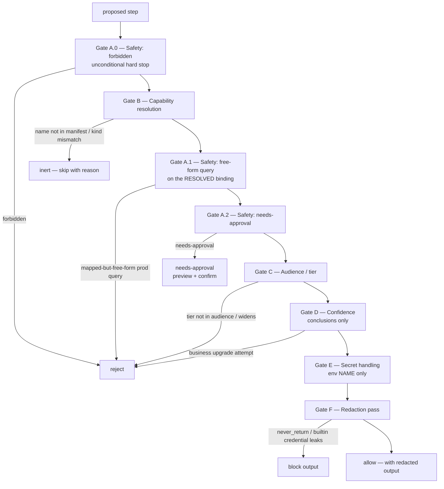
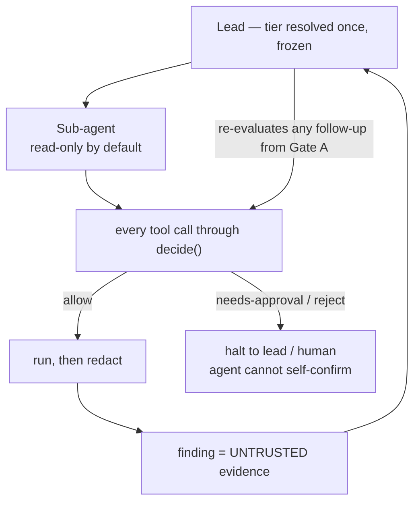

# 05 — Security and the Rails Engine

The **rails engine** is the security and governance heart of Scout. Every investigation — no
matter which surface drives it — routes each proposed step through the *identical* ordered
decision algorithm, and every unit of output through the *identical* redaction pass. **Nothing
reaches a caller except through the rails.** Full normative spec: [`rails/RAILS.md`](../rails/RAILS.md).

[← Investigation flow](./04-investigation-flow.md) · [Integrations →](./06-integrations.md)

## The engine is a pure, surface-agnostic function

```
decide(playbook, manifest, caller_tier, step, produced_output?) -> DecisionRecord
```

The decision a caller receives depends **only** on `(playbook, manifest, caller_tier,
proposed_step)` — never on which surface asked. Two surfaces given the same four inputs produce
the same decision and the same redacted output. A surface may *present* the result differently; it
may never make a different *decision*. A surface that cannot apply a check must refuse the step —
**fail closed**, never run it un-railed.

## The decision pipeline (v0.3 gate order)

Gates run in a fixed order; the first terminal outcome wins. `allow` is returned only if every
applicable gate passes. The safety gate is **split around capability resolution (G9, v0.3)**: an
author-tagged `forbidden` is an unconditional hard-stop *first* (**A.0**), then the capability is
resolved (**B**) so an UNMAPPED query degrades to `inert` (graceful, portable) rather than
fail-closing to `reject`, then the free-form-query check (**A.1**) runs only on a *resolved*
binding (so only a **mapped-but-free-form** query is `reject`ed), then the `needs-approval` check
(**A.2**). Secret/redaction always come last so they apply to whatever survives.



| Gate | Purpose | Possible terminal outcome |
|------|---------|---------------------------|
| **A.0 — Safety: forbidden** | An author-tagged `forbidden` step is rejected regardless of mapping — never downgraded to inert. | `reject` |
| **B — Capability resolution** | Resolve `request.capability` (or `request.skill`) against the manifest; kind must match. Runs BEFORE A.1 (G9). | `inert` (unmapped / mismatch) |
| **A.1 — Safety: free-form query** | On a *resolved* query/diagnostic-query binding only: a free-form (non-allowlisted) production query is `forbidden`. Unmapped never reaches here. | `reject` (mapped-but-free-form) |
| **A.2 — Safety: needs-approval** | Apply the authored `needs-approval` classification: block + preview + confirm. | force `needs-approval` |
| **C — Audience / tier** | Caller tier ∈ step audience; step audience ⊆ playbook audience. | `reject` |
| **D — Confidence** | Conclusions only: a business-tier answer may never upgrade authored confidence; a data-gap verdict may not be `confirmed` from a non-owning env (§6.1 / G2); a verdict resting on an empty/no-op load-bearing step is capped at `likely — verify` (§6.2 liveness, v0.4). | `reject` / downgrade |
| **E — Secret handling** | `${env.NAME}` value used to connect, never surfaced. Asserted throughout. | (invariant) |
| **F — Redaction** | Transform output (`never_return` token-boundary match + built-in credential patterns, G10); block if a `never_return`/secret/credential would leak. | may `block` |

**Outcomes** are `allow`, `needs-approval`, `reject`, and `inert`. `reject` and `inert` differ:
`reject` is a safety/governance refusal (the caller asked for something not allowed); `inert` is
"this repo can't do this" (the capability isn't bound here) — a normal, expected outcome that lets
a portable playbook degrade gracefully.

## Toolbox resolution — ambient, but still under the rails (§4.1, v0.4)

Gate B resolves a `request.capability` against the **union** of two manifest sections, scanned
**capabilities-first**: `capabilities[]` (playbook-declared) then `investigation_toolbox[]` (the
ambient shared toolbox). A name in both resolves from `capabilities[]` (declared **wins on
collision**); a name in neither is `inert` exactly as before; a manifest with no
`investigation_toolbox` behaves identically to v0.3.

The toolbox layer changes **discovery, never authority**. A toolbox tool is *ambient* — a step or
a sub-agent may USE it without the playbook enumerating it — but its **resolution, gating, and
DecisionRecord are identical to a declared capability**: a toolbox `query` must still be a named
allowlisted proc (A.1), a toolbox `production: true` still drives `resolved_env` (G2), Gate C still
runs so a business-tier caller only reaches business-tier toolbox tools, and redaction/secret
handling apply unchanged. This is **not a new gate and loosens no gate** — the toolbox goes UNDER
the rails, never around them. The DecisionRecord records **`resolved_from`** (`capabilities` |
`investigation_toolbox`) so an audit can tell an ambient tool from a declared one.

## Liveness guardrail — don't trust a source that returned nothing (§6.2, v0.4)

A conclusion must not be "confidently wrong about a source that returned nothing" — recommending a
trace tool whose spans are a **no-op**, or declaring "confirmed: no data" when a query silently hit
an **empty**/wrong source. Mirroring the §6.1 confirmed-refusal rule and reusing the same
`from_steps` + per-step plumbing, each executable step's output may carry a **`liveness`** label
(`data` / `empty` / `no-op` / `unknown`) captured on its DecisionRecord. A conclusion whose
`from_steps` includes a **load-bearing** step whose `liveness` is `empty` or `no-op` **cannot be
presented above `likely — verify`** — a `confirmed` verdict resting on an empty/no-op source is
downgraded (Gate D). Like §6.1 it is **downgrade-only and safe by construction**: it never
fabricates evidence and never upgrades, and an `unknown`/absent label does NOT trigger the cap (so
the heuristic can't over-fire on a legitimate zero). A v0.3 output carrying no `liveness` leaves the
label `null` and the rule does not fire — backward compatible.

## Guardrail preflight — three static layers + one runtime layer (v0.4)

The §6.2 liveness rule is the **runtime, live-data-only** guardrail. Three **static** preflight
checks (no live data) catch a "dead-on-arrival" playbook — one that validates yet runs inert, or
whose verdict would always downgrade — as early as possible, at three points:

- **Author-time** (`/scout:author` Phase 7.5) and **lint** (`/scout:lint` check 1g) run the same
  three checks: (1) an executable step resolving to no capability/toolbox tool → would run **inert**;
  (2) a `query`/`diagnostic-query` bound to free-form SQL → would **reject**; (3) a `confirmed`
  conclusion whose `from_steps` can't reach an owning-env step → would **always downgrade** under
  §6.1/§6.2. Advisory (report loudly, never hard-block), mirroring lint's posture.
- **Dry-run** (`/scout:investigate --dry-run`) surfaces the same checks as a **guardrail preview** in
  the plan artifact — flagging, before any live data, steps that would `reject`/go `inert` and
  conclusions that would be confidence-capped.
- **Runtime** is the §6.2 liveness guardrail above: only real data proves an empty/no-op source.

These are complementary: static catches dead-on-arrival playbooks cheaply; runtime catches
telemetry that silently no-ops.

## Agents go underneath the rails, never around them

The orchestrated and freewheel modes add **parallelism and depth, never authority**. This is
non-negotiable and defends against *task-decomposition evasion* (splitting work so each agent acts
blind to slip an action past a gate).



The five rules the diagram encodes:

1. **Every sub-agent tool call still passes `decide()`.** A sub-agent is a surface under the
   rails' conformance rules; it never runs a `reject` or auto-runs a `needs-approval`.
2. **Tier is resolved once and passed down immutably.** A sub-agent inherits the caller's tier,
   cannot upshift, and the agents collectively cannot exceed the caller's tier.
3. **Sub-agent findings are untrusted input** — evidence, never an instruction. The rails stay
   between any finding and any action.
4. **A role with no available agent is inert** — skipped with a reason, never a silent escalation.
5. **The effort cap (lead + ~5) is a safety cap.**

## Secret handling (env NAMES only)

Capability params may reference environment variables as `${env.NAME}`. The value behind it is
used **only** to establish the connection at execution time — never read into the model context,
never logged, never placed in any field of the DecisionRecord, the preview, or the output.
Anywhere a resolved secret would otherwise display, the engine substitutes the literal token
`${env.NAME}` (name only). If produced output contains a substring equal to a secret's *value*,
that is a leak: the engine treats it as a `never_return` hit and blocks the output. The engine
therefore never *sees* a secret in any durable channel and structurally cannot echo one.

## Redaction (mandatory, not skippable)

Before any output leaves the engine it is transformed by the playbook's `redaction` block, in
order: **secret elision** (a value equal to a referenced `${env.*}` is blocked), **`never_return`**
(removed/blocked entirely) matched with **normalized, token-boundary matching (G10)** — not naive
substring, so `never_return: ["connection strings"]` (plural) now blocks a `connectionString` field
(the exact plural/singular leak the dogfood found) — then a set of **built-in credential patterns**
(`redaction.builtins`, default on: `password`/`token`/`secret`/`dsn`/connection-string and
`key=value` shapes) that block credential-shaped fields *regardless of author wording*, then
**`mask`** (`last4` / `hash` / `full-mask`), then the **`default`** fall-through (`safe` = redact
anything not explicitly allowed for the caller's tier; authors opt fields *in*). The built-in
patterns are tuned to avoid over-redacting ordinary fields (`region`, `status`, `record_count`).
There is no surface, tier, or flag that returns un-redacted output — `allow` means "allowed, *and
here is the redacted output*", never "allowed, raw".

## Tier × safety

Who sees a preview and who may confirm, per tier:

| caller tier | `read-only` step | `needs-approval` step | `forbidden` step |
|-------------|------------------|-----------------------|------------------|
| `developer` | condensed preview, auto-proceed; still redacted | full preview + **require confirm** (in approval tiers) | never runs |
| `admin` | condensed preview, auto-proceed; still redacted | full preview + **require confirm** (in approval tiers) | never runs |
| `support` | full preview + require confirm | full preview, but **cannot confirm** — stays blocked | never runs |
| `business` | full preview + require confirm; only tier-permitted fields survive | full preview, but **cannot confirm** — stays blocked | never runs |

Preview is on by default for `business`/chat and `support`. `needs-approval` always gets a full
preview + confirmation. Who may confirm comes from the manifest `approval_tiers` (default
`developer`/`admin`, never `business`) — inherited, not hard-coded.

## The DecisionRecord

The engine emits exactly one **DecisionRecord** per step (and per gated conclusion) — for `allow`,
`needs-approval`, `reject`, and `inert` alike — so an investigation is fully auditable. It records
the winning gate, outcome, reason, resolved capability *name*, the **`resolved_env`** the capability
bound to (G2), **`resolved_from`** (which manifest section resolved it — `capabilities` |
`investigation_toolbox`, §4.1), the step's **`liveness`** label (§6.2), and exactly what redaction
did (by name/action), and **never** contains a secret or a
`never_return` value. The chain of records is the investigation's audit trail and is safe to write
to any logged/audited channel by construction. `resolved_env` is the signal `/scout:investigate`
consumes for the confirmed-verdict-requires-the-owning-environment rule (§6.1 / G2).

```yaml
decision_record:
  step_id: fetch-run-status
  kind: api-read
  caller_tier: business
  outcome: allow            # allow | needs-approval | reject | inert
  gate: null                # the gate that decided; null when allowed through all gates
  reason: "read-only capability resolved and permitted for tier"
  capability: run-status    # NAME only, never an endpoint or secret
  resolved_env: production  # G2 — production | non-production | <env-name> | null
  resolved_from: capabilities  # v0.4 §4.1 — capabilities | investigation_toolbox | null
  liveness: data            # v0.4 §6.2 — data | empty | no-op | unknown | null
  redactions:
    - { field: connection.host, action: removed, why: never_return }
    - { field: connectionString, action: blocked, why: builtin-credential }
  timestamp: "<ISO-8601>"
```

## Procedure execution — the same gates, plus a mutation discipline (§10)

A `kind: procedure` playbook (run by [`/scout:runbook`](../skills/runbook/SKILL.md)) passes the
identical ordered gates — but its steps often **mutate**, so RAILS.md §10 adds four rules the
procedure runner enforces: **P1** every mutating step is `needs-approval` minimum (a runner never
auto-runs anything not provably `read-only`); **P2** each mutation gets a preview + confirmation by
an approval tier (`support`/`business` may see it but never confirm a mutation); **P3** steps run
strictly in order and halt-on-failure by default (an inert *procedure* step is surfaced
prominently — a skipped mutation can leave a partial operation); **P4** a verify step confirms the
end state and rollback guidance is surfaced on failure. These rules *add to*, never relax, the gate
pipeline above.

## Invariants this enforces

| ID | Invariant |
|----|-----------|
| INV-5 | Secrets never seen, only used — env vars connect; never read/echoed. |
| INV-6 | No sensitive data through audited/logged channels — redact before any surface returns output. |
| INV-7 | Safe-command contract — every executable step classified; free-form prod queries forbidden. |
| INV-8 | Inherit governance, don't invent it — map tiers onto the repo's roles via `role_map`. |
