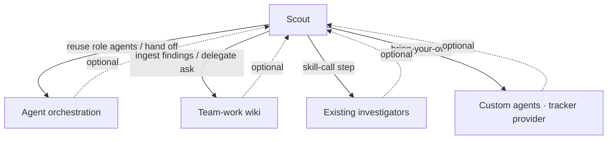
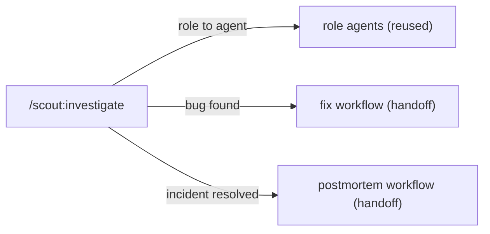
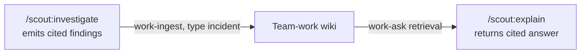
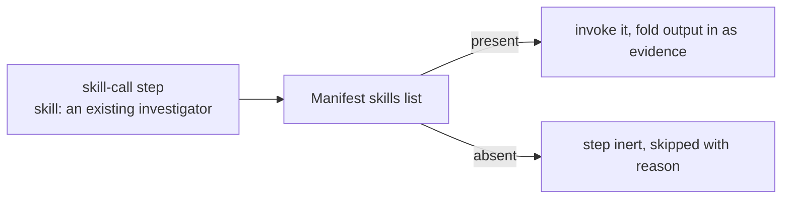

# 06 — Integrations

Scout **complements, never replaces** what a team already has. It wraps existing runbooks, chat,
MCP, investigators, and knowledge tooling rather than supplanting them. Every integration below is
**optional and degrades gracefully** — Scout works standalone when none are present.

[← Security and rails](./05-security-and-rails.md) · [Lifecycle and flywheel →](./07-lifecycle-and-flywheel.md)

## Overview

## (a) Agent orchestration — reuse role agents and hand off

Scout reuses an existing agent-orchestration layer instead of shipping its own agents or
postmortem logic.

- **Orchestrated investigation** resolves a playbook's investigator **role** (infra, data, app,
  security, observability, incident, root-cause, generic) to a real agent via the manifest
  `investigators:` map — reusing the orchestration layer's role agents. Each runs under the frozen
  tier and re-gates every tool call (see [05](./05-security-and-rails.md)).
- **Fix handoff** — when an investigation surfaces a fixable bug, Scout offers to hand off to the
  orchestration layer's *make/fix* workflow to branch, fix, and open a PR without leaving the flow.
- **Postmortem handoff** — when a resolved incident's playbook sets `incident.postmortem:
  create-rfo`, Scout delegates to the orchestration layer's RFO/postmortem workflow, feeding it the
  redacted findings + the running timeline. Scout does not reimplement postmortems.

## (b) Team-work wiki — findings compound into knowledge

When a knowledge wiki is present (detected by a config file at the repo root), Scout closes a loop:

- **Findings → wiki** — the cited findings doc is ingested as an `incident` source so
  investigations compound into searchable institutional knowledge.
- **Explain via the wiki** — `/scout:explain` **delegates** retrieval to the wiki's ask/search
  skill; it never reimplements search or RAG. When no wiki exists, it falls back to reading the
  repo's docs + the Scout playbook store, clearly labeling the answer as non-wiki-sourced.
- **Harvest ↔ wiki** — `/scout:harvest` reads the same class of source docs a wiki ingests; when a
  wiki exists it can ingest those sources alongside drafting playbooks from them.

All of this is guarded by detection: no wiki → Scout runs standalone, no prompt, no error.

## (c) skill-call — reuse a team's existing investigators

A `skill-call` step invokes a team's **existing** investigator (e.g. an error-tracker
investigation skill) and folds its output in as evidence — complement, don't replace. Setup
records which investigation skills a repo has in the manifest `skills` list; a call to a skill the
repo lacks renders that step **inert** (not an error), exactly like an unmapped capability.

## (d) Extensibility — bring your own agents and tracker

Scout is portable across teams because its bindings live outside the plugin:

- **Bring-your-own agents** — the manifest `investigators:` role→agent map can point a role at a
  reused orchestration agent, a Scout default investigator, or a **user-imported agent** declared
  in a team's own agents config. A role with no agent is simply inert.
- **Tracker-provider contract** — routing from a ticket and attaching findings back go through a
  tracker abstraction, so a team can plug in whichever tracker they use behind the same contract.
- **Skill hook points** — each Scout skill exposes `before`/`after` extension hooks so a team can
  inject house conventions (routing rules, staleness thresholds, review passes) without forking
  the plugin. Absent config → the skill runs exactly as documented, no behavior change.

## (e) The investigation toolbox — ambient reach to logs / DB / traces / MCP (v0.4)

Where (a)–(d) wrap *external* systems, the **investigation toolbox** is how an investigation
reaches the team's own everyday diagnostic surfaces — application logs, a read-only database query,
traces, an investigation MCP — **ambiently**, without a playbook re-declaring them each time.
Declared once in the manifest's `investigation_toolbox[]` by `/scout:setup` + `/scout:author`, its
tools are implicitly available to every investigation and every step/agent (still rails-gated per
use; see [05](./05-security-and-rails.md) §4.1). Modes 2 (orchestrated) and 3 (freewheel) benefit
most — a sub-agent can read logs / run a DB proc / pull a trace directly instead of stalling
because no playbook declared the capability.

- **`db-read` closes the #1 gap** — the canonical toolbox tool is a **named allowlisted proc** (a
  read-only DB query), so the "root-cause needed a DB read the playbook never declared" dead-end
  becomes a first-class, gated capability every playbook can reach.
- **`kind: toolbox` playbooks** capture how to USE/interpret a given tool and are **composed as
  sub-procedures** by investigations — never symptom-routed (see [03](./03-playbook-model.md)).

The toolbox is additive: a repo with no `investigation_toolbox` section behaves exactly as v0.3.

**The through-line:** every integration is optional, detected, and degrades gracefully. Scout adds
investigation ability *on top of* what a team built — it never asks them to rebuild it.
