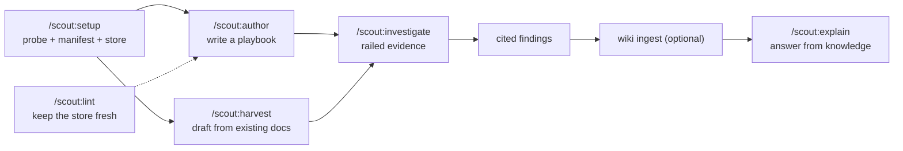
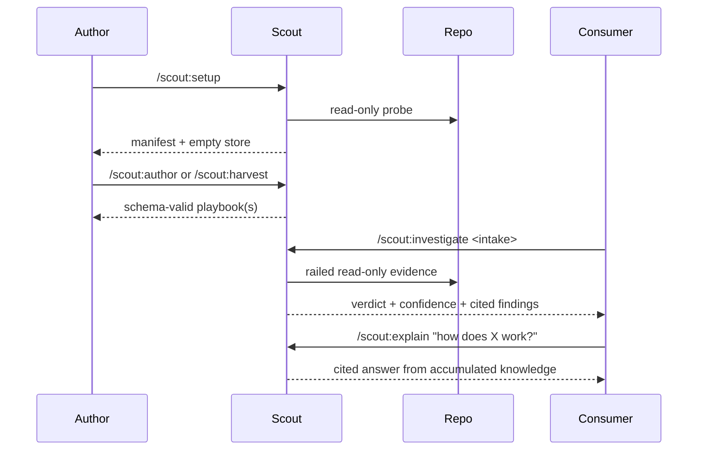
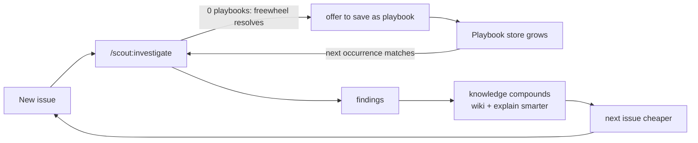

# 07 — Lifecycle and the Flywheel

How Scout is adopted and how it compounds. The end-to-end lifecycle turns tribal knowledge into
railed, reusable investigations; the flywheel makes each incident cheaper than the last.

[← Integrations](./06-integrations.md) · [Design decisions →](./08-design-decisions.md)

## End-to-end lifecycle

1. **Setup** (once per repo) — probe capabilities, emit the Capability Manifest, scaffold an empty
   playbook store. Even a plain repo yields a valid, sparse manifest.
2. **Author / harvest** — write a playbook by hand through the guided wizard, or auto-draft from
   existing runbooks/docs/targets (drafts are human-reviewed before use).
3. **Investigate** (`kind: investigation`) — route an intake to the matching playbook(s) via the
   INDEX, gather railed evidence, conclude at a confidence-gated verdict, emit cited findings. For
   `kind: procedure` playbooks, [`/scout:runbook`](../skills/runbook/SKILL.md) is the parallel
   runner: route a natural-language operation via the INDEX (filtered to procedures), execute the
   ordered steps through the rails (mutating steps → needs-approval + preview + confirm), verify,
   and emit a cited run doc.
4. **Findings → wiki (optional)** — ingest findings as incident knowledge so they compound.
5. **Explain** — answer "how does X work / why does X break?" from the compounded knowledge,
   delegating to the wiki when present, cited either way.
6. **Lint** (ongoing) — health-check the store for stale / draft / drifted / broken playbooks so a
   maintainer keeps it fresh rather than discovering a dead playbook mid-incident.

## Lifecycle sequence

## The adoption flywheel

Investigations compound. A resolved freewheel investigation (no playbook matched) offers to become
a **new playbook**; the store grows; the next occurrence of that issue matches a playbook and runs
cheaply (Linear or orchestrated) instead of cold. Findings ingested into the wiki make `explain`
smarter over time. Each turn lowers the cost of the next incident.

The loop **degrades gracefully without a wiki**: findings stay as cited docs and `/scout:explain`
reads them + the repo's docs + the playbook store directly. `/scout:lint` keeps the *playbook*
side of this knowledge fresh — flagging stale/drifted/never-promoted playbooks before they mislead
an investigation (the playbook analogue of a wiki health check). Together, capture-from-session and
lint keep the flywheel turning without letting the store rot.
