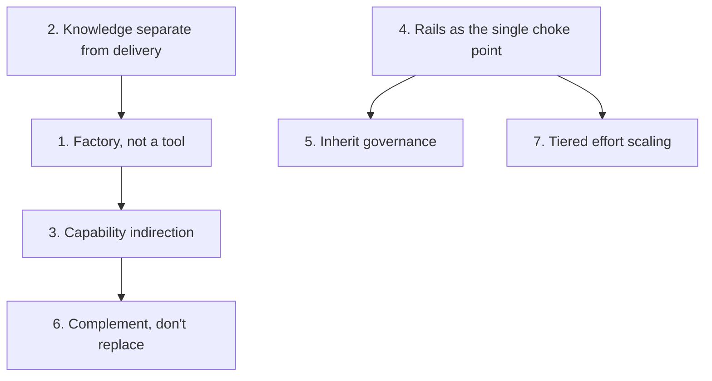

# 08 — Design Decisions

The key architectural decisions behind Scout, ADR-style: each is a *decision*, a *why*, and a
*consequence*. These follow from Scout's invariants and shape everything in the other docs.

[← Lifecycle and flywheel](./07-lifecycle-and-flywheel.md) · [Index](./README.md)

## 1. Scout is a factory, not a support tool

- **Decision.** Scout ships no application-specific logic. It is a factory that turns a team's own
  knowledge and its repo's own surfaces into a razor-specific toolkit.
- **Why.** Two teams install the same plugin and need completely different toolkits. Baking any
  specifics in would fork the plugin per team and break portability (INV-1).
- **Consequence.** All specificity lives in a repo's playbooks and Capability Manifest, never in
  the plugin. The plugin can go upstream and be reused unchanged.

## 2. Knowledge separate from delivery — one playbook, many surfaces

- **Decision.** A playbook is ONE artifact describing *what to investigate and how to reason about
  it* — never *which surface renders it*. The projector compiles it onto surfaces.
- **Why.** Authoring per-surface would triple the work and let surfaces drift apart (INV-2).
- **Consequence.** You author once; the same playbook serves a developer in Claude Code, an MCP
  tool, a business user in chat, or a guided-human runbook. See [03](./03-playbook-model.md).

## 3. Capability indirection for portability

- **Decision.** A step names an **abstract capability** (e.g. `run-status`), not an endpoint. The
  manifest binds the name to the repo's real target + auth env-var NAME.
- **Why.** Hardcoding endpoints would tie a playbook to one repo and expose connection details.
- **Consequence.** The same playbook is portable; an unmapped capability renders a step *inert*,
  not broken; secrets stay as names (INV-5). See [02](./02-components.md).

## 4. Rails as the single enforcement choke point — agents underneath

- **Decision.** One ordered decision + redaction engine gates *every* executable step on *every*
  surface. Sub-agents are added underneath the rails, never around them.
- **Why.** A single choke point is auditable and cannot be sidestepped by adding a surface or
  decomposing work across agents (task-decomposition evasion).
- **Consequence.** Two surfaces given the same inputs produce the same decision; every sub-agent
  re-gates every tool call; the DecisionRecord chain is the audit trail. See
  [05](./05-security-and-rails.md).

## 5. Inherit governance, don't invent it

- **Decision.** Scout's four fixed tiers map onto a repo's own roles via the manifest `role_map`;
  when no role model exists, tier defaults apply — no roles are fabricated.
- **Why.** Inventing an access model would conflict with the repo's real one and create a shadow
  security surface (INV-8).
- **Consequence.** Scout enforces the repo's existing access model; who may confirm a
  `needs-approval` step comes from the manifest `approval_tiers`, never hard-coded.

## 6. Complement, don't replace

- **Decision.** Scout wraps existing runbooks, chat, MCP, investigators, and knowledge tooling
  rather than supplanting them; every integration is optional and degrades gracefully.
- **Why.** Teams have already built investigators and knowledge bases; rebuilding them wastes
  effort and fragments knowledge (INV-4).
- **Consequence.** `skill-call` reuses existing investigators; findings ingest into an existing
  wiki; fixes and postmortems hand off to existing workflows. No wiki/agents/tracker → Scout still
  works standalone. See [06](./06-integrations.md).

## 7. Tiered effort scaling — don't over-orchestrate

- **Decision.** Effort scales with the incident: 1 playbook → Linear (0 agents); 2+ → orchestrated;
  0 → a bounded freewheel loop. The agent cap is lead + ~5, a hard **safety** cap.
- **Why.** Naive orchestration burns ~15× the tokens and multiplies risk; most tickets need one
  playbook run top-to-bottom.
- **Consequence.** The operator can always override *down* to Linear for cost; orchestration never
  grants more authority than the caller's frozen tier; the freewheel loop has six explicit stop
  conditions. See [04](./04-investigation-flow.md).

## 8. The investigation toolbox — an ambient shared capability layer (v0.4)

- **Decision.** Common investigation tools (logs, a read-only DB proc, traces, MCP) live in an
  **optional manifest section** `investigation_toolbox[]`, are **ambient** (implicitly available to
  every investigation/step without re-declaration), yet remain **explicitly nameable** — a hybrid
  ambient+explicit model. `db-read` ships as the canonical tool, a **named allowlisted proc**.
- **Why.** Dogfooding showed every investigation needs the same base toolset, yet a playbook had to
  re-declare each capability every time, and the #1 root-cause dead-end was a DB read no playbook
  declared. An optional section keeps ONE source of truth for capabilities+auth+tiering, reuses the
  whole rails/redaction path, and — because the manifest schema is `additionalProperties: true` and
  resolution is capabilities-first — is **loose-compatible**: an absent section is identical v0.3
  behavior.
- **Consequence.** A fresh playbook reads logs/DB/traces without naming them; resolution is
  `capabilities[] ∪ investigation_toolbox[]` (declared wins on collision); ambient changes
  *discovery, never authority* — every use still passes the identical gates and emits a
  DecisionRecord (`resolved_from` distinguishes it). See [02](./02-components.md) and
  [05](./05-security-and-rails.md) §4.1. *(Rejected: a separate `common-tools.md` file — it would
  fork the resolution/auth model. Rejected: ambient-only never-nameable — a sharper break from the
  "every step names its capability" model than needed.)*

## 9. Toolbox playbooks are a separate kind, composed not routed (v0.4)

- **Decision.** "How to USE/interpret a tool" is captured as a `kind: toolbox` playbook in a
  `toolbox/` subdir, indexed so runners **never symptom-route** to it — it is only **composed as a
  sub-procedure** by an investigation/procedure playbook that uses the underlying tool.
- **Why.** Tool-usage know-how ("query per-run, not windowed") is distinct from symptom diagnosis;
  routing a symptom to a how-to-use doc would mis-answer it. A separate kind + subdir keeps the two
  cleanly apart while reusing the identical schema, rails, and redaction.
- **Consequence.** Tribal correction becomes a reusable, composable asset. See
  [03](./03-playbook-model.md).

## 10. Guardrails are static-early + runtime-live; playbook apiVersion is unchanged (v0.4)

- **Decision.** A playbook is checked against the guardrails as early as possible: **three static
  preflight checks** (inert / would-reject-free-form / confirmed-can't-reach-owning-env) at
  author-time, in `/scout:lint`, and in `--dry-run`, plus the **runtime liveness guardrail** (§6.2)
  that only real data can prove. The v0.4 changes are manifest-versioned only — the **playbook
  `apiVersion` stays `scout/v0.3`** (no playbook-visible field changed).
- **Why.** Static checks catch dead-on-arrival playbooks cheaply; only live data proves an
  empty/no-op source, so a runtime layer is still required. Bumping the playbook schema version for
  a purely additive, playbook-invisible change would needlessly break loose-compat.
- **Consequence.** Advisory (report, never hard-block) static layers + a downgrade-only runtime
  cap; every v0.3 install and every existing playbook keeps working untouched. See
  [05](./05-security-and-rails.md).

## Invariants these decisions uphold

| ID | Invariant | Primarily served by |
|----|-----------|---------------------|
| INV-1 | Repo-agnostic core | Decision 1 |
| INV-2 | Knowledge separate from delivery | Decision 2 |
| INV-3 | Authorable by non-developers (declarative data, not code) | Decisions 1–2 |
| INV-4 | Complementary, not a replacement | Decision 6 |
| INV-5 | Secrets never seen, only used | Decisions 3–4 |
| INV-6 | No sensitive data through logged channels | Decision 4 |
| INV-7 | Safe-command contract | Decision 4 |
| INV-8 | Inherit governance, don't invent it | Decision 5 |
