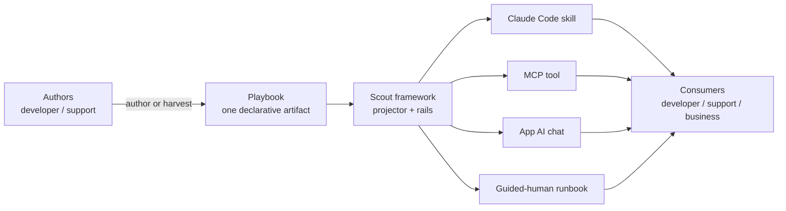

# Scout Architecture

Leveled, C4-inspired architecture documentation for the **Scout** plugin.

Scout is a **repo-agnostic factory for support/investigation tooling — not a support tool
itself**. It turns tribal support knowledge into declarative **playbooks** — each an
**investigation** (diagnose a symptom to a confidence-gated verdict), a **procedure** (an ordered
operational runbook), or a **toolbox** how-to-use-a-tool playbook (v0.4) — that anyone (support,
admin, BA — no code) can author, then *projects* each playbook onto whichever delivery surface a
repo supports: a Claude Code skill, an MCP tool, or a repo's existing AI chat. An optional, ambient
**investigation toolbox** (v0.4) gives every investigation shared reach to logs, a read-only DB
proc, traces, and MCP without re-declaring them. Both classes route by **natural language** through a per-repo playbook
INDEX. Security, redaction, and a safe-command contract are enforced by the framework across every
surface, and governance is **detected and inherited** from the target repo rather than invented.
Two teams install the same plugin and get completely different, razor-specific toolkits — because
the specificity comes from what each team authors and what their repo exposes.

## Documentation map

Read top-to-bottom, or jump to what you need. Levels follow the C4 model (context → containers →
components), then deepen into the core models and cross-cutting concerns.

| Doc | Level | What it covers |
|-----|-------|----------------|
| [00 — this index](./README.md) | 0 | What Scout is; the context diagram; the map. |
| [01 — System context](./01-system-context.md) | 1 | Who authors vs. who consumes; external systems Scout touches. |
| [02 — Components](./02-components.md) | 2 | Internal pieces (schema, store + `toolbox/` subdir, INDEX, manifest, the ambient investigation toolbox, the 7 skills, rails, projector, findings/run) and how they relate; capability indirection. |
| [03 — Playbook model](./03-playbook-model.md) | — | The declarative playbook: `metadata.kind` (investigation / procedure / toolbox), anatomy, step-kind taxonomy (incl. `diagnostic-query`), the v0.3 step-level fields, an annotated example. |
| [04 — Investigation flow](./04-investigation-flow.md) | — | INDEX-first routing, the 3 investigation modes, the bounded hypothesis loop + stop conditions, severity → effort tier. |
| [05 — Security and rails](./05-security-and-rails.md) | — | The gate pipeline (A.0/B/A.1/A.2/C/D/E/F — G9 reorder), toolbox/ambient resolution (§4.1) + liveness guardrail (§6.2) + guardrail preflight (v0.4), agents-underneath-the-rails, secrets, redaction (G10 builtins), the DecisionRecord (`resolved_env`/`resolved_from`/`liveness`), procedure §10. |
| [06 — Integrations](./06-integrations.md) | — | How Scout complements agent orchestration, a knowledge wiki, existing investigators, bring-your-own agents, and the ambient investigation toolbox (logs/DB/traces/MCP). |
| [07 — Lifecycle and flywheel](./07-lifecycle-and-flywheel.md) | — | End-to-end lifecycle; the adoption flywheel; keeping playbooks fresh. |
| [08 — Design decisions](./08-design-decisions.md) | — | ADR-style record of the key design decisions and their rationale (incl. the v0.4 toolbox, toolbox playbooks, and the static+runtime guardrail layers). |

The concise single-page overview lives at [`../ARCHITECTURE.md`](../ARCHITECTURE.md); this
directory is its detailed expansion. Source contracts: the [playbook schema](../schema/playbook.schema.md),
the [capability manifest schema](../schema/capability-manifest.schema.json), and the
[rails spec](../rails/RAILS.md).

## Context diagram (Level 0)

Scout sits between the knowledge a team **authors** and the surfaces through which any audience
**consumes** it. One playbook, many surfaces; every path enforced by the same rails.

**The one idea.** Scout separates *who authors* from *who consumes*, and *knowledge* from
*delivery*. A developer captures a support investigation once, as a declarative playbook (in the
repo, no code); the framework projects it onto whichever surface the repo supports; the same
playbook then serves any audience — a developer in Claude Code with full evidence, or a business
user with no repo access running a scoped, redacted version from the app's own chat. You never
write an investigation twice for different surfaces.
