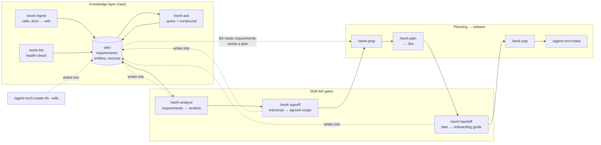

# Team Work Plugin

Collaborative work planning for teams using Claude Code. Bridges the gap between client calls, requirements, planning sessions, and agent-assisted implementation — the full SDLC from a discovery call to merged code.

## Skills

### Knowledge layer — the LLM-maintained SDLC wiki (new in 0.12.0)

A persistent, compounding knowledge base that sits **upstream** of planning. A business analyst accumulates client calls, requirement docs, and postmortems into living, cross-referenced markdown pages with a full audit trail back to the source. The LLM does the bookkeeping (summarizing, cross-referencing, filing, citing); the human curates sources and asks questions. Pages are plain markdown with frontmatter and **standard relative links** (`[text](path/to/page.md)`), so they render and navigate correctly on **GitHub** *and* in **Obsidian** — the BA can browse the wiki right in the GitHub UI. The catalog lives in `README.md`, so GitHub shows it automatically as the wiki's landing page. And with `/work-publish` the same markdown is hosted as a searchable **MkDocs Material site on GitHub Pages** — no separate authoring step, the wiki *is* the docs source.

The wiki is an **[Open Knowledge Format (OKF v0.1)](https://github.com/GoogleCloudPlatform/knowledge-catalog/tree/main/okf) bundle** (new in 0.17.0). OKF — published by Google Cloud — formalizes exactly this "LLM wiki" pattern into a portable, vendor-neutral spec: a directory of typed markdown *concept* pages with YAML frontmatter, cross-linked into a graph, with `index.md` navigation and a `log.md` history. Conformance here means: every concept page carries a required `type`; each directory has an OKF `index.md` nav file *alongside* the human-facing `README.md`; the bundle root declares `okf_version: "0.1"`; and `sources/` is treated as the OKF citations store (exempt from frontmatter rules). The wiki keeps its **relative** links (OKF §5.2) over OKF's recommended absolute form, because relative links also navigate in Obsidian — still fully conformant. `/work-wiki` creates conformant wikis; `/work-upgrade` makes older ones conformant; `/work-lint` checks conformance.

| Skill | Description |
|-------|-------------|
| `/team-work:work-wiki` | Bootstrap/repair a wiki at a configurable path — `CLAUDE.md` schema, `README.md` catalog, per-directory OKF `index.md` navigation, `log.md`, immutable `sources/` tree, generated page dirs, qmd search. Born **OKF v0.1**-conformant (typed concept pages, `okf_version` at the bundle root). Idempotent |
| `/team-work:work-ingest` | The core BA tool. Classify a source → archive it verbatim+categorized under `sources/<type>/<client>/<date>` (audit trail; converts PDF/xlsx/docx to markdown, preserves the original binary) → extract attendees + speaker attribution → integrate into requirement/entity/concept/decision/incident pages where **every claim cites its source** via a relative markdown link → flag contradictions → update `README.md`+`log.md` → re-index qmd |
| `/team-work:work-ask` | Ask a question → qmd hybrid search (with `README.md` fallback) → cited answer (page + originating call/doc + speaker/date) → optionally file the answer back as a new page so explorations compound |
| `/team-work:work-lint` | Health-check: contradictions, stale claims, orphan pages, requirements lacking a page, missing cross-refs, broken provenance, broken/dangling relative links, lingering `[[wikilinks]]`/`index.md`, source gaps. Prioritized punch list; read-only by default, `--fix` to apply safe fixes |
| `/team-work:work-upgrade` | Migrate an older wiki to current conventions so the other skills run cleanly: `index.md` → `README.md` (via `git mv`, preserving history), rewrite Obsidian `[[wikilinks]]` → standard relative markdown links, verify every link resolves, refresh the `CLAUDE.md` schema, and run an **OKF v0.1 conformance pass** (backfill required `type` frontmatter, generate per-directory `index.md` nav, add bundle-root `okf_version`). Idempotent, `--dry-run` to preview |
| `/team-work:work-publish` | Host the wiki as a **MkDocs Material site on GitHub Pages** (`pages.code.ssnc.dev/<org>/<repo>/`), styled with the **SS&C Blue Stone** look by default (SS&C Blue `#0077C8` + Teal accent, full brand palette, Calibri typography, bordered tables, light/dark — from a canonical `extra.css` embedded in the skill so the brand applies even when the template repo is unreachable; logos fetched best-effort; opt-out to plain Material). Scaffolds `mkdocs.yml` (`docs_dir` = wiki root, `README.md` home, auto-generated nav), `requirements.txt`, and a self-hosted GitHub Actions workflow that deploys via `mkdocs gh-deploy` to `gh-pages`. Detects the remote host (**code.ssnc.dev only**), prints a confidentiality notice before publishing `sources/`, and offers a `publish_exclude` opt-out. Idempotent, `--dry-run` to preview. `/work-wiki` offers it automatically |
| `/team-work:wiki-source` | Turn the **code repository itself** into wiki knowledge in three steps: (1) generate/refresh C4 architecture docs in `docs/c4/` (delegates to `/agent-orch:c4`); (2) walk the source to write a **business-domain guide** at `docs/wiki/domain/` (what the system does + domain rules — caching policy, matching logic, settlement, entities — *not* how the code is written) and a **technical/DevSecOps reference** at `docs/wiki/technical/`, cross-linking existing repo docs and filling gaps; (3) `/work-ingest` the repo's markdown (now including the fresh C4 + guides) into the wiki. Honors `ingest_mode`; commits in place. Scopes to whole-repo, changed-files, or a path |
| `/team-work:wiki-source-branch` | The `/wiki-source` pipeline over the **entire repo**, always committed on the **current branch** — no scope prompt, no worktree, no PR. **No-ops cleanly when no wiki is initialized**, so it's safe to call unconditionally. Run automatically by `/agent-orch:make` after it commits code changes, keeping the wiki in lockstep with every feature |

### Shift-left gates — requirements → agreement → handoff

As agents absorb more of the build, the leverage moves **left**: the hard part is
no longer typing the code, it's getting the context and the plan right. These
three skills make that front third repeatable. Each one closes a gate, and each
consumes the previous one's output. All three are **wiki-required** — the wiki
supplies the cross-source memory and the citations that make their output
defensible — and all three write their artifact back into the wiki, so it
compounds and stays queryable by `/work-ask`.

| Skill | Gate it closes | Description |
|-------|----------------|-------------|
| `/team-work:work-analyze` | *Is what they asked for what we should build?* | Deeply analyze a requirements document against the **actual codebase** (auto-resolved from sibling repos) and the wiki's prior decisions. Every requirement gets an explicit verdict — BUILD AS WRITTEN / BUILD WITH CHANGES / RECOMMEND AGAINST / DEFER / NEEDS DECISION — backed by `file:line` evidence or a cited decision, with an alternative for anything recommended against. Routes open questions to named owners by audience, surfaces risks and the implicit scope the document never asked for, and states plainly what the release will not deliver |
| `/team-work:work-signoff` | *What exactly are we committing to?* | Turn the transcript of the review meeting into the concise, agreed statement of what the release delivers — the thing stakeholders actually sign, instead of reconciling a requirements doc that has drifted from reality. Reconciles what was decided against the prior analysis, **supersedes** any earlier sign-off (keeping it as a citable baseline) with a "what changed since" section, and splits still-open items into **blocking vs non-blocking** so the build can start honestly |
| `/team-work:work-handoff` | *Can a developer start without me?* | Generate a developer onboarding guide from the work plan, its tracker issues, and the wiki. The dependency map is **read from the tracker's real link graph, never inferred** — a plausible-but-wrong map stalls teammates. Maps each item to its repo and stack, mines the authoritative design and the decisions behind it into a document index with reading order, and leads "getting unblocked" with querying the wiki rather than interrupting the lead |

Shared behavior (wiki resolution, sibling-repo discovery, idempotent ingest
delegation, audience routing, output/commit) lives in
[`rules/shift-left-common.md`](rules/shift-left-common.md).

### Planning → release

| Skill | Description |
|-------|-------------|
| `/team-work:work-prep` | Full SDLC intake — parse transcripts into requirements, ideas, decisions, open questions. Business alignment and Jira hierarchy |
| `/team-work:work-plan` | Convert agreed plans into Jira issues with dependencies and assignments |
| `/team-work:work-pop` | Pick your next assigned item or explore ideas, launch into `/agent-orch:make` |
| `/team-work:work-report` | Sync Jira status across all plans, generate unified Bluestone HTML report for PDF export |
| `/team-work:work-recap` | Time-windowed recap of Jira activity, git commits, and agent-orch sessions. Writes a Markdown report and a Bluestone light-mode PowerPoint to `../` for PM updates and engineers catching up |
| `/team-work:groom` | Worktree-based agentic backlog grooming with Jira lifecycle — batch assign, reschedule, resolve open questions, set timelines, commits planning changes on a worktree and opens a PR |
| `/team-work:create-release` | Branch-aware tagging, dual release notes (technical + customer) as markdown + PDF, GitHub release, optional Jira ticket |

## The Wiki Layer in the SDLC

The wiki **front-runs** planning — it doesn't replace `/work-prep`. A BA accumulates knowledge across many calls in the wiki, then seeds a `/work-prep` planning session from the requirement pages when a body of work is ready.



### Wiki directory layout

The wiki root is configurable (in-repo `wiki/`, a sibling repo, or any path), persisted to `.team-work/wiki-config.md`. Canonical structure:

```
<wiki-root>/
  CLAUDE.md              # schema: conventions + ingest/query/lint workflows for the agent
  README.md              # content catalog — every page, one-line summary, by category (GitHub landing page)
  index.md               # OKF navigation (root: declares okf_version: "0.1"); one per directory
  log.md                 # append-only chronological record (also the OKF §7 update log)
  .qmd/                  # qmd search index (gitignored — derived, rebuilt on demand)
  sources/               # IMMUTABLE, categorized — the audit trail
    transcripts/<client>/2026-06-04-discovery-call-acme-billing.md
    requirements-docs/<client>/acme-rfp-v2.pdf  (+ .md rendering)
    incidents/2026-05-22-prod-outage-billing.md
    emails/  misc/  assets/
  requirements/          # GENERATED, compounding — functional + NFR pages
  entities/              # clients, systems, people, products
  concepts/              # domain glossary
  decisions/             # ADR-style decision pages
  incidents/             # generated postmortem/RFO synthesis (feeds /create-rfo)
  plans/                 # thin pages linking a planning/<slug>.md back to its requirements
```

### Audit trail & citations

Every ingested source is saved verbatim under `sources/` and never edited. Every generated claim carries a citation block linking back to it:

```markdown
## Invoice generation must support multi-currency

> Source: [Acme discovery call, 2026-06-04](../sources/transcripts/acme/2026-06-04-discovery-call-acme-billing.md) — Maria Chen, 00:42:18
> Status: confirmed requirement
```

Links are standard relative markdown links (with the right number of `../` hops and a `.md` extension), so they resolve on GitHub and in Obsidian alike. So months later you can ask "why did we commit to multi-currency?" and jump straight to the call, the attendee list, and the timestamp.

### Ingest commit mode

The first `/work-ingest` asks whether wiki changes should be committed **locally** (fast, solo/trusted) or via **PR** (review gate for teams), and stores the answer repo-wide in `.team-work/wiki-config.md` (`ingest_mode: local|pr`). It is honored thereafter without re-asking.

### Publishing to GitHub Pages

`/work-publish` hosts the wiki as a searchable **MkDocs Material** site at `https://pages.code.ssnc.dev/<org>/<repo>/`, reproducing the SS&C [`tech-infra/wiki-template`](https://code.ssnc.dev/tech-infra/wiki-template) setup but **adapted for an LLM wiki**: `docs_dir` points at the wiki root, `README.md` is the home page, and the nav is **auto-generated** from the page directories — so the site stays correct as the agent reshapes the wiki (no hand-maintained `nav:` to drift).

It scaffolds three files at the publishing repo root — `mkdocs.yml`, `requirements.txt`, and `.github/workflows/deploy-docs.yml` (a self-hosted runner job that deploys via `mkdocs gh-deploy --force` to the `gh-pages` branch) — then commits per `ingest_mode` and prints the two one-time repo settings it can't set from a commit (Actions write-permission, Pages source = `gh-pages`/`(root)`).

`/work-wiki` offers publishing automatically when it finishes (on `code.ssnc.dev` repos). Notes:

- **Look & feel — SS&C Blue Stone by default.** The site ships with the brand identity from [`tech-infra/wiki-template`](https://code.ssnc.dev/tech-infra/wiki-template): SS&C Blue `#0077C8` primary, Teal `#1099AC` accent, the full brand palette as CSS variables, **Calibri** typography, bordered data tables, and light/dark (`slate`) schemes. The canonical `extra.css` is **embedded in the skill** and written directly, so the brand applies reliably — *not* a runtime fetch that silently degrades to plain Material. Logos are fetched best-effort; if unreachable, the colors + font still apply and Material shows a text logo. Teams can opt out to plain Material, or use Blue Stone as a base and tweak `stylesheets/extra.css` for a sub-brand. The hosted style guide (`docs/style-guide/` in the template) documents the full conventions.
- **Host:** `code.ssnc.dev` only. On any other remote the skill explains why and changes nothing.
- **Confidentiality:** the default publishes the **whole** wiki, *including the immutable `sources/` audit trail*. Since `pages.code.ssnc.dev` is readable by anyone on the SS&C network, `/work-publish` prints a notice naming exactly what becomes public. To reduce exposure it recommends **restricting who can view the site** over excluding content — because excluding `sources/` makes **every citation link 404 on the live site** (each page cites its source as a link into `sources/`), and `mkdocs build --strict` does *not* catch that. A `publish_exclude` opt-out exists for directories nothing links into, with a loud warning otherwise.
- **Pages enablement & verification:** `/work-publish` enables Pages via the API automatically once the `gh-pages` branch exists (on a re-run after the first deploy), then probes the live site (home + a deep page) to confirm it's up — no manual click in the common case.
- **Config:** `publish`, `publish_url`, and `publish_exclude` are written to `.team-work/wiki-config.md` and preserved by `/work-wiki`.

## Installation

```bash
# Register the marketplace (if not already done)
/plugin marketplace add git@code.ssnc.dev:ai/claude-agent-orchestration-plugin.git

# Install the plugin
/plugin install team-work@ssnc-agent-orch
```

Or add to `.claude/settings.json` for team-wide setup:

```json
{
  "extraKnownMarketplaces": [
    { "source": "git", "url": "git@code.ssnc.dev:ai/claude-agent-orchestration-plugin.git" }
  ],
  "enabledPlugins": [
    { "name": "agent-orch", "marketplace": "ssnc-agent-orch" },
    { "name": "team-work", "marketplace": "ssnc-agent-orch" }
  ]
}
```

## Prerequisites

- **agent-orch plugin** (v2.17.0+) for `/make` integration
- **Jira MCP server** for `/work-plan` (run `/agent-orch:mcp-start`)
- **Jira context cached** (run `/agent-orch:jira`)
- **`gh` CLI** authenticated for PR creation
- **qmd** (optional, recommended for the wiki) — on-device hybrid BM25/vector + LLM re-rank markdown search (CLI + MCP). See [qmd](https://github.com/tobi/qmd). The wiki skills degrade gracefully to `README.md`-based navigation if qmd is absent
- **Markdown converter** (optional, for `/work-ingest` of non-markdown sources) — `markitdown`, `pandoc`, or `textutil` (macOS). Without one, the original binary is still archived; only auto text-extraction is skipped

## Workflow

```
0. /team-work:work-wiki            # One-time: init the knowledge wiki at a chosen path (offers to publish at the end)
   /team-work:work-upgrade         # Migrate an older wiki (index.md → README.md, [[wikilinks]] → markdown links)
   /team-work:work-publish         # One-time: host the wiki on GitHub Pages (code.ssnc.dev → pages.code.ssnc.dev)
   /team-work:work-ingest          # After each client call/doc → archive + integrate (compounding)
   /team-work:wiki-source          # Mine THIS repo (C4 + domain/technical docs) → ingest into the wiki
   /team-work:work-ask             # Query the accumulated knowledge → cited answers
   /team-work:work-lint            # Health-check before seeding a plan
   (when a body of work is ready, seed planning from the requirement pages ↓)

1. /team-work:work-analyze <doc>   # Requirements doc → verdicts + pushback + open questions
                                   # (share it; hold the review meeting)
   /team-work:work-signoff <txt>   # That meeting's transcript → the agreed scope statement
                                   # (circulate for sign-off; scope is now settled)

2. /team-work:work-prep            # Planning → structured plan → PR for team review
   (team reviews and comments)
   /team-work:work-prep            # Incorporate feedback → push updates

   /team-work:work-plan            # Agreed plan → Jira issues with deps + assignments
                                   # Plan markdown updated with Jira URLs
   /team-work:work-handoff         # Plan + issues → developer onboarding guide
                                   # (devs self-serve: deps, DoD, how to start)

3. /team-work:groom                # Groom by Epic: dates, assignments, open questions, batch actions

4. /team-work:work-pop             # Pick next item → review → /agent-orch:make
   /agent-orch:make-clean          # Merge → Jira Done → plan updated
   /team-work:work-pop             # Next item...

5. /team-work:work-report          # Sync Jira → Bluestone HTML report → PDF → PR

6. /team-work:work-recap           # Time-windowed Markdown + Bluestone PPTX recap → ../ (PM/engineer catch-up)

7. /team-work:create-release       # Tag → release notes → PDFs → GitHub release → PR
```

## Plan Format

Plans are stored as `planning/<slug>.md` with:

- **Goal**: What we're trying to accomplish
- **Work Items**: Tables with item, owner, label, status, Jira link
- **Definitions of Done**: Testable criteria for each item
- **Dependencies**: Mermaid diagram or text list
- **Execution Waves**: Recommended sequencing
- **Open Questions**: Items needing team resolution

### Labels

| Label | Meaning |
|-------|---------|
| `claude-code-agent-harness` | Agent can implement this in the repo |
| `human-review-required` | Needs human judgment before agent work |
| `external` | Outside this repo (ServiceNow, vendor, etc.) |

## Version

- **Plugin**: 0.18.0
- **Requires**: agent-orch 2.17.0+ (2.30.2+ for `/create-rfo --wiki`; agent-orch with `/agent-orch:c4` for `/wiki-source` step 1)
- **Wiki format**: [Open Knowledge Format (OKF) v0.1](https://github.com/GoogleCloudPlatform/knowledge-catalog/tree/main/okf)
- **Optional**: qmd for wiki hybrid search; markitdown/pandoc/textutil for non-markdown ingest
- **For `/work-publish`**: a `code.ssnc.dev` repo, `gh` authenticated against the enterprise host, and access to an SS&C self-hosted Actions runner
