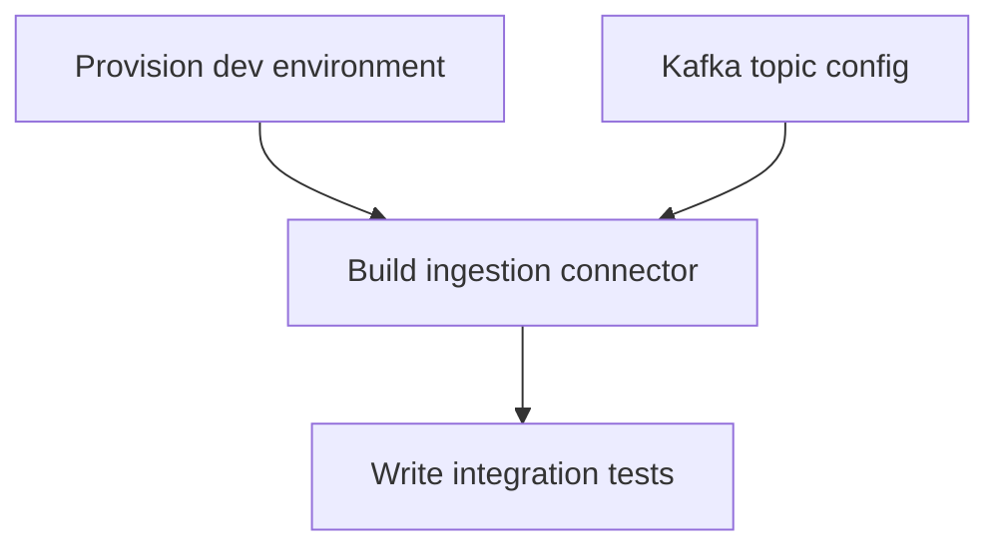

# Work Prep: Full SDLC Intake & Collaborative Work Planning

Turns raw SDLC material — call transcripts, stakeholder notes, brainstorming sessions, or live conversation — into a structured work plan markdown file. Classifies content into requirements, ideas, decisions, status updates, and open questions rather than forcing everything into work items. Opens a PR so the team can review, comment, and iterate before any Jira issues are created.

**This is NOT a Jira skill.** `/work-prep` produces markdown for human review. `/work-plan` (separate skill) converts the agreed plan into Jira issues later.

## Key Principles

1. **Ask, don't assume.** If you don't know something (priority, assignment, dependency, scope), add it to Open Questions. Never fabricate answers the user hasn't provided.
2. **Interactive wizard.** Walk the user through the plan step by step. Don't dump a wall of markdown and ask "does this look right?"
3. **Definitions of done matter.** Every work item needs a clear, testable definition of done. If the user can't articulate one, that's a signal the item needs more breakdown.
4. **Label for execution.** Each item gets classified: `claude-code-agent-harness` (agent can do this), `human-review-required` (needs human judgment), or `external` (outside this repo -- ServiceNow ticket, vendor request, etc.).
5. **Classify, don't flatten.** Transcripts contain different types of content — requirements, ideas, opinions, status updates, decisions. Classify each into its proper section rather than forcing everything into work items. An idea that isn't ready to be actionable should stay an idea, not become a vague ticket.

## Prerequisites

- Must be in a git repository
- Must NOT already be in a worktree (unless re-running on an existing /work-prep PR)
- `gh` CLI must be authenticated (`gh auth status`)

## Process

### Phase 0: Detect Mode (New vs. Iteration)

**Goal**: Determine if this is a new plan or iteration on an existing PR.

1. **Check if currently in a worktree with an existing work plan:**

   ```bash
   git worktree list
   ```

   Look for a file matching `planning/*.md` or `planning/**/*.md` in the current directory.

   **If a work plan already exists in this worktree:**
   - This is **iteration mode**. The user is providing feedback on an existing plan.
   - Read the existing plan file.
   - Ask: "I see an existing work plan. What feedback do you have? I'll update the plan."
   - Skip to Phase 3 (Interactive Refinement) with the existing plan loaded.

2. **Check arguments for a PR reference:**

   If the user passed a PR number or URL (e.g., `/work-prep #42` or `/work-prep https://...`):
   - Fetch the PR: `gh pr view <number> --json headRefName,body,title`
   - Check out that branch's worktree
   - Enter iteration mode as above.

3. **Otherwise**: This is a **new plan**. Proceed to Phase 1.

### Phase 1: Gather Raw Input

**Goal**: Get the starting material for the plan.

Ask the user what they have:

```
What are we planning? I can work from:

(a) Meeting notes or call transcript -- paste or point me to a file
(b) A rough list of things to do -- I'll help structure them
(c) Let's figure it out together -- I'll ask questions
```

**Option (a): Meeting notes / transcript**

- If the user pastes text, capture it as the raw input.
- If the user points to a file, read it.
- Parse the raw input and **classify each extracted item** into one of these categories:
  - **Functional requirements** — actionable, testable items that describe what the system should do ("we need to add X", "the API should support Y"). These become work items.
  - **Non-functional requirements** — performance, security, scalability, reliability constraints ("it needs to handle 10K requests/sec", "must pass security audit"). These become work items tagged as NFR.
  - **Ideas & hypotheses** — suggestions or theories that aren't yet actionable ("maybe we could deploy integration tests as a container", "what if we ran the full suite only on release branches?"). These go to the Ideas & Hypotheses section for further refinement.
  - **Opinions** — perspectives shared but not yet resolved into decisions ("I think this was more manageable when John was the only one making changes"). Capture in Ideas or Notes depending on context.
  - **Status updates** — informational context about the current state ("dev environment is up", "UAT is deploying off main"). These go to the Context & Status section.
  - **To-dos** — quick action items that may or may not be code ("do that as a PR now", "cut that out now"). These become work items with appropriate label.
  - **Decisions** — things explicitly agreed on during the discussion ("don't touch IAAUAT for now", "keep it going off main"). These go to the Decisions section.
  - **Open questions** — things deferred, unclear, or debated without resolution ("how do we handle promotion from dev to UAT?"). These go to the existing Open Questions section.
- **Track speaker attribution**: Note who said what (e.g., "Joe proposed:", "Philip raised:").
- **Track timestamps** if available in the transcript for reference.
- Present a **categorized summary**:

  ```
  Extracted from transcript:

  Functional Requirements (3):
    1. Update CI to run only unit + lint on PRs (Joe, 24:52)
    2. Deploy to dev from release/0.6 branch (Joe, 27:23)
    3. Add GitHub Action for release promotion (Joe, 28:09)

  Non-Functional Requirements (0):
    (none identified)

  Ideas & Hypotheses (2):
    1. Container-based integration test deployment (Joe, 24:00) — needs exploration
    2. Full test suite only on release branch (Philip, 24:15) — hypothesis

  Status Updates:
    - Dev environment is up in new project (Joe, 26:56)
    - UAT deploying off main for now (Joe, 27:08)

  Decisions:
    - Don't touch IAAUAT deployment for now (Joe, 27:08)

  Open Questions:
    - How to handle promotion from dev to UAT (unresolved, call ended)

  What did I miss? Anything to reclassify?
  ```

**Option (b): Rough list**

- Ask the user to list items.
- For each item, ask clarifying questions:
  - "What does 'done' look like for this?"
  - "Who would own this?"
  - "Does this depend on anything else being done first?"
  - "Can Claude Code handle this, or does it need a human?"
- Don't ask all questions for all items at once. Batch 2-3 items, confirm, move on.

**Option (c): Interactive discovery**

- Start with: "What's the goal? What are we trying to accomplish?"
- Then: "What are the main workstreams or areas?"
- For each area: "What needs to happen here? Walk me through it."
- Build the list incrementally, confirming as you go.

### Phase 2: Create Worktree and Plan File

**Goal**: Set up the git worktree and initial plan file.

1. **Derive a branch name:**
   - Slugify the topic/goal from Phase 1
   - Prefix: `work-plan/` (e.g., `work-plan/q2-data-pipeline-migration`)
   - Truncate to 50 chars

2. **Confirm branch name with user:**
   ```
   Branch name: work-plan/q2-data-pipeline-migration

   (a) Use this name
   (b) Let me type a different name
   ```

3. **Create worktree** using `EnterWorktree`:
   ```
   EnterWorktree:
     name: "<branch-name>"
   ```

4. **Create planning directory and file:**
   ```bash
   mkdir -p planning
   ```

   Create `planning/<slug>.md` with the initial structure (see [Plan Format](#plan-format) below).

### Phase 3: Interactive Refinement

**Goal**: Walk through each section of the plan with the user, asking targeted questions.

This is the core of the wizard. For each work item extracted in Phase 1:

#### Step 1: Confirm Work Items

Present items grouped by area/workstream:

```
I've identified these work items. Let's go through them:

## Area: Data Pipeline
1. Set up Kafka topic configuration
2. Build ingestion connector for source X
3. Write integration tests for connector

## Area: Infrastructure
4. Provision dev environment resources
5. Configure monitoring dashboards

Does this capture everything? Any items to add, remove, or regroup?
```

Wait for confirmation before proceeding.

#### Step 1.5: Review Ideas & Hypotheses

If ideas/hypotheses were extracted from the transcript (or the user added some), present them for triage:

```
Ideas & hypotheses from the discussion. These aren't work items yet — let's decide what to do with each:

1. "Container-based integration test deployment" (raised by Joe)
   (a) Keep as idea — needs more thinking before it's actionable
   (b) Promote to work item — it's clear enough to be actionable now
   (c) Park — not relevant for this plan
   (d) Add notes — capture context for next time

2. "Full test suite only on release branch" (raised by Philip)
   (a) Keep as idea
   (b) Promote to work item
   (c) Park
   (d) Add notes
```

- If promoted: add to the work items list and proceed through definition of done, classification, etc. for that item.
- If kept as idea: stays in the Ideas & Hypotheses section with status `open`.
- If parked: stays in Ideas with status `parked`.
- If notes added: append to the idea's Notes field.

If no ideas were extracted, skip this step.

#### Step 2: Definitions of Done (per item)

For each item (or batch of related items):

```
Let's define "done" for each item.

1. "Set up Kafka topic configuration"
   What does done look like? Examples:
   - Topics created in dev + staging?
   - Schema registry entries configured?
   - Consumer groups defined?

   Your definition of done:
```

**If the user can't define "done":**
- Add to Open Questions: "Definition of done unclear for: <item>. Needs team discussion."
- Don't force it. Mark the item as needing refinement.

#### Step 3: Classification

For each item, determine execution label:

```
How should each item be executed?

1. Kafka topic configuration
   (a) claude-code-agent-harness -- agent can implement this in the repo
   (b) human-review-required -- needs human judgment/approval before agent work
   (c) external -- outside this repo (ServiceNow, vendor, manual infra work)
```

If the user isn't sure, default to `human-review-required` and note it in Open Questions.

#### Step 3.5: North Star & Milestones (Optional)

```
Does this work align to specific business goals or project milestones?

(a) Yes — let me describe the north star and milestones
(b) Skip — no specific alignment needed for this plan
```

If (a):
- Ask: "What's the business goal or north star this work serves?" (1-2 sentences)
- Ask: "What are the key milestones and target dates?"
- For each milestone, ask which work items serve it.

This creates the "North Star & Milestones" section in the plan.

#### Step 3.6: Jira Hierarchy

```
How should these items be organized in Jira when /work-plan runs?

(a) All under one Epic — I'll name it
(b) Group into multiple Epics by area/workstream
(c) Create a Goal with Epics underneath (for larger initiatives)
(d) Flat — standalone Stories, no Epic grouping
(e) Skip — /work-plan will figure it out
```

If (a): Ask for Epic name, all items link to that Epic.
If (b): For each area/workstream in the plan, ask for an Epic name.
If (c): Ask for Goal name, then Epic names under it, and map items to Epics.
If (d) or (e): No hierarchy recorded.

This creates the "Jira Hierarchy" section in the plan.

#### Step 4: Dependencies and Sequencing

```
Let's figure out the order. Which items block other items?

Current items:
1. Kafka topic configuration
2. Build ingestion connector
3. Write integration tests
4. Provision dev environment
5. Configure monitoring

Any dependencies? (e.g., "4 must be done before 2")
```

Build a dependency graph from the user's answers.

#### Step 5: Assignments (Optional)

```
Do you want to assign owners now, or leave that for the team review?

(a) Assign now -- I'll ask for each item
(b) Leave unassigned -- team decides during PR review
(c) Assign some, leave others
```

If assigning, ask per item or per group.

#### Step 6: Open Questions Review

Present all accumulated open questions:

```
Here are the open questions I've collected. These will be highlighted in the plan for team discussion:

1. Definition of done unclear for: "Configure monitoring dashboards"
2. Who owns the ServiceNow ticket for infra provisioning?
3. Is the Q2 deadline firm or flexible?
4. Should connector support batch AND streaming, or streaming only?

Any questions to add or resolve now?
```

### Phase 4: Generate Plan Markdown

**Goal**: Write the structured plan file.

Create/update `planning/<slug>.md` using the [Plan Format](#plan-format).

After writing, show the user a summary:

```
Work plan written to: planning/<slug>.md

Summary:
- X work items across Y areas
- Z items agent-ready, W need human review, V external
- N open questions for team discussion
- Dependencies mapped

Review the file and let me know if anything needs adjustment before we open the PR.
```

### Phase 5: Commit, Push, Open PR

**Goal**: Get the plan in front of the team.

1. **Stage and commit:**
   ```bash
   git add planning/
   git commit -m "planning: <topic> work plan for team review

   - X work items across Y areas
   - N open questions for team discussion
   - Ready for /work-plan after team agreement"
   ```

2. **Push:**
   ```bash
   git push -u origin <branch-name>
   ```

3. **Create PR:**
   ```bash
   gh pr create --title "Work Plan: <topic>" --body "$(cat <<'EOF'
   ## Work Plan for Team Review

   This PR contains a structured work plan created with `/team-work:work-prep`.

   ### Summary
   - **Items**: X work items across Y areas
   - **Agent-ready**: Z items labeled `claude-code-agent-harness`
   - **Needs review**: W items labeled `human-review-required`
   - **External**: V items outside this repo
   - **Open questions**: N items needing team input

   ### How to Review
   1. Read `planning/<slug>.md`
   2. Comment on items, assignments, definitions of done
   3. Resolve open questions in PR comments
   4. When the team agrees, run `/team-work:work-plan` to create Jira issues

   ### Open Questions
   <list open questions here for easy scanning>

   ---
   Created with `/team-work:work-prep`
   EOF
   )"
   ```

4. **Report:**
   ```
   PR created: <PR URL>
   Branch: <branch-name>

   Next steps:
   - Team reviews and comments on the PR
   - Run /team-work:work-prep again to incorporate feedback
   - When agreed, run /team-work:work-plan to create Jira issues from the plan
   ```

---

## Plan Format

The work plan markdown follows this structure:

```markdown
# Work Plan: <Topic>

> Created: <YYYY-MM-DD>
> Author: <user name>
> Status: Draft | Under Review | Agreed | In Progress | Complete
> PR: <PR URL when available>

## Goal

<1-3 sentence description of what we're trying to accomplish and why>

## North Star & Milestones

> Optional. Business goals and project milestones this plan serves.

**North Star**: <business goal or north star — 1-2 sentences>

| Milestone | Target Date | Items |
|-----------|-------------|-------|
| <name> | <YYYY-MM-DD> | #1, #2, #3 |
| <name> | <YYYY-MM-DD> | #4, #5 |

## Work Items

### <Area/Workstream 1>

| # | Item | Owner | Label | Status | Jira |
|---|------|-------|-------|--------|------|
| 1 | <description> | <name or TBD> | `claude-code-agent-harness` | todo | -- |
| 2 | <description> | <name or TBD> | `human-review-required` | todo | -- |
| 3 | <description> | <name or TBD> | `external` | todo | -- |

#### Definitions of Done

- **Item 1**: <testable definition of done>
- **Item 2**: <testable definition of done>
- **Item 3**: <testable definition of done>

### <Area/Workstream 2>

| # | Item | Owner | Label | Status | Jira |
|---|------|-------|-------|--------|------|
| 4 | <description> | <name or TBD> | `claude-code-agent-harness` | todo | -- |

#### Definitions of Done

- **Item 4**: <testable definition of done>

## Dependencies



<Or plain text if mermaid not supported:>
- Item 4 (Provision dev) must complete before Item 2 (Build connector)
- Item 1 (Kafka config) must complete before Item 2 (Build connector)
- Item 2 (Build connector) must complete before Item 3 (Integration tests)

## Sequence

Based on dependencies, the recommended execution order:

1. **Wave 1** (no dependencies): Item 1, Item 4
2. **Wave 2** (after wave 1): Item 2
3. **Wave 3** (after wave 2): Item 3, Item 5

## Jira Hierarchy

> How items should be organized when /work-plan creates Jira issues.

**Structure**: <flat | single-epic | multi-epic | goal-epic-story>

<!-- If multi-epic or goal-epic-story: -->
- **Goal**: <goal name> (if applicable)
- **Epic: <epic name>**: Items #1, #2, #3
- **Epic: <epic name>**: Items #4, #5

## Ideas & Hypotheses

> Items that need further exploration before becoming work items. Review during next /work-prep session or explore via /work-pop.

| # | Idea | Source | Status | Notes |
|---|------|--------|--------|-------|
| I1 | <description> | <who raised it> | open | <any notes> |
| I2 | <description> | <who raised it> | exploring | <any notes> |

### Idea Status Values
- `open` — needs discussion, not yet explored
- `exploring` — someone is actively thinking about it
- `promoted` — became a work item (reference the item #)
- `parked` — not relevant now, kept for reference

## Decisions

> Decisions made during planning. Recorded for team reference and continuity.

- **<YYYY-MM-DD>**: <decision> (decided by: <who>)

## Context & Status

> Informational items from discussions. Not work items, but important context for the team.

- <status update or context item> (<source, date>)

## Open Questions

> These need team resolution before `/work-plan` can create Jira issues.

- [ ] <question 1>
- [ ] <question 2>
- [ ] <question 3>

## Notes

<Any additional context, links to docs, meeting recordings, etc.>

## Changelog

- <YYYY-MM-DD>: Initial plan created by <author>
- <YYYY-MM-DD>: Updated per PR feedback -- resolved Q1, Q3
```

### Status Values

| Status | Meaning |
|--------|---------|
| `todo` | Not started |
| `in-progress` | Work underway (Jira issue exists and is In Progress) |
| `in-review` | PR open for this item |
| `done` | Completed and verified |
| `blocked` | Waiting on dependency or external action |
| `cut` | Removed from scope during planning |

### Label Values

| Label | Meaning | What Happens in /work-plan |
|-------|---------|---------------------------|
| `claude-code-agent-harness` | Agent can implement this | Creates Jira Story with label, appears in /work-pop |
| `human-review-required` | Needs human approval | Creates Jira Story with label, flagged in /work-pop |
| `external` | Outside this repo | Creates Jira Task without agent label, or skips if user prefers |

---

## Error Handling

| Scenario | Action |
|----------|--------|
| Already in worktree with no plan | Ask if user wants to create plan here or start fresh |
| Already in worktree with plan | Enter iteration mode |
| No input provided | Start interactive discovery (option c) |
| User can't define "done" | Add to open questions, don't block |
| Push fails | Report error, plan is committed locally |
| PR creation fails | Branch is pushed, show `gh pr create` command |

## Extensibility

This skill is extensible via `.claude/ssnc-team-work/skills.yaml`. Before running, check
that file for a `skills.work-prep:` entry. If the file is absent, has no entry for this
skill, or the entry is empty, **run exactly as documented above — no behaviour change.**

If an entry exists, this skill exposes `before` and `after` hook points (plus any
skill-specific points noted in the config template). Run listed targets in order per the
shared resolver `plugins/agent-orch/rules/extension-resolver.md`. team-work skills also
read `.claude/ssnc-agent-orch/jira-workflow.yaml` and `git-workflow.yaml` when present.
Tell the user when you run an extension target; a failing target is surfaced but does not
abort the skill. Full contract: `plugins/agent-orch/rules/extensibility.md`.
