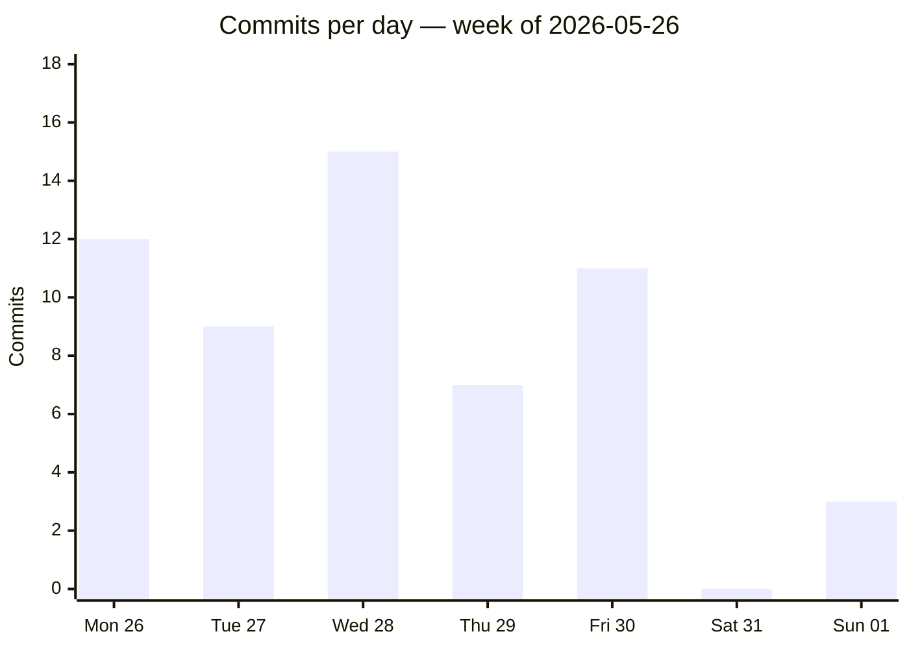
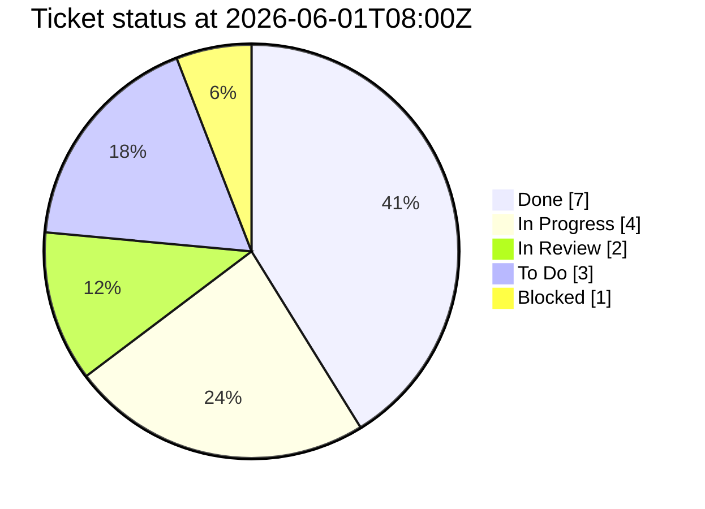
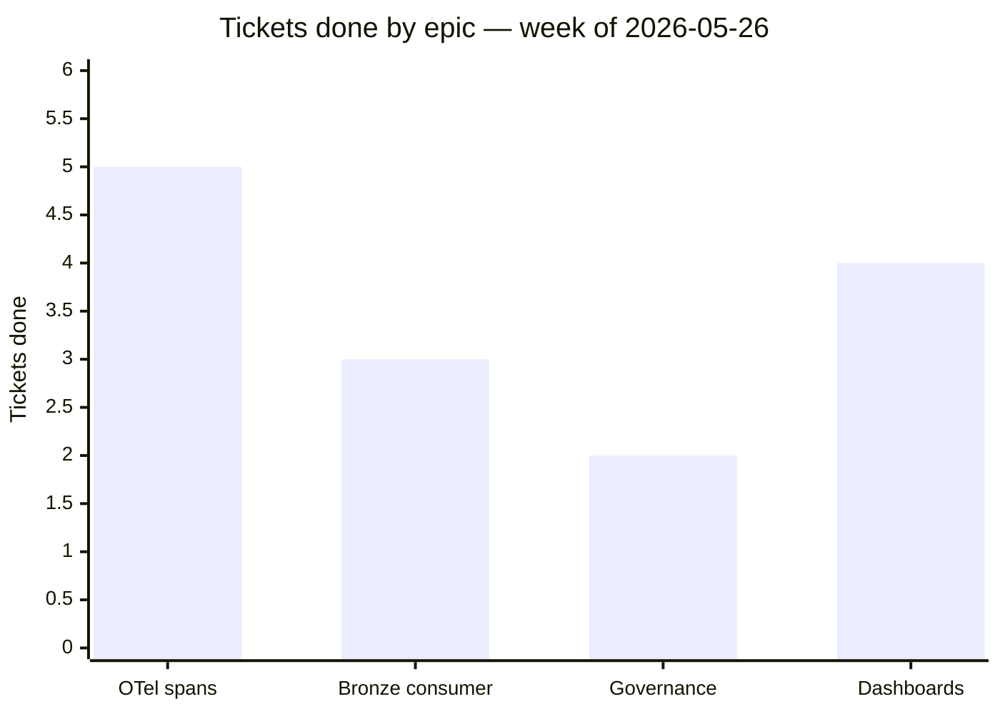
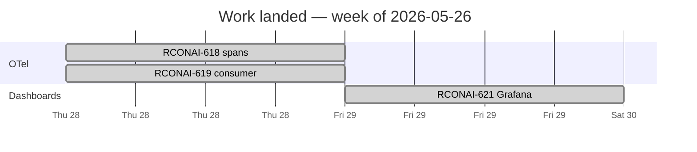

# exec-update reference — KPIs, Mermaid recipes, layout

Bundled reference for `/vault-orch:exec-update`. Everything here renders in
Obsidian, GitHub, and standard Mermaid viewers with **no viewer-side plugins**.

---

## 1. KPI definitions

The KPI strip is four numbers. Define them precisely so week-over-week is
comparable:

| KPI | Definition | Source |
|-----|------------|--------|
| **Sessions shipped** | Distinct agent-orch sessions whose `status` is `shipped`/`done` in the window; if status is absent, count sessions whose newest artifact mtime falls in the window. | `gather-activity.mjs` `sessions[]` |
| **PRs merged** | Merged PRs with `merged` date inside the window. `gh pr list --state merged --search "merged:<start>..<end>" --json number` length. Omit if `gh` unavailable. | `gh` |
| **Tickets advanced** | Distinct Jira keys referenced by commits/sessions in the window. With Jira enrichment, narrow to keys whose status changed. | `summary.jiraKeysReferenced` / MCP |
| **Net LOC** | `Σ insertions − Σ deletions` across non-merge commits in the window. | `summary.netLoc` |

Render as a compact Markdown table (see §4 layout). Keep it to one row.

---

## 2. Mermaid recipes

### 2.1 Throughput — commits per day (`xychart-beta`)

`xychart-beta` is the supported Mermaid time-series. Rules that keep it valid:

- `x-axis` is a bracketed list of **quoted** day labels.
- `y-axis` needs a title and an explicit `0 --> <max>` range; set `<max>` to the
  highest daily count rounded up (never 0 — use at least 1).
- `bar` (or `line`) takes a bracketed numeric list the **same length** as the
  x-axis. No trailing comma.

````markdown

````

You may add a second `line [...]` for a comparison series (e.g. prior week).
Keep both series the same length as the x-axis.

### 2.2 Delivery status — frozen snapshot (`pie showData`)

The point-in-time status snapshot. `showData` prints the raw counts. Labels are
quoted strings; values are numbers. Omit any zero-count slices.

````markdown

````

> This is the one place a Jira *state* snapshot is embedded — legitimate because
> the file is a frozen, dated report (see SKILL.md "State nuance").

### 2.3 Epic / theme progress — grouped bar (`xychart-beta`)

When Jira epic data is available, show progress per epic/theme. One bar = tickets
done; pair with a "total" line, or just show done-counts.

````markdown

````

### 2.4 Optional — timeline (`gantt`)

For a roadmap-flavoured view of when work landed in the window:

````markdown

````

### Mermaid escaping rules (avoid broken charts)

- Quote every label containing spaces, `-`, `:`, `()` or `#`.
- Never put a raw `"` inside a quoted label; rephrase instead.
- Numeric lists: integers or decimals only — no `k`/`%` suffixes inside `[...]`.
- Keep `xychart-beta` x-axis and each series list the **same length**.
- One chart per fenced block; don't combine diagram types in a block.

---

## 3. Narrative — group by theme/epic, not by commit

Exec altitude means **outcomes**, not a changelog. For each theme/epic:

```markdown
### <Theme or Epic name>

<2–4 sentences: what shipped, the business outcome, and any risk/decision an
exec should know. No SHAs, no file lists.>

**Drove this:** [[2026-05-28-rconai-618-otel-spans]] · [[RCONAI-618]] · [[RCONAI-619]]
```

Derive themes from (in priority order): Jira epics (if enriched) → session
feature names → commit-subject clustering. Aim for 3–6 themes; fold trivia into
a one-line "Also" bullet.

---

## 4. Page layout (order is load-bearing)

1. **H1 title** — `Executive Update — <period label>`.
2. **One-line frame** — window + "frozen point-in-time" caveat (blockquote).
3. **KPIs** — single-row Markdown table (§1).
4. **Throughput** — §2.1 chart.
5. **Delivery status** — §2.2 chart.
6. **Highlights by theme** — §3, the body of the report.
7. **Sessions this period** — bullet list of `[[session]]` wikilinks.
8. **Tickets referenced** — bullet list of `[[TICKET]]` wikilinks.
9. **Footer** — "Generated by /vault-orch:exec-update" + relationships-not-state note.

The shipped template `assets/templates/exec-update.md` encodes this order with
`{{placeholders}}`; fill them rather than re-inventing the structure.

---

## 5. Wikilinks tie it into the graph

- `[[<session-folder-name>]]` links the exec-update node to each session node.
- `[[RCONAI-NNN]]` links it to the phantom ticket nodes — so the exec-update
  shows up in those tickets' backlinks and in the Tickets dashboard. This is how
  a weekly summary becomes a first-class citizen of the knowledge graph rather
  than a detached document.
